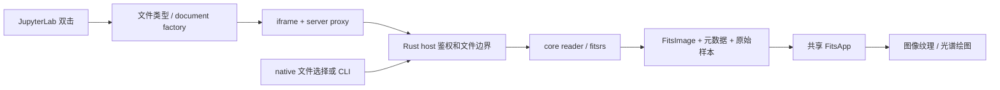

# AgentWorkLog — FitsViewer 开发、UI 演进与源码交接记录

> 面向接手源码的开发者及 AI Agent。最后整理日期：**2026-10-18**。
> 本文以中文记录决策及故障经过，保留源码中的英文标识，方便检索。
> Public, sanitized engineering handoff; historical evidence is separated from current implementation and execution results.

**0.1.7 开发补充（2026-10-29，尚未发布）：** 下文的发布基线与旧测试数字保留为历史。
当前开发验证请读 [0.1.7 验证记录](docs/releases/VALIDATION-0.1.7.md)，当前职责边界请读
[架构](docs/ARCHITECTURE.md) 和 [AI 修改指南](docs/AI_DEVELOPMENT_GUIDE.md)。界面新增意大利语、
西班牙语、德语、法语；六种语言改为 [`web/locales/`](web/locales/README.md) 中的共享注册表与
独立 JSON 词典，native/WASM 与浏览器 shell 使用同一份译文，不再增加内联翻译表。
增加语言后既要检查 key、占位符与科学单位，也要检查真实按钮边界；德语窄窗曾暴露整按钮
不换行的缺陷，不能通过缩小字号或删掉科学含义来掩盖。当前执行环境为隔离 Linux 容器；
候选构建、源码检查、实际 GUI 验收和跨平台发布仍须分别记录，不能互相替代。

**本地 Linux 收尾已完成：** 测光结果前移、光谱结果摘要/独立滚动、大图精度切换、
Jupyter 私有后端认证均已有针对性与实际运行证据。通用 Python 客户端使用浏览器
选星并取得一/零起点明确的原图坐标；接入和范围见
[人工选星指南](docs/MANUAL_STAR_SELECTION.md)。外部科学处理保持在调用方自己的环境中。最新 wheel/hash 与边界见上述 0.1.7 验证记录；此状态
不代表 Windows/macOS 或 GitHub 发布已经完成。为控制消耗，子智能体已全部暂停，
未修改的科学与布局检查沿用已有证据，只补测新增或失败的部分。

## 阅读入口与适用基线

本项目是以 Rust / fitsrs 为内核的轻量 FITS 查看器，服务于本地、远程服务器、容器、
Jupyter 和桌面查看场景。它逐渐加入交互测量与外部科学工具，但不应被理解为已经验证的
完整科研归约管线。本工具识别、推算或测量的坐标、流量、星等等数据建议仅作检查与参考；
用于论文前须独立校准、验证并评估误差和系统效应。

本记录对应以下基线，后续修改时应重新核对，不把这里的版本、包大小和测试数字当作永久常量：

| 项目 | 本次交接基线 |
|---|---|
| 公开仓库 | [FitsViewer](https://github.com/minglinwang86/FitsViewer) |
| 已发布预览版 | [v0.1.5-rc.1 / Python 0.1.5rc1](https://github.com/minglinwang86/FitsViewer/releases/tag/v0.1.5-rc.1) |
| 发布源码提交 | `b591ddc8a56ce1b4368537e8c5f66d4ed64e0c08` |
| Mac 实际构建／验收提交 | `29e9140d67bc1ae30f5e79f4885d3ba16d770dcd`；随后发布提交仅补充文档与源归档过滤 |
| 内核 | `fitsrs 0.4.1`，含仓库内可追溯小补丁 |
| 本次发行范围 | **Full 一个功能集合**，运行时含 Minimal / PRO；不另发仅 Mini 功能的包 |
| 本文变更范围 | 开发记录与导航；不重新生成已发布的 wheel、安装器或 Mac ZIP |

推荐顺序：

1. 读 [AGENTS.md](AGENTS.md)，确认本次请求是否允许编译、安装、重启和发布。
2. 读本文的[结构地图](#source-map)、[跨模块流程](#flows)和[修改流程](#agent-workflow)。
3. 对照 [AI 修改指南](docs/AI_DEVELOPMENT_GUIDE.md)、[架构](docs/ARCHITECTURE.md)
   和 [资源生命周期](docs/RESOURCE_LIFECYCLE.md) 阅读实际函数体。
4. 检查当前工作树、相关测试与最近新增记录，再修改源码。

本文来自当前源码、历史对话、已保存工作日志、验收 JSON、截图索引及发布缓存的交叉整理。
原始记录中存在私人路径、连接配置和测试令牌，因此没有把原始缓存整体上传。历史中出现过的
过时名称和方案只用于解释决策；当前命令、Python 包及导入名均为 **`fitsviewer`**，
产品显示名为 **FitsViewer**，不保留旧名称别名。

## 目录

- [1. 证据口径与长期约束](#evidence)
- [2. 开发阶段与需求演进](#history)
- [3. UI 多轮修改记录](#ui-history)
- [4. 当前功能与入口](#features)
- [5. 代码结构与编辑地图](#source-map)
- [6. 跨模块数据、调用与状态流](#flows)
- [7. 科学数值与数据约定](#science)
- [8. 生命周期故障及修复经验](#lifecycle)
- [9. 模块选择、体积与构建产物](#modules)
- [10. 安装、Jupyter 和跨平台问题](#platforms)
- [11. 测试方法、已有证据与边界](#validation)
- [12. 本次发布中的实际阻塞](#release-problems)
- [13. Agent 修改源码的操作规程](#agent-workflow)
- [14. 未完成事项与接手建议](#next)
- [15. 可公开复核的文档与记录更新规则](#references)

<a id="evidence"></a>
## 1. 证据口径与长期约束

### 1.1 如何使用历史记录

| 证据类型 | 可以说明 | 不能据此推断 |
|---|---|---|
| 需求／调研 | 为什么安排某个功能、曾经考虑哪些方案 | 功能已经实现或可正确运行 |
| 当前源码阅读 | 分支、默认值、参数、状态与清理路径的实现 | 当前安装包一定包含该源码 |
| 单元／合成测试 | 已定义输入和边界条件的数值或状态行为 | 真实仪器数据已完成科学验证 |
| 真实数据集成运行 | 某个版本、环境和输入的完整路径跑通 | 所有系统、文件类型或科研对象适用 |
| 实际截图／手势 | 特定窗口尺寸、语言、面板和状态的可用性 | 所有展开页面都检查过，或截图中的联网任务已成功 |
| 发布文件 hash | 所验收文件与所上传文件的一致性 | 算法或测量具有论文级科学可靠性 |

早期日志中的“待同步”“未发布”“待验收”是对应检查点的状态。后续可能已完成；应优先
查看最后的验收与发布记录。反过来，后来的总体发布成功也不能把早期失败运行改写成通过。

### 1.2 已反复确认的产品约束

- JupyterLab 文件列表双击打开是优先入口，同时保留 Notebook 内嵌及命令行。
- 极简模式保留日常显示、基础孔径测光和坐标／Gaia；复杂工具放 PRO，按需初始化。
- 调用用户所选 Python / Conda 环境中的科学包，不内嵌 Python、Astropy、Specutils、
  大型科学数据、星表或 TeX 排版引擎。外部 MathText 预览不等于内嵌 TeX。
- 中英文、图像／光谱、Minimal／PRO、native／WASM 的共享行为尽量只实现一次。
- 图标用于应用、查看标签、启动器、快捷方式和程序窗口；**不替换关联数据文件图标**。
- 显示拉伸、图层透明度、相对亮度与预览处理不改写原始观测数组。
- 关闭、换图和退出必须管理本程序拥有的资源；不按模糊进程名终止用户服务。
- 源码修改、构建、部署、公开发布是不同操作。用户要求“只改源码”时，Cargo check/test
  也属于编译，不应偷偷执行。

<a id="history"></a>
## 2. 开发阶段与需求演进

以下按实际决策顺序归纳；没有可靠时间戳的细节不编造精确日期。

| 阶段 | 原始问题／需求 | 实施方向与应保留的经验 |
|---|---|---|
| 初始调研 | Rust 点击即看；参考 DS9；Linux 命令行、Jupyter、Notebook 都要 | 选共享 Rust/egui native 与 WASM UI，Jupyter 用预构建扩展；不要为每个平台另写一个查看器 |
| 内核选择 | 比较 JS9、CARTA 与 fitsrs；控制依赖体积 | 用户确认 fitsrs；遇到格式缺口用小适配层与明确拒绝处理，不能因此声称等同 CFITSIO 全格式支持 |
| MVP | 缩放、scale、Jupyter 双击、远程弹出窗口 | 分开显示范围、stretch、亮度／对比度和物理数值；浏览器入口通过 Jupyter/SSH 复用 |
| 交互补充 | DS9 风格右键拖动调亮度／对比度、平移、自动显示 | 手势与快捷键进入共享 UI；“参考 DS9”不等于数值算法和所有按键逐项一致 |
| 安装与管理 | pip/git 安装、指定 Python/Conda、端口查看与修改、默认 FITS 查看器 | 配置端口、正在监听端口、本地 SSH 映射端口分别报告；安装器必须针对目标解释器工作 |
| 跨平台发布 | Linux 兼容性、Windows 安装器、应用图标、统一名称 | 验收真实包及卸载；名称迁移后命令／包／导入保持统一，无冲突别名 |
| 文件与稳定性 | 中文粘贴路径乱码、底部闪烁、`.fz`、基础光谱、开关多文件后的内存 | 新增读取适配、固定状态区布局、Unicode 端到端处理和资源释放测试 |
| 功能扩展 | A 组进入极简；高级测量、WCS、星表、SAMP、导出与光谱工具进入 PRO | 以外部包执行科学计算，用模块 registry 和能力检查约束依赖 |
| 真实使用与 UI 整理 | 工具栏拥挤、光谱出现图像测光面板、PRO 子页难用 | 按数据类型切工作区；Office/CAD 的任务栏思路与 PS 的面板管理思路结合 |
| 快照与独立验收 | 用户指定先存 `1018001`，继续 UI、功能、进程与天文学使用模拟 | 快照是修改前回退点，不是版本号；保留失败证据与真实数据来源 |
| Full 发布 | 用户授权编译、图文说明与上传；随后补 Mac | 冻结运行时，多平台单独验收；许可、隐私和实际公开下载校验是发布的一部分 |

### 已被后续方案替代的做法

早期曾为估算仅 Mini 包体积而临时剥离 PRO。用户指出这种方式不可维护，随后整理成同一
源码的 feature/module 构建，不再用复制、AST 删除或临时删函数生成另一套应用。

早期 Jupyter 直接把 TAR 当文本打开出现 “not UTF-8 encoded”，并非归档编码损坏。
本次公开版本文档要求先解包 ZIP/TAR 再查看其中文件；不要把曾经讨论“压缩包查看”自动
扩张为已实现任意归档浏览器。FITS 的 gzip 或 tile compression 与归档容器是不同问题。

<a id="ui-history"></a>
## 3. UI 多轮修改记录

### 3.1 从堆叠工具到任务工具栏

| 轮次／触发问题 | 修改及原因 | 后续 Agent 应遵守 |
|---|---|---|
| 初期功能不断增加，测光、坐标分别额外占一行 | 常用操作进入紧凑任务栏，复杂参数进入子页面 | 不在主画布上方为每个新能力常驻增加一整行 |
| 用户要求参考 Office/CAD | 用任务选项页区分查看、测量、坐标、分析、星表、导出；内容随任务变化 | 顶部负责选择任务，详细参数由工作区承载 |
| 光谱 PRO 仍显示找星／图像测光工作区 | 光谱专属任务及控制器；不加载无关图像工具 | 分支依据当前数据类型及 `spectrum` 元数据，不依据文件名猜测 |
| 光谱上方任务太稀疏，随后功能增多又显拥挤 | 采用双行：常用模式／文件操作与按组科学任务；路径另有入口行 | 极简不被迫复制 PRO 的展开行；不要用大面积空白假装分组 |
| 模块小字占独立一行 | 中文曾改为模块左侧小标签；英文删除这些辅助组名 | 保留真实操作含义；不要为英文重新增加无必要的竖排小标题 |
| 同行按钮、下拉框高度不同 | 统一交互高度、padding、行距和共享样式 | 中英、Mini/PRO、图像/光谱同步；不能只修一张截图 |
| 不同行之间的空隙仍不一致 | 将行高、行距和组间距作为布局规则，去掉空文本占位 | 同行高度一致不等于多行整体节奏已经一致 |
| HDU 占据第二行空间 | Mini 和 PRO 都把 HDU 上移；后续删除左侧冗余“数据”字样 | 不把 HDU 重新塞回单独常驻行 |
| 顶部路径过长，打开／文件头远在最右 | 路径按可用宽度布局；短路径操作靠近中部，长路径给动作让位；优先露出右侧文件名 | 缩略的是显示副本，完整 Unicode 路径必须保留 |
| 设置／工作区与路径操作分散 | 放到文件头后；空间不足时压缩路径可视区域 | 重要动作应可达，不能被长路径挤到屏幕外 |
| 图像任务被换成下拉选择器后不直观 | 当前图像 PRO 采用可见的小任务按钮并自然换行 | 历史窄窗选择器方案已被后续用户反馈替代 |
| 极简测量／坐标及 PRO 选项行横向滚动过长 | 删除多余横向滚动容器，按内容自然换行／分组 | 不让主任务行产生常驻水平滚动条 |
| 顶部 HTML “天文图像查看器”行重复 | 去掉重复标题；网页弹出行为用第一行右侧 `↗` | 网页外壳和 egui 内部不要各占一条重复品牌标题行 |

负责文件主要是 [`ribbon.rs`](crates/viewer/src/ribbon.rs)、
[`controls.rs`](crates/viewer/src/controls.rs)、[`ui_style.rs`](crates/viewer/src/ui_style.rs)
与网页外壳 [`web/index.html`](web/index.html)。修改前确认操作到底属于哪一层。

### 3.2 PS 风格 PRO 工作区与图层

| 触发问题 | 实施／修复 | 设计约束 |
|---|---|---|
| PRO 区没有明显外框，模块边界弱 | 增加工作区框和面板层次 | 内容、分组和整体容器边界应可辨识 |
| 单个图层缺少边框，名称、箭头和透明度散乱 | 每层独立框，按固定操作区布局，长名称截断 | 图层名称不能决定箭头列的位置 |
| 上下箭头靠字形基线，视觉不居中 | 图标由几何线段按点击框中心绘制 | 不依赖字体的 Unicode 箭头作为对齐依据 |
| 大量解释性文字占据面板正文 | 模块右侧统一 `…` 信息入口 | 运行、取消、错误、单位、拟合警告及结果有效性仍须直接可见 |
| PRO 标题不够醒目、位置偏 | 标题加重，以整个边框为中心；子面板标题同样中心对齐 | 两侧按钮占用不对称时，文字也不能跟随剩余区域偏移 |
| 测量、分析、坐标、星表等复杂子页各自弹窗 | 所有复杂 PRO 页面进入统一工作区 host | 不是仅把用户截图中提到的两个面板改成停靠 |
| 用户要求可折成栏、移动、调大小、吸附 | 支持侧栏折叠、浮动、边缘吸附、标题区合并标签组、重新停靠 | 面板容器不拥有科学任务；布局操作不重建控制器 |
| 关闭重开／刷新后布局丢失 | 保存顺序、开关、折叠、尺寸、位置与浮动组 | 图像和光谱布局分别保存；语言切换使用稳定非翻译 ID |

轻量宿主集中在 [`workspace_ui.rs`](crates/viewer/src/workspace_ui.rs)。当前 `Page`
覆盖 Current tool、Coordinates、Photometry、Growth、Preview、Files、Secondary、
Histogram、Settings 和 Header。新复杂页面若绕过该 host 创建另一套窗口管理，会重现
不一致的拖动、保存、关闭及状态归属问题。

边缘吸附保留独立窗口；标题区域重叠用于标签组合，两者语义不同。隐藏／折叠面板保留
任务与轮询。关闭浮窗可保留布局元数据以供下次恢复；应检查 `open=false` 和不再绘制，
不能强制断言 `floating_groups` 数组必须清空。

初版 Dock 在 `1018001` 审计中还暴露过以下状态问题，后续修改者尤其应保留对应防线：

- 用 `current_open || saved_open` 恢复，把“用户明确关闭”重新打开，并让图像与光谱状态
  互相覆盖。恢复、导入和本帧显式操作必须有确定优先级，不能用 bool OR 推断意图。
- 浮窗 group 编号从 1 重新开始，原先只用 group id 作为 egui ID，导致图像／光谱串用
  内部窗口记忆。当前 Window ID 包含 spectrum 上下文，并限制复用的 ID 数量。
- 标题按下即开始吸附，普通单击或下层重叠标题也可能被误当拖动。必须区分 press 与真正
  drag，检查可交互层归属，并让 Escape 能取消停靠会话。
- 导入新布局后，帧尾又把旧内存 Dock 写回偏好，覆盖导入结果。当前集成检查布局变化并
  重建 host；新增导入入口不能绕过该路径。
- 激活已折叠浮窗中的页、dock 后重新 float、切换同号组及改变内容尺寸，都要检查实际
  恢复结果；outer rect 与内容 size 不是同一个数。
- 增长曲线／预览若缺源标记，切源后可能仍显示旧结果；Secondary 若只存外壳而不存对象
  与链接参数，恢复出的不是同一个对照。业务来源与布局状态须分别验证。

这些条目记录当时的问题和当前维护要求，不代表仅凭初版只读审计就已获得运行验收；
后续实际折叠、浮动、吸附、恢复和源切换检查另见验收记录。

### 3.3 黑边、空行和弹窗高度：实际失败经过

1. **底部读数随文字长短换行，改变画布高度。** 光谱截图中看似“三列”的字段分组也引发
   误解。最终使用固定两行读数，把“图像结构”和“游标像素／坐标／数值”稳定分开。
   新增字段不得再次让鼠标移动改变画布尺寸。
2. **对照控件单占一行。** 先移到上方空闲任务选项行；窄窗溢出时的备用行又留下黑边。
   删除动态空行，窄窗改为同行 Compare 菜单。一次实际 850 px 复验中，受影响工具栏
   从 108 px 降到 81 px。这个数值是当时截图测量，不能作为所有 DPI 的硬编码高度。
3. **旧一帧 TopBottomPanel 裁剪。** 即时布局改变行数后，面板可能仍沿用上一帧边界。
   当前记录工具栏实际高度并请求重绘；不要再靠额外空行掩盖剪裁问题。
4. **菜单嵌套 ComboBox。** Compare 菜单内普通 ComboBox 替换了父 popup，表现为点开
   选择后菜单立即关闭。改用原生级联子菜单并复用原选择数据，不另写第二套状态。
5. **子窗口标题栏过高。** 统一紧凑标题和正文边距；12 pt 标题采用现有字体做轻量加重，
   不因此额外打包完整粗体中文字库。一次验收中标题纯色带由 35 px 降至 23 px。
6. **初稿窗口随重绘不断长高。** 在已有 Resize 最小尺寸后手动移动 cursor 补 padding，
   使尺寸每帧累加。真实复验出现坐标窗内容从 250 高增至 390，重开后到 660。
   暂停部署，改用标准 Frame 包住正文；保存的是原内容尺寸，正文边距只加一次。
   新增坐标／测光各 80 帧、重开、保存与恢复回归。
7. **最后统一普通控件字体。** 顶部普通控件为 12.5 pt，窗口标题保留独立 12 pt 规则，
   科学绘图和统计文字按用途管理。字体“统一”不代表所有坐标轴与提示都强制同一字号。

当前标题处理通过原始 Galley 身份和标题区域定位，只加重该标题；保留原生 close、collapse、
淡入淡出、裁剪与拖动。不要粗暴全局替换文本绘制，或给浮窗标题盖一个拦截鼠标的新层。

### 3.4 孔径、坐标与直方图的最后几轮修正

- 孔径新增明确选中状态、删除按钮、Delete/Backspace、半径及背景环参数，并支持拖中心
  移动、拖边界缩放。输入框正在编辑时 Delete 仍编辑文字，不能误删孔径。
- 删除冗余的“移动孔径”工具；直接交互不要求用户先切换一个无意义的额外模式。
- 孔径编辑只失效相关测量结果，通过 revision/generation 拒绝旧响应。
- Gaia／WCS 解沿坐标功能共用，底部游标读数读取缓存；没有生成整幅像素到世界坐标的大数组。
- 坐标前端为有界精确像素缓存，后端保留完整 Astropy WCS 模型；不是对坐标做近似插值。
- 物理数值直方图缩为小窗口，计数和显示设置同行。当前实现默认 340×180、统计字 11 pt、
  绘图区高上限 120；这些是源码中的当前设置，后续调整仍应从共享样式入手。

### 3.5 功能入口命名造成的实际误解

一次用户询问“谱线识别去哪了”，Agent 把它误解为 Gaussian/Voigt 拟合。应区分：

| 用户目的 | 当前入口 | 实际能力 |
|---|---|---|
| 自动寻找发射／吸收特征 | 光谱 → PRO → **谱线** → 候选特征（Specutils）→ 寻找候选发射／吸收特征 | 外部 Specutils 导数／阈值找特征，按给定红移和线表给候选名 |
| 拟合选中的谱线轮廓 | 光谱 → PRO → **线形拟合** | 1–4 个有界 Gaussian/Voigt 分量、固定连续谱、模型与残差 |
| 手动查看已知谱线位置 | 光谱 → PRO → **谱线** 的参考列表／线组 | 参考波长、红移和标线宽度；不执行自动找线 |

自动找线入口目前在手动参考列表下方，发现性不足。此项在本文整理时仅记录为后续 UI
改进建议，**没有为了写文档而改动 UI 或新增完整自动红移／物种分类**。

当前真实 UI 示例仅用于理解已发布界面，不代表所有功能执行成功：


<a id="features"></a>
## 4. 当前功能与入口

### 4.1 基础能力与 Minimal

| 能力 | 当前范围与限制 |
|---|---|
| 图像／HDU | 可查看 FITS 图像、相关压缩形式与受支持的 HDU；保留原始头，不把不同 HDU 的头合并冒充原头 |
| 压缩图像 | gzip；tile 的 RICE_1、GZIP_1、GZIP_2；HCOMPRESS_1、PLIO_1、压缩 null mask 等明确拒绝 |
| 光谱 | 受支持的 1D FITS、表格型光谱及文本／gzip 文本；显式 X/Flux/Error 选择；不等于通用 FITS 表编辑器 |
| 显示 | 缩放、平移、自动适应、反转、范围与八种 stretch、右键亮度／对比度、自动显示 |
| 基础测光 | 圆孔径、背景环、移动／缩放／删除、结果与误差来源；不是 PSF 测光 |
| 坐标 | 像素、J2000/WCS 和外部 Gaia 校准入口；需要初始场约束，不是无条件全空盲解 |
| 偏好 | 中英、主题、默认 Minimal/PRO、窗口状态；Full 在 Minimal 时不初始化 PRO 控制器 |

八种 stretch 为 Linear、Log、Power、Sqrt、Squared、Asinh、Sinh、Histogram Equalization。
ZScale 属于显示范围选择，不是第九个 stretch。自动显示选择查看起点，不进行科学定标。

### 4.2 图像 PRO

图层显隐／顺序／透明度、多图对照与联动；场星相对亮度匹配；高级孔径与模板；简单找星；
直线与受约束曲线迹线／线型孔径；星表叠加、本地／CDS XMatch；WCS 工具、在线检索与
SAMP；可视化重投影、RGB、标注及导出。详见 [科学工具](docs/SCIENTIFIC_TOOLS.md)
和 [图层](docs/IMAGE_LAYERS.md)。

“场星定标”在本实现中估计相对显示比例，不提供已经建立标准星零点的绝对流量／星等。
重投影主要服务显示，不能当作保流量科研重采样；曲线跟踪不是任意图像中全自动恢复任意曲线。

### 4.3 光谱 PRO

参考线与线组、发射／吸收候选、红移及空气／真空标线；连续谱与归一／扣除预览；EW/pEW、
净流量、质心、极值、FWHM、显示速度轴；分段平滑；1–4 分量 Gaussian/Voigt；相对黑体；
多谱原网格显示及显示比例／偏置。**多谱相减与合并尚未实现**。

自动特征检测调用 `specutils.fitting.find_lines_derivative` 或 `find_lines_threshold`。
先对有效连续段扣滑动中值；阈值法需要有效误差，导数法可使用记录的噪声估计。结果是
候选极值及邻近参考线，不自动确定元素、红移、超新星类型或吸积盘物理参数。

当前小参考线表并非完整原子数据库。宽线、混叠、速度位移、连续谱选择与分辨率都会影响
结果。详见 [谱线候选](docs/SPECTRA.md) 和 [光谱分析](docs/SPECTRAL_ANALYSIS.md)。

<a id="source-map"></a>
## 5. 代码结构与编辑地图

### 5.1 顶层目录及唯一职责

```text
Cargo.toml / Cargo.lock       Rust workspace、版本、锁定依赖与 fitsrs patch
crates/core/src/              FITS/光谱读取、物理样本、显示数值、孔径几何
crates/viewer/src/            native/WASM 共用 egui UI 和文档状态
crates/server/src/            原生宿主、HTTP、纯 Rust 测量、外部 worker 归属
web/                         浏览器外壳、共享字体/图标与 web/python 科学适配器
jupyter/src/                 JupyterLab TypeScript 扩展源码
jupyter/fitsviewer/           Python CLI、安装管理、proxy、Notebook API
jupyter/hatch_build.py        wheel 构建 hook
config/                      模块 registry 与锁定的 Mac 资源输入
scripts/                     构建、打包、字体、许可、安装及验收入口
qa/                          小型回归与浏览器测试依赖清单
vendor/fitsrs/               受控的上游源码及必要兼容补丁
licenses/                    上游许可证、字体许可与来源
windows/ / macos/             平台安装器或原生启动器相关源码
docs/                        架构、协议、使用、科学边界、验收范围
examples/                    仓库可分发的小型示例；不是私人观测库
```

`target/`、`web/pkg/`、预构建 Lab 输出、`_vendor/`、`build/`、`dist/`、wheel 和安装器
都是产物或缓存。**不要修改它们代替修改源码**。目录中有旧 WASM 并不能证明发布包使用它；
发布时必须根据 manifest 和实际包成员核对。

### 5.2 Rust core：读取与科学数值，不管理 UI

| 文件 | 职责／关键类型 | 修改后追踪 |
|---|---|---|
| [`lib.rs`](crates/core/src/lib.rs) | `FitsImage`、`ImageInfo`、`HduInfo`、`RawPixels`、`SpectrumMeta/Data`、`ErrorKind`、`LoadOptions`、统计和基础 stretch | reader、包协议、UI 与 Python 数据消费 |
| [`reader.rs`](crates/core/src/reader.rs) | 普通 FITS/gzip、选择 HDU 与读取入口 | 空 primary、错误 HDU、尺寸/输入上限 |
| [`compressed_reader.rs`](crates/core/src/compressed_reader.rs) | 有界 tile 适配，descriptor、边缘 tile、shuffling、gzip fallback、量化 | 原始/物理参考像素与 codec 拒绝分支 |
| [`spectral_reader.rs`](crates/core/src/spectral_reader.rs) | FITS/表／文本谱、选列、波长及误差约定 | sigma/variance/ivar、log 坐标、单位与缺失值 |
| [`display.rs`](crates/core/src/display.rs) | 显示映射、直方图相关统计、自动范围所需数据 | 只改显示，不重复应用 BSCALE/BZERO |
| [`regions.rs`](crates/core/src/regions.rs) | 孔径几何与基础数值 | UI 像素原点、背景环、误差模型 |
| [`view.rs`](crates/core/src/view.rs) | 视图配置契约与验证 | CLI/API/session 的输入一致性 |

fitsrs 的补丁通过 workspace `[patch.crates-io]` 固定。补丁公开已有 Rice 能力／常量，
明确小端输出及有符号差值重建的 wrapping arithmetic；tile 兼容工作在本项目适配层。
升级 fitsrs 应重做参考数据比较并评估移除补丁，不能直接删除 vendor 后假定结果相同。
详见 [补丁说明](vendor/README.fitsviewer.md)。

### 5.3 Shared viewer：协调层、控制器、绘制和布局分开

| 文件 | 核心职责 | 不应承担 |
|---|---|---|
| [`lib.rs`](crates/viewer/src/lib.rs) | `FitsApp` 生命周期、每帧调度、命令入口、当前图像／纹理／generation | 新科学工具的整段算法或整套重复 UI |
| [`document_lifecycle.rs`](crates/viewer/src/document_lifecycle.rs) | 换图、缓存选中、关闭、引用报告与心跳，共用释放路径 | 按具体分析工具猜测要杀哪个 PID |
| [`ribbon.rs`](crates/viewer/src/ribbon.rs) | 文件行、任务行、选项行、窄窗布局、动作路由 | 保存第二份业务模型 |
| [`ui_style.rs`](crates/viewer/src/ui_style.rs) | 主题、控件几何、菜单、窗口标题及正文边距 | 更改科学图像的显示色值或原始数据 |
| [`controls.rs`](crates/viewer/src/controls.rs) | `Preferences`、模式、语言、默认模式、显示工具及自动显示 | 通过隐藏按钮假装移除编译模块 |
| [`window_layout.rs`](crates/viewer/src/window_layout.rs) | Minimal 弹窗位置／尺寸／开关／折叠缓存 | 初始化 PRO |
| [`workspace_ui.rs`](crates/viewer/src/workspace_ui.rs) | PRO 布局 host、`Page`、停靠、浮动组、吸附、保存 | 拥有或复制科学任务控制器 |
| [`pro.rs`](crates/viewer/src/pro.rs) | PRO `Workspace`、operation 选择、任务状态及结果接收 | 提供极简必需能力 |
| [`regions_ui.rs`](crates/viewer/src/regions_ui.rs) | 孔径交互、选择、缩放、删除、测量参数和结果失效 | 把编辑后的几何与旧结果 revision 混用 |
| [`coordinates.rs`](crates/viewer/src/coordinates.rs) | 坐标／Gaia 入口、解的接收与来源检查 | 用屏幕坐标代替像素坐标 |
| [`wcs_cache.rs`](crates/viewer/src/wcs_cache.rs) | 有界精确像素响应缓存及模型身份 | 近似插值或整图世界坐标数组 |
| [`header_ui.rs`](crates/viewer/src/header_ui.rs) | 原始单 HDU 头显示／请求 | 把空 primary 自动替换成别的头 |
| [`science_client.rs`](crates/viewer/src/science_client.rs) | native callback／HTTP、请求归属、代次与结果队列 | 绕过 host 的权限与能力检查 |
| [`multiview.rs`](crates/viewer/src/multiview.rs) | 多文件槽、选择、原网格对照、缓存 | 将显示叠加当作已重采样共同观测 |
| [`image_layers.rs`](crates/viewer/src/image_layers.rs) | 图层渲染、纹理与相对显示比例 | 替换原始测量样本 |
| [`spectral_lines.rs`](crates/viewer/src/spectral_lines.rs) | 标线、线组、候选显示、红移匹配与找线 UI | 高置信度自动物种鉴定 |
| [`spectral_analysis.rs`](crates/viewer/src/spectral_analysis.rs) | 选区、显示轴、分析参数、请求和模型／残差预览 | 用低分辨率显示曲线执行正式测量 |
| [`spectrum.rs`](crates/viewer/src/spectrum.rs) | Full 光谱绘制与高级叠加 | 执行外部 Python 科学算法 |
| [`spectrum_mini.rs`](crates/viewer/src/spectrum_mini.rs) | 非 PRO 编译时的基础光谱渲染 | 依赖被 feature 排除的 PRO 类型 |
| [`plot_geometry.rs`](crates/viewer/src/plot_geometry.rs) | 基础与 Full 复用的绘图几何 | 再复制一套缩放／映射公式 |
| [`text_io.rs`](crates/viewer/src/text_io.rs) | 文本与路径显示辅助 | 损坏底层完整 Unicode 字符串 |
| [`i18n.rs`](crates/viewer/src/i18n.rs) | 中英显示词典 | 用翻译后文本作为持久状态的唯一 key |

`FitsApp` 持有当前 `Arc<FitsImage>`、统计、纹理、显示参数、读取 pending、文档代次、
坐标与区域控制器。PRO、multi、dock 是按 feature 存在且按运行时模式创建的可选状态。
`Preferences` 存模式、默认模式、语言、主题、图像／光谱独立 PRO 布局与 Minimal 弹窗布局。

### 5.4 Host、Python 与 Jupyter

| 层／文件 | 职责和接手提示 |
|---|---|
| [`server/main.rs`](crates/server/src/main.rs) | CLI 参数、native/HTTP 入口、鉴权、路径与输入边界；检查路由与实际 feature |
| [`server/measurement.rs`](crates/server/src/measurement.rs) | header／基础测光等纯 Rust 请求；不应为基本查看强制启动 Python |
| [`server/science.rs`](crates/server/src/science.rs) | `Bridge`，序列化 worker 协议、artifact 注册／pin／回收、生命周期整合 |
| [`server/science_sessions.rs`](crates/server/src/science_sessions.rs) | View/PRO/Gaia 租约、document/role epoch 与关闭墓碑 |
| [`server/science_process.rs`](crates/server/src/science_process.rs) | worker 由稳定线程创建、Unix 进程组／Windows Job 归属与等待回收 |
| [`server/supervisor.rs`](crates/server/src/supervisor.rs) | 观察明确 Jupyter 父进程的生存期，触发自身退出；不向父服务发终止信号 |
| `server/desktop_unix.rs` / `desktop_windows.rs` | 平台原生窗口及系统入口差异 |
| [`fitsviewer_science.py`](web/python/fitsviewer_science.py) | `Worker` 调度、lazy import、任务限额／结果历史、core packet 与产物归属 |
| `fitsviewer_wcs.py` / `fitsviewer_gaia.py` | 完整 Astropy WCS、Gaia 查询与有验证集的解；不重写为简化通用线性公式 |
| `fitsviewer_detection.py` / `fitsviewer_tap.py` | 基础/Gaia和 PRO 共用的找星、TAP 实现，避免两套复制源码 |
| `fitsviewer_spectra.py` / `fitsviewer_spectral_analysis.py` | Specutils 候选；NumPy/SciPy 连续谱、测量、平滑、模型拟合 |
| `fitsviewer_measure.py` / `fitsviewer_image_matching.py` | 高级测量、模板与相对场星亮度 |
| `fitsviewer_vo.py` / `fitsviewer_network.py` | VO/TAP/下载与共享网络约束 |
| `fitsviewer_export.py` / `fitsviewer_samp.py` | 导出、可视化派生物与 SAMP 对接 |
| [`jupyter/fitsviewer/cli.py`](jupyter/fitsviewer/cli.py) | Python 主命令路由；普通导入和管理命令不得急切导入科学包 |
| `install.py` / `management.py` / `settings.py` / `defaults.py` | 目标环境、端口、服务发现、默认行为与状态输出 |
| `desktop.py` / `desktop_macos.py` / `platform_support.py` | 关联、桌面入口及平台能力差异 |
| `runtime.py` / `build_info.py` / `scientific.py` | 已安装资源定位、模块信息、stateless CLI／session 与外部 worker 调用 |
| [`jupyter/fitsviewer/server.py`](jupyter/fitsviewer/server.py) | Jupyter 扩展与 proxy 启动参数，包括明确 supervisor PID |
| [`jupyter/fitsviewer/__init__.py`](jupyter/fitsviewer/__init__.py) | 轻量导入与 Notebook `show()` 接口 |
| [`jupyter/src/index.ts`](jupyter/src/index.ts) | metadata provider、文件类型、document/widget factory、iframe 生命周期、启动器 |
| [`jupyter/src/icon.ts`](jupyter/src/icon.ts) | LabIcon 定义；图标用于应用标签／命令，不改数据文件列表 |

<a id="flows"></a>
## 6. 跨模块数据、调用与状态流

### 6.1 打开一个 FITS：从双击到画布



Lab 注册本身不读取整幅科学文件；其 metadata provider 与 viewer factory 使查看器接管
目标文件。浏览器通过受鉴权 API 取数据。native 通过同一 core 读入，复用同一 UI。
底层保留原始样本，物理值解释与显示变换分开。换图即使来自缓存标签，也必须经过文档
释放与新 generation 绑定；不能只替换 `image` 指针。

### 6.2 请求一次外部科学分析


典型 request 有 operation、params、文件/HDU/选列、单位，以及 GUI 的 `_viewer_session`、
`_document_generation`、`_role_epoch`。不是所有 CLI 请求都带 GUI 元数据；旧／stateless
路径保持自己的验证约定，不能用这个兼容性让新 GUI 漏掉归属校验。

长任务有 job id，状态查询、取消和结果读取检查所有者；开始请求与释放请求可能乱序，
因此“已经知道哪些 job id”不足以防止关闭后任务重新复活。服务端需用文档／角色关闭栅栏
拒绝迟到的启动；前端也须拒绝迟到结果。

### 6.3 关键对象与身份

| 身份／对象 | 作用 | 必须失效／释放的时机 |
|---|---|---|
| `Arc<FitsImage>` | 多视图共享不可被显示变换覆盖的样本 | 最后一个真实数据引用移除；纹理另有归属 |
| viewer session | 区分不同查看页 | 查看页关闭／租约失效 |
| document generation | 区分同一查看页前后文件／HDU上下文 | 换图、重选缓存文档、关闭 |
| PRO/Gaia role epoch | 区分同一文档的不同科学角色与新一轮使用 | 退出对应角色、角色失效；角色之间不互相误删 |
| 参数 revision | 防止测量/拟合结果对应旧选区或参数 | 相关参数、几何或输入改变 |
| WCS model 身份 | 文件、HDU、完整 override 与文件状态 | 文档／HDU／解或源文件改变 |
| artifact id + pins | 临时派生文件的物理所有权与活引用 | 最后引用移除后允许过期清理 |
| UI stable id | 语言／重绘后恢复相同控件或窗口 | 不随显示文本翻译而随意变化 |

### 6.4 本次基线的有界资源

| 对象 | 当前上限／时限 | 口径 |
|---|---|---|
| core 文件输入 | 512 MiB | 压缩和解压边界分别按实现检查；不承诺任意大文件 |
| 前端精确像素 WCS 缓存 | 512 点、1 MiB | 不是整图坐标映射或插值表 |
| 后端 WCS 模型 | 12 个 LRU | 保留完整模型与 owner 释放 |
| 多视图 LRU | 128 MiB | 不是整个进程／GPU 总内存上限 |
| viewer／角色 lease | 180 s 无心跳过期 | 独立 reaper 处理丢失的关闭请求 |
| session 表／关闭墓碑 | 4096；墓碑最长约 30 min | 防止无限积累及迟到请求复活 |
| active/queued jobs | 32 | 完成任务退出活任务配额 |
| 完成结果历史 | 32 项、合计 32 MiB；128 个轻量墓碑 | 被移除的结果明确 consumed，不自动重跑 |
| 注册 artifact | 64 个、合计 512 MiB | 活文档 pin；未 pin 约 15 s 过期 |
| worker 协议 | 请求 8 MiB、响应 32 MiB、响应等待 120 s | 不等于所有外部函数能立即中断 |
| core packet 提取 | 60 s deadline 并轮询取消 | 与第三方科学例程的协作式取消分开 |

修改限额需一起检查生产者、协议消费者、错误提示、取消、回收及压力测试，不能只改常量。
完整规则见 [RESOURCE_LIFECYCLE.md](docs/RESOURCE_LIFECYCLE.md)。

<a id="science"></a>
## 7. 科学数值与数据约定

1. **FITS 数值**：BSCALE/BZERO 应用一次；BLANK/NaN/非有限掩码保留。整数原始值和物理值
   都有明确语义，显示 low/high/stretch 不是再做一次物理标定。
2. **坐标**：内部像素中心为零起点；UI 像素显示为一起点。天球坐标、J2000、角单位、
   波长单位、空气／真空约定显式传递，不把未知单位猜成埃。
3. **WCS**：真实 DSS 摄影板可不含常规 CTYPE；曾因仅按普通 TAN 头判断而误拒绝。
   接收新 override 时要清除旧 DSS/TPD 竞争参数，避免旧模型获得优先级。保留 SIP／DSS
   所需完整模型和模板元数据，不随意删成看似简单的几张坐标卡。
4. **误差**：sigma、variance、inverse variance 必须明确。core 光谱 packet 的误差数组为
   解释后的标准差；缺失／无效值保留不可用，不补零冒充高精度。图像 ERR HDU 与光谱误差列
   不可混作一个虚构列索引；复制与导出保留实际 HDU、类型和单位。
5. **光谱轴**：显示 rest／velocity 转换不隐式修改流量；速度采用实现中声明的相对论波长比。
   log 波长列的解释必须来自元数据／明确选列，原始采样不能被显示降采样代替。
6. **测量选区**：线区、两侧连续谱窗和掩膜以源横轴坐标保存。显示坐标改变不改选区语义。
   正式测量读取未平滑源采样；平滑和归一预览不覆盖源文件。
7. **连续谱与拟合**：当前先拟合连续谱并固定，再拟合有界线形成分；不是联合多参数连续谱
   与轮廓拟合。显示收敛、权重、χ²/dof、边界／协方差警告与残差，不能只展示好看的曲线。
8. **黑体与多谱**：黑体是可调相对 `B_lambda` 形状，不推断绝对温度、消光或流量定标。
   多谱保持原网格；叠加、比例、偏置不是合并或有定义误差传播的相减。
9. **找星／测光**：简单找星是局部峰和质心方案，不是 PSF 拟合。背景、拥挤、DQ、单位与
   孔径修正仍需用户解释；不能默认把所有仪器 DQ 位域按一个通用掩膜处理。
10. **Gaia**：解携带来源、匹配与独立验证残差，需初始场约束。游标缓存只复用已确认模型；
    不因网络返回一份表就声称完成了可信全空盲解。

真实使用模拟曾覆盖超新星、QSO/星系、星团、标准星和透镜场，但重点是输入语义、UI
与调用链。没有把混叠最低点认作自动物种分类、局部高斯拟合认作吸积盘参数，或透镜场显示
认作完成透镜建模。数据来源与截图限制见 [图片来源](docs/images/v0.1.5rc1/README.md)。

<a id="lifecycle"></a>
## 8. 生命周期故障及修复经验

### 8.1 从“关页后内存会不会释放”到完整所有权

早期只检查普通 FITS／gzip 多开多关。后来 PRO 引入任务、派生文件、SAMP、WCS 和图层，
单独删除一个 iframe 已不够。历史审计发现或提示的关键问题，及当前对应保护如下。

| 历史风险／失败现象 | 当前保护与修改入口 |
|---|---|
| 缓存切换丢旧 job id，最后标签关闭后仍续租或轮询 | `document_lifecycle` 统一 abandon/close，清 pending、释放文档、重新绑定代次 |
| `job_start` 迟于 release 到达，关闭后又启动任务 | `science_sessions` 文档／角色 epoch 与 tombstone 在 host 端拒绝旧启动 |
| 只在下一次请求到来时扫 lease，关闭后没有下一次请求 | Bridge 独立后台 reaper，TTL 不依赖新查看请求 |
| 多 host 共用 science 缓存，清 orphan 误删另一 host 活文件 | 唯一标记子目录；仅清理本 host 拥有目录及已登记产物 |
| Python 与 Rust 都认为自己拥有同一产物 | 注册后内部 `artifact_detach` 交接，Python 放弃删除权；host 管 pin 和删除 |
| 退出 PRO 把仍显示的派生图删掉 | View 引用 pin 与 PRO 角色分开；活图层或另一查看页的引用继续保留 |
| 完成 futures 长期占满 32 任务配额 | 活任务转有界 JSON 历史；明确 consumed/tombstone，而非静默重跑 |
| 取消／失败留下未登记或部分产物 | 按 job、owner 和登记归属清理；退出路径包含本 host 的标记目录 |
| 只看到 `worker_pid=null` 就断言没有子进程 | 检查 worker、packet 子进程、launcher/helper 与各自创建时间／归属 |
| lease 变空与新 acquire 并发，误杀刚获得角色的 worker | 归属检查、序列化关键路径和停止状态一起处理 |
| PRO 退出时 Gaia 仍活，SAMP 资源跟着全局 worker 被留住 | 按角色释放，不把“worker 仍存活”等同“本角色不需清理” |

### 8.2 平台进程细节

- **Linux creating-thread/PDEATHSIG**：worker 若由短命请求线程创建，线程退出就可能触发
  parent-death signal。改为专门稳定创建线程，保留到 worker 完成回收；不能重新移回
  临时 HTTP handler 创建。另管理已拥有进程组。
- **Windows Job Object**：先 suspended 启动，加入宿主 Job，再恢复；环境 launcher 生成
  的真实 Python 子进程也受同一树管理。加入／恢复失败须终止并 wait 新建进程。
- **Jupyter 父进程**：proxy 的 shutdown hook 在某些组合中未能回收 host。明确传
  `--supervisor-pid`，Windows pin 进程 handle，Linux 核对 PID 和启动时间；父服务退出后
  host 回收自己的 worker，再结束 HTTP。普通 standalone 不继承短命 CLI 的寿命。
- **浏览器**：Lab 父 widget 的 disposed 信号可能早于 iframe 子 widget dispose；需要提前
  release。取消 fetch/poll、销毁 WASM/WebGL 并做 best-effort 通知；网络断开由 lease 兜底。

### 8.3 测试本身造成的假阳性

内存测试中，Playwright iframe ElementHandle 和子 realm 对象曾由 harness 自己持有，
导致看似产品泄漏。改成父 realm WeakRef、dispose 所有 handles，再重做开关循环。
轻量 CDP 比较也避免 Network/Debugger/Performance 调试域的保留开销。

应同时记录 live iframe/WASM、owner、artifact、job、纹理／缓存和本程序子进程身份。
RSS/JS heap/GPU allocator 可能保留预分配空间；RSS 不立即下降不直接证明泄漏，
有限循环没有持续增长也不构成长期无泄漏保证。不得把不存在的统计字段补成零。

不得在验收脚本最后手工 `kill` 剩余子进程，再把结果写成“自然退出通过”。需要清理时
照实记为 harness cleanup，并保留清理前证据。

<a id="modules"></a>
## 9. 模块选择、体积与构建产物

### 9.1 一个源码树，两个不同层次的开关

| 层次 | 含义 |
|---|---|
| Full 包中的 Minimal UI | PRO 代码仍在包内；进入 Minimal 不创建其控制器，退出 PRO 释放角色 |
| 编译 profile `mini` | feature 与资源 registry 不包含 PRO；不是隐藏几排按钮 |
| 默认打开模式 | 用户偏好；不能把没有编译的模块安装出来 |

当前 registry 在 [`config/build-modules.json`](config/build-modules.json)，driver 在
[`scripts/build_profiles.py`](scripts/build_profiles.py)。模块为 `base`、`pro`、`desktop`、
`jupyter`；preset 是 mini、desktop-mini、remote-pro、full。PRO 目前作为整体功能组选择，
**尚未实现任意按按钮组合的二进制插件体系**。

基础/Gaia共享检测和 TAP 独立成小模块。新增适配器必须在 registry 中恰好归属一次；
同时检查 Rust client/host feature、Python capability 拒绝、资源清单与 package metadata。
不能仅把一份 `.py` 从 wheel 删除就宣称模块边界完成。

不编译的计划查看：

```bash
python scripts/build_profiles.py --profile full --plan
python scripts/build_profiles.py --profile mini --plan
```

`--execute` 才启动 profile build；`bash scripts/build.sh` 本身是显式构建入口，
要只看计划必须加 `--plan`。Cargo check/test 同样会编译。

### 9.2 产物定位与一致性

- driver 的 staging：`build/profiles/<profile>/`，记录 `build-profile.json` 与资源 manifest。
- wheel assembler 的隔离 staging：`build/python-packages/`；输出：`dist/<profile>/`。
- `web/pkg/`、Lab 预构建输出和 `_vendor/` 是生成物，不是新增功能的编辑入口。
- `scripts/build_wheel.py` / `jupyter/hatch_build.py` 负责实际 wheel 输入；
  `scripts/prepare_release.py` 负责审核后源归档及资产清单，不负责自动公开发布。
- Mac 的 Linux wheel 输入只供锁定的平台无关 Web 资源；Mac Rust binary 必须原生编译。
- 发布前比对实际包内 executable、WASM、字体、适配器、模块 metadata 与 hash，避免把
  某个目录里的旧产物误认作刚刚修改的源码。

### 9.3 体积优化的决定

使用已有 egui helper 和轻量布局 host，而非新增大型 docking 或排版框架；共享数据用
`Arc<FitsImage>`，避免每层复制整幅原始图。高体积科学包及数据不打包。

中文字库由完整 fallback 改为常用字子集。当前 manifest 为 **677,956 bytes**、4,304 个
映射码位、3,755 个常用汉字，并保留标点／科学符号及 Apache 许可。罕见／繁体字不保证
覆盖。新增 UI 字符应核对显示字符串；不要误把源码注释里所有汉字都要求打进字体。
入口为 [`prepare_cjk_font.py`](scripts/prepare_cjk_font.py)，来源记录在
[`font-manifest.json`](web/fonts/font-manifest.json)。

本次 14 张界面截图保存原始 JPEG 字节并正确使用 `.jpg`，共 1,558,319 bytes；初期把格式
或扩展名处理不当会增加数 MB。截图压缩大小、下载压缩包大小、解压大小、native/WASM
大小及运行 RSS 是不同口径，不要放在同一列比较。

<a id="platforms"></a>
## 10. 安装、Jupyter 和跨平台问题

### 10.1 Jupyter 绑定的完整路径

`pip install` 成功并不意味着双击接管完成。需同时检查：目标 Python、Lab 预构建扩展、
server extension、`jupyter-server-proxy`、禁用配置、默认 viewer、Notebook 及 URL prefix。
运行 Jupyter 的环境与 Notebook 内核环境可能不同；优先安装到实际运行服务的环境。

Plain wheel 只安装 FitsViewer；需要集成依赖时使用 `[jupyter]`。本轮发现 Windows 目标
环境安装曾漏 extra，随后修复；修复依赖时保留现有受支持 Lab 版本，除非明确允许升级。
JupyterLab 当前约束 `>=4.4,<5` 是已定义支持范围，不能把未测试 5.x 描述成已证明不兼容。

目标环境接口、默认查看器与管理命令见 [安装](docs/INSTALL.md) 和 [命令](docs/COMMANDS.md)。
安装成功输出应以英文包含目标环境／Python、配置与运行端口、绑定状态和可复制修复命令。
不要把当前开发解释器或开发环境覆盖变量当作目标环境检测结果。

### 10.2 端口与部署

Jupyter 端口、独立浏览器服务端口、内部动态 proxy 端口及本地 SSH 映射端口分别管理。
Linux 命令不能直接改已经运行在用户 Mac/Windows 上的 SSH 隧道；应显示状态并生成在
浏览器所在机器运行的命令。不要把内部动态 viewer 端口写成永久 SSH 转发目标。

历史一次只替换 viewer 后，旧 `jupyter-server-proxy` 仍记着已退出进程，返回 connection
refused 而没有重启子进程。恢复先核对目标 Jupyter 的 kernels/sessions，获授权后才重启
明确的服务，保留其他服务。不能遇到端口故障就 `pkill jupyter`。

远程连接中断时，本地使用缓存、备份与独立测试环境继续；恢复后通过普通命名文件、
manifest、备份与 hash 同步。运行服务不会因为源码同步自动变成新版本，应另行核对服务的
实际 WASM／binary。历史断线和后续恢复应分别保留记录。

### 10.3 Unicode 路径与默认程序

路径乱码需要检查粘贴、引号、Unicode 文件 API、JSON、worker stdin/stdout、所选 Python
及打包入口，不能只在文本框换字体。Windows 长缓存路径用 extended path，启动 worker
明确 UTF-8。路径缩略只用于视觉，不能把带省略号的字符串传给 reader。

Windows 安装器提供现有 Python/Conda 路径与是否关联默认 FITS 查看器；silent 模式必须
在拒绝时返回失败码，不能弹阻塞对话框。UserChoice 由系统保护；不能强写绕过其机制。
卸载恢复原后备注册，不能篡改通用 `.gz`。曾漏检 `.fz` 单独默认项，已修复为完整后缀集合。

应用图标不等于文件图标。Lab Other 分类卡片的 `kernelIconUrl` 曾无效，改用扩展 command
的 `LabIcon`，同时去掉重复 proxy 卡片。Windows ProgID 不指定数据文件 DefaultIcon；
其他系统同样不替换关联文件图标。

### 10.4 平台覆盖的实际含义

- Linux wheel 是 x86_64 glibc 2.28 baseline，已做 auditwheel 和 2.28/2.31 loader/backend
  测试；不等于在全部旧桌面、驱动、musl 或 ARM 上验证。
- Windows 当前实际验收为 Windows 11 x86_64；不把支持目标 Win10 自动当作实际跑过。
  Conda 目录输入路径用隔离 venv 验证过，不等于完整真实 Conda 安装矩阵。
- Mac 提供 arm64/x86_64 原生便携 `.app` ZIP；基础查看不需 Python，科学工具另选外部环境。
  本次不提供 Mac Python wheel／本机 Jupyter 安装器，不修改 Finder 文件关联。
- Mac 为 ad-hoc 签名，未经过 Developer ID / Apple notarization；GUI 启动截图不等于
  完整人工 PRO 工作流或 Gatekeeper／quarantine 验收。编译 target 11.0 不等于验收旧系统。
- Mac 浏览器通过 SSH 访问 Linux Jupyter 是独立于 Mac 本机 Jupyter 集成的使用路径。

<a id="validation"></a>
## 11. 测试方法、已有证据与边界

### 11.1 按修改风险选择验证

| 修改 | 应优先检查 | 不能用来替代它的检查 |
|---|---|---|
| UI 几何／标题／菜单 | 真 egui 多帧、实际中英窄宽截图和手势、状态恢复 | 只 grep 字号常量或编译成功 |
| reader／`.fz`／误差语义 | 独立 Astropy 参考 raw/physical/BLANK 与 header，异常 codec | 仅成功打开一张看起来正确的图 |
| 科学工具 | 参数拒绝、单位、误差、缺包、真实数据与可控数值参考 | 配置面板截图或模型曲线看起来平滑 |
| 异步／资源 | late-start/late-result、释放、取消、pin、父进程退出与多次开关 | 测试脚本最后强行杀进程后的干净状态 |
| 模块／打包 | dry plan、两端 feature、registry、实际包成员和 capability | runtime 隐藏按钮后查看包大小 |
| 安装器／环境 | 隔离 install/import/CLI、绑定、拒绝、卸载及原注册恢复 | 在开发机现有全依赖环境中运行 |
| 文档 | 文件/锚点、命令参数、源码身份、私密信息、公开 URL | 重跑与文档无关的全平台编译 |

UI 最低矩阵包含：中文／英文，Minimal／PRO，图像／光谱，窄窗／宽窗，浅／深主题，长中文
路径，以及空、运行、成功、失败和折叠／浮动／停靠。重点展开定标、测光、谱线、测量、
处理、拟合和比较；不能每次只截默认图层。

真实视觉数据曾用 M67 摄影板、HST NICMOS、SDSS、公开超新星／标准星及透镜场输入。
小型合成数据仍用于已知真值和损坏边界测试，但不拿极简合成图代替实际科研界面演示。
公开可下载不自动代表允许重分发；本次公开 README 只使用有来源说明的截图，不上传私人
观测或受重托管限制的原始科学数据。

### 11.2 可复用验证入口

| 入口 | 覆盖方向 |
|---|---|
| `qa/test_build_profiles.py` | registry、feature、资源与计划 |
| `qa/test_install_release.py` / `test_runtime_entrypoints.py` | 选择正确 Full wheel、轻量导入、安装入口 |
| `qa/test_icons.py` / `test_wcs_cache.py` | 应用图标边界、精确 WCS 模型／缓存 |
| `qa/test_macos_packaging.py` | LF/CRLF 源码比较、license 原文／来源与篡改拒绝 |
| Rust core/viewer/host tests | 数值、状态、布局与协议；这些命令会编译 |
| `scripts/verify_next.py` / `verify_next.cjs` | 候选包、隔离 Jupyter、真实 UI 操作 |
| `scripts/verify_memory.py` / `verify_memory_light.cjs` | 多文档开关、对象／进程与内存口径 |
| `scripts/verify_science.py` / `verify_numerics.py` | 科学输入与 core 参考 |
| `scripts/verify_spectra.py` / `verify_spectral_analysis.py` | 候选、连续谱、测量、平滑与拟合 |
| `scripts/verify_image_matching.py` / `verify_vo.py` | 相对亮度与 VO 边界 |
| `scripts/verify_glibc.py` / `verify_native.py` | ABI loader、原生窗口生命周期 |
| `scripts/verify_windows.py` / `verify_windows_setup.py` | Windows 包与安装器 |
| `scripts/verify_macos_full.py` | 重定位 ZIP、native、真实 FITS、API／worker 和 GUI startup |
| `scripts/verify_privacy.py` | 归档／二进制内个人路径、token/key 等发布扫描 |

脚本参数以实际 `--help` 和函数体为准。许多验收会创建隔离环境／服务或下载测试依赖，
不能因为名字含 verify 就当成无副作用只读操作。

### 11.3 已发布 Full 的历史验收摘要

这是本次整理复用的已有执行证据，**不是本轮写文档重新执行所有测试**。

| 范围 | 已记录结果 | 明确边界 |
|---|---|---|
| 共享 viewer | Full 73/73、Mini feature 35/35；中英布局、标题、孔径编辑与窗口恢复 | 测试数量随版本改变，不是永久覆盖率 |
| Linux package | auditwheel 2.28；2.28/2.31 loader/backend；隔离导入、原生退出、Python 3.10.12 | 非全部 Linux 桌面矩阵 |
| Linux JupyterLab 4.4 | 37 参考 API，真实 FITS/gzip/FZ、Unicode、光谱选列、实际 Notebook `show()` | 不外推 Lab 5 或 Safari |
| 多页关闭 | 四轮每轮三页后 live WASM 回零，无产品 JS 错误；artifact pin 与 worker 退出 | 有限循环不保证永久无泄漏 |
| Windows package | 37 参考包、6 次 native 加载/退出、中文路径安装、绑定修复及三次卸载恢复 | 实测 Win11；最终英文光谱视觉步骤被用户 Esc 中止，没有记作通过 |
| Mac 两架构 | macOS 15.7.9 各 33 core tests、6 组打包验收、真实 HorseHead 对照、GUI startup 与退出 | 无完整手工 PRO、Mac Jupyter 或 Apple 公证验收 |
| 发布 | 8 个公开资产实际匿名下载并逐一核对 SHA256；中英 README 和示例图片匹配源码 | 不等于论文级科学验证 |

完整公开范围在 [VALIDATION-0.1.5rc1.md](docs/releases/VALIDATION-0.1.5rc1.md)，
早期独立使用模拟在 [VALIDATION_1018001.md](docs/VALIDATION_1018001.md)。不要把早期
QA binary、优化 dev WASM 或只生成 IFrame 的检查冒充最终发行包／实际 Notebook 执行。

<a id="release-problems"></a>
## 12. 本次发布中的实际阻塞

### 12.1 Linux／Windows 与资源完整性

- **输出目录迁移**：旧安装器只找 `dist/`，模块化后正确包在 `dist/full/`；修复选择规则，
  按版本／平台／Full 约束选择，不随机挑目录中最新 wheel。
- **漏装集成依赖**：Windows 环境关联只装普通 wheel，目标缺 proxy 时绑定失败；增加
  明确 opt-in 的 `[jupyter]`，并固定已有兼容 Lab 版本。
- **silent 安装阻塞**：明确静默拒绝仍弹错误窗，自动化卡住；修为退出码 1，无交互和部分注册。
- **Windows 默认关联**：补 `.fz` 独立默认项检测；不写 UserChoice，不改通用 gzip。
- **Git 自动换行破坏资源**：为 FITS/FZ、字体、图像等加 binary 属性；比对索引与原文件。
  许可哈希严格绑定的原文另用 `-text` 防止 checkout 改字节。
- **截图格式**：原始是 JPEG 时保留原字节与 `.jpg` 后缀，不以错误扩展名或无必要 PNG
  重编码膨胀。真正截图可作为 UI 证据，原始科学文件另按许可处理。
- **源归档混进生成锁文件**：一次审核发现 vendored 测试生成 `vendor/fitsrs/Cargo.lock`
  未跟踪却进入 archive；过滤 vendored 子锁，保留 workspace 根锁。
- **测试环境故障**：临时目录权限、测试初始化顺序、缺 adapter、Notebook 保存对话框、
  Conda 动态库冲突等均按实际原因记录，不能把未开始的测试算通过或为迁就 QA 改科学定义。

### 12.2 Mac 五轮构建／验收

1. 草稿资产不是公开下载，read-only CI token 无法读取。改为单独窄权限资源 fetch job，
   native build 保持 read-only，接收同一次 workflow 的 hash-verified artifact，不传个人 token。
2. 两架构均编译、core 测试通过后，packager 把 wheel 的 CRLF 与 checkout LF 误判为旧源码。
   只规范化换行后比较，仍拒绝真实算法差异；加故意修改科学输入边界的拒绝回归。
3. 功能验收通过后父级复核发现 Mac-only Objective-C/Cocoa 依赖许可覆盖缺口，因此先暂停
   Mac 上传。Linux/Windows/WASM 的旧许可清单不能冒充新 native Mac 图覆盖。
4. 新收集器按实际 native normal/build 依赖图保留原始文本、作者／来源与每文件 hash；
   遇到 `dispatch 0.2.0` 上游缺独立 LICENSE 时正确停止。最终为该精确 crate/版本记录原
   MIT 声明、作者、VCS 与官方 MIT 标准原文及来源，不编造版权年份，也不放宽成通用绕过。
5. [最终 run 39124204993](https://github.com/minglinwang86/FitsViewer/actions/runs/39124204993)
   双架构成功，每架构 251 个 native 依赖记录、462 个审计许可文件逐一验 hash，完整
   license payload 587 文件。Rust binary 与共享 Web 资源保持原已验收字节；只补许可与签名元数据。

“许可文本收集通过”是工程完整性检查，不是法律认证。Mac 包没有携带 Linux ELF；
原生 Mach-O 架构、系统动态依赖、可执行权限、`.app` 图标和重定位均单独检查。

### 12.3 本次已发布资产

| 文件 | Bytes |
|---|---:|
| `fitsviewer-0.1.5rc1-py3-none-manylinux_2_28_x86_64.whl` | 9,892,777 |
| `fitsviewer-0.1.5rc1-py3-none-win_amd64.whl` | 12,009,070 |
| `FitsViewer-0.1.5rc1-windows-x86_64-setup.exe` | 25,202,666 |
| `FitsViewer-0.1.5rc1-windows-x86_64-portable.zip` | 29,870,805 |
| `FitsViewer-0.1.5rc1-macos-arm64-portable.zip` | 9,771,371 |
| `FitsViewer-0.1.5rc1-macos-x86_64-portable.zip` | 10,099,509 |
| `fitsviewer-0.1.5-rc.1-source.tar.gz` | 7,772,987 |
| `SHA256SUMS` | 780 |

确切校验值以 [公开 SHA256SUMS](https://github.com/minglinwang86/FitsViewer/releases/download/v0.1.5-rc.1/SHA256SUMS)
和实际下载为准。本次 release 的源归档含 841 个审核源文件，不含随后新增的本文；
本文在 main 另行提交，后续源归档选择应包含本文。不得为了补工作记录静默替换已发布文件
或移动版本 tag。

<a id="agent-workflow"></a>
## 13. Agent 修改源码的操作规程

### 13.1 开工前

1. 明确目标与操作范围：调研、源码、编译、安装、重启、发布中哪些已授权。
2. 检查 `git status --short`、基线 commit、当前版本和本文件后续记录，不重置其他人的改动。
3. 区分源码树、staging、已安装资源和实际运行服务；记录所查对象的 hash/版本。
4. 用 `rg` 沿入口、状态写入、调用方、取消和退出路径阅读函数体。
5. 说明此次涉及 base/PRO、图像/光谱、native/WASM、Python/HTTP/Lab 的哪些边界。

### 13.2 如何新增一个工具

先判断是否确有新的状态与依赖边界。轻量共享能力放 base 小模块；PRO 控制器放对应源码
而非继续堆入 `FitsApp::update`。参数先经类型／单位／限额验证，再进入后台；结果必须携带
文档和参数身份。共享算法只保留一份，不为 Minimal 复制删除后的版本。

如果使用外部包：更新 registry、capabilities、selected Python、lazy import、缺包提示、
任务 owner/cancel/result/artifact，以及可选 requirements。前端隐藏按钮和后端拒绝缺失能力
要同时成立。新复杂 UI 接入 `Page`/Dock 统一 host，保留稳定 ID、两种语言和保存恢复。

### 13.3 如何修改现有 UI

先在三层定位：网页外壳、ribbon、工作区内容。优先改共享 helper；不要在多个面板分别
硬编码相似高度。保留全路径／全数据，把截断限定在绘制层。辅助说明进入 `…`，错误与
科学结果警告保留可见。使用真实科研输入验收展开状态，保存截图与实际操作结果。

缩小标题栏、改边距和恢复尺寸的组合尤其容易出现逐帧累积；至少覆盖连续 repaint、
关闭重开、保存/读取偏好、不同 Context 和窗口缩放。新菜单检查父子 popup 行为。

### 13.4 如何修改资源／异步

列出谁创建、谁引用、谁删除；追踪 document、role、epoch、revision 和 artifact pins。
按顺序测试启动中取消、旧请求迟到、旧结果迟到、换图、缓存切换、最后页关闭、PRO→Mini、
关闭 Jupyter、宿主退出。面板折叠不释放科学任务，关闭真正查看页则必须释放。
仅删除自己的标记目录；检查文件和进程树身份，不依赖模糊 glob 或 PID 单值。

### 13.5 构建／部署／发布时

先做计划和最小适当检查，再由已授权步骤构建。双端 feature、字体、适配器、UI 和 Lab
资源一起冻结；不要不断同步小文案让平台 Agent 反复编译。最终以实际包验收，并核对
runtime payload 与已验收候选的一致性。

部署前确认运行服务及用户内核归属。源码同步、wheel 安装和服务刷新分别记录。遇到代理
缓存旧进程问题，先查状态，不直接重启全套环境。仅在授权范围内操作明确服务。

发布前完成许可、隐私、文件类型／后缀、checksum 和下载说明。只上传审核清单中的文件，
不上传 token/config、浏览器 profile、私有观测、绝对路径日志和 raw QA 缓存。推送不 force；
公开后实际无认证下载核对 checksum。旧 release/tag 的删除是另一个明确操作，不顺手清空。

### 13.6 提交与记录模板

```text
目标与用户授权：
起始 commit / 版本 / 当前未提交修改：
影响层：base/pro；image/spectrum；native/WASM；host/Python/Lab
触发输入与复现步骤：
根因（源码路径、关键函数、状态）：
改动（为什么放在该模块）：
数据/单位/误差/所有权变化：
实际运行的验证与结果：
只做静态检查或仍未覆盖的部分：
产物、输入来源和 hash（不写秘密）：
服务/进程/临时文件清理及保留项：
部署/同步/发布状态：
后续风险或下一步：
```

文档修改使用相称检查：链接、锚点、命令／源码一致性、Markdown、PII 与 diff；不为一份
交接文档重编译全平台。若用户授权并希望并行，分配互不重叠的模块文件，主 Agent 整合
共享生命周期和最终验收。子任务完成声明仍需检查具体文件和证据，不能代替主级复核。

<a id="next"></a>
## 14. 未完成事项与接手建议

以下是范围边界或建议，**不是本文已实现的新功能**：

- 自动找线入口应更容易发现，明确区分候选检测、手动标线与线形拟合；保留外部包调用。
- 更完整谱线数据库、自动红移／模板分类、宽线／混叠识别需另行方案与独立验证。
- 多谱相减／coadd、正式误差传播、分辨率与单位匹配尚未实现，不用显示偏置冒充。
- HCOMPRESS/PLIO、压缩 null mask、光谱 cube、通用表编辑、任意归档浏览不在当前支持声明。
- 完整 PSF／时序测光、绝对零点、透镜及吸积盘物理推断应对接专用工具，不能从当前预览结果外推。
- Mac Developer ID、公证、Gatekeeper、旧系统、完整交互和本机 Jupyter wheel 待独立工作。
- Linux musl/ARM、Windows ARM/Win10 实际矩阵、Safari、真实 X2Go、所有输入法/剪贴板和
  JupyterLab 5 尚未全面验收。
- 在线 Gaia/CDS/VO/SAMP 配置面板出现不证明远端服务成功；需记录真实响应、超时、离线、
  取消与访问策略，不能把网络演示凭据写入日志。
- 更长期／大文件资源压力、异常退出和驱动差异需持续检查；当前有限开关测试不是永久保证。
- 当前 `pro` 仍是整体构建组。将来如按功能细分，应先画依赖／状态边界，再扩 registry；
  不要恢复“复制一份源码再删掉不需要函数”的打包方式。

<a id="references"></a>
## 15. 可公开复核的文档与记录更新规则

| 主题 | 当前参考 |
|---|---|
| 上手与产品界面 | [中文 README](README.zh-CN.md)、[English README](README.md) |
| 源码修改准则 | [AGENTS](AGENTS.md)、[AI guide](docs/AI_DEVELOPMENT_GUIDE.md)、[Architecture](docs/ARCHITECTURE.md) |
| 协议／数值 | [API](docs/API.md)、[Scientific tools](docs/SCIENTIFIC_TOOLS.md)、[Resource lifecycle](docs/RESOURCE_LIFECYCLE.md) |
| 光谱 | [Spectra](docs/SPECTRA.md)、[Spectral analysis](docs/SPECTRAL_ANALYSIS.md) |
| 图层与相对亮度 | [Image layers](docs/IMAGE_LAYERS.md) |
| 构建／安装／操作 | [Building](docs/BUILDING.md)、[Install](docs/INSTALL.md)、[Commands](docs/COMMANDS.md)、[Releasing](docs/RELEASING.md) |
| Mac 与许可补丁 | [macOS](docs/MACOS.md)、[fitsrs patch](vendor/README.fitsviewer.md)、[Notices](THIRD_PARTY_NOTICES.md) |
| 当前／历史验收 | [0.1.5rc1](docs/releases/VALIDATION-0.1.5rc1.md)、[1018001](docs/VALIDATION_1018001.md)、[早期内存记录](docs/releases/MEMORY-0.1.4rc1.md) |
| 图片来源 | [Credits](docs/images/v0.1.5rc1/README.md) |

整理时还核对了以下**私有开发记录的主题与结论**，这里仅列文件名便于项目持有人定位；
它们不作为仓库中应存在的公开链接，也不意味着可公开其中原始路径、配置或科学数据：

- `FUTURE_FEATURES_WORK_LOG_20261017.md`、`NEXT_VERSION_IMPLEMENTATION_WORK_LOG_20261017.md`
- `UI_DESIGN_RESEARCH_20261018.md`、`CURRENT_UI_VISUAL_REVIEW_1018001.md`
- `PRO_DOCK_SOURCE_AUDIT_1018001.md`、`RESOURCE_LIFECYCLE_AUDIT_1018001.md`
- `OVERNIGHT_RESULT_1018001.md`、`UI_SYNC_20261018.md`
- `UI_FEEDBACK_IMPLEMENTATION_20261018.md`、`ICON_BROWSER_QA_20261018.md`
- `WINDOW_TITLES_COMPACT_20261018.md`、`CONTROL_FONT_UNIFICATION_20261018.md`
- `FULL_RELEASE_WORK_LOG_20261018.md`、Linux/Windows/macOS 分平台最终报告及公开下载校验 JSON

后续 Agent 在本文末尾追加日期、基线、需求、根因、文件、执行证据和未验收边界，必要时
同步更新结构地图。旧结论如果被新实现取代，应明确标注并指向替代记录，不抹掉失败经过。
当任务仅补文档时，不更改已发布 tag、资产和运行服务，不把文档提交写成一次新的产品发布。

## 16. 0.1.6 统一修改记录（2026-10-18 至 19，验收进行中）

本节接续 `bed63ac0fa56a18f55ffc7089e2e24ef3c3909f3`。用户已结束需求收集，授权
统一实施 PRO 审查与普通 SSH 查看方案，先测 Linux/Jupyter，再测 Windows/macOS，
验收后发布 0.1.6。本节的源码状态与阶段证据不能替代最终发行验收。

### 16.1 新源码的职责与修改入口

| 目标 | 主要源码 | 必须一起检查 |
| --- | --- | --- |
| 各工具的常用输入、前置条件与主按钮 | `crates/viewer/src/pro_forms.rs` | `pro.rs` 参数默认值、Python 实际字段、翻译 |
| 曲线种子、路径选点与拖动 | `crates/viewer/src/pro_points.rs` | `image_transform.rs`、孔径原始像素坐标、取消选点 |
| 显示旋转与逆变换 | `crates/viewer/src/image_transform.rs` | 图像、图层、鼠标、孔径、坐标、视野导出使用同一变换 |
| 比例尺和旋转控件 | `crates/viewer/src/image_display.rs` | `ribbon.rs` 的 HDU/比例尺入口与无 WCS 状态 |
| 环境选择、依赖状态和安装 UI | `crates/viewer/src/environment_ui.rs` | `server/src/environment.rs`、`science.rs`、`fitsviewer_environment.py` |
| manifest/full/tile/pixel 数值协议 | `crates/core/src/remote.rs` | `remote_tests.rs`、宿主预算、WASM/native 客户端 |
| 服务端大图准备、缓存与 gzip spool | `crates/server/src/remote_data.rs` | 源版本、原始像素值、操作并发、取消和独占临时目录 |
| 渐进显示与精确鼠标读数 | `crates/viewer/src/remote_image.rs` | `lib.rs`、`image_layers.rs`、`multiview.rs`、`web/remote.js` |
| 普通 SSH 命令和本机可选助手 | `jupyter/fitsviewer/remote.py`、`bin/fver` | CLI 注册、会话复用、端口转发、首次可点击 URL |
| 文件能力、票据、队列与回执 | `crates/server/src/remote_broker.rs` | 宿主每个路由、science 所有权、bootstrap/ACK/cancel |
| 稳定文件读取租约 | `crates/server/src/remote_sources.rs` | 文件替换、跨文件系统有界复制、异步任务持有与释放 |
| 助手原生窗口入口 | `crates/server/src/remote_native.rs` | 固定 stdin 协议、回环地址、进程归属和失败回退 |
| 星表识别 | `web/python/fitsviewer_catalogue_services.py` | 活跃 FITS/Gaia WCS、候选亮点与真实星表对象的区别 |
| 附近观测、产品和 DataLink | `web/python/fitsviewer_archive_services.py` | 覆盖范围、曝光/产品语义、网络超时、下载动作与大小 |

以上 viewer/core/HTTP 基础设施并非全部属于 PRO。环境设置、Gaia、旋转、基础测光、
渐进传输和 SSH broker 属于基础能力；原生助手还要求 `desktop`。专用科研表单、
高级谱学和图层保持 PRO 边界。新增 Python 适配器在 `config/build-modules.json`
恰好归属一个组；不能靠构建时删除函数制作 Mini。

### 16.2 UI 修改的原因与范围

- 旧 PRO 通用 JSON 自动表单把内部字段当主要操作，所有工具还重复指北针、ROI、
  JSON 与通用结果折叠。新页面先给当前任务的常用输入和明确的运行按钮，次要说明与
  可复现 JSON 放到 `…`；错误、取消、科学单位与结果有效性仍需可见。
- “找星”区分沿 WCS 投影的星表对象识别与局部光源候选检测。亮点检测不等于匹配到
  SDSS/Gaia，坐标接近也不等于已验证图像探测。附近巡天覆盖不等于有单次曝光产品。
- 设置和文件头作为独立浮窗；极简/PRO、图像/光谱分别保存弹窗上下文，避免一页的
  折叠/位置覆盖另一类页面。环境选择不再伪装成科研工具页。
- 比例尺放到 HDU 右侧；图像旋转只改变显示，不重采样科学数组。种子、路径和孔径
  必须经同一逆变换回到原图零基坐标。孔径清空/删除仍需按真实状态验收。
- 中英文、暗/亮主题、窄/宽窗口、展开的定标/测光/光谱各页需要实际截图检查；
  旧版本截图和新默认图层页均不能代表所有工具已经验收。

### 16.3 本轮发现的实现陷阱

1. **虚拟环境解释器不能随意 canonicalize。** 解析 `venv/bin/python` 符号链接会
   把选定环境变成基础 Python。候选路径保留绝对路径和符号链接，实际探测
   `sys.executable`、`sys.prefix` 与导入结果。
2. **基础依赖任务的角色必须贯穿启动、轮询和取消。** 最初仅让依赖操作进入 `view`
   不够；`job_start` 的内层、`job_status` 与 `job_cancel` 也要保持 View 所有权，
   否则会误取得 PRO 租约或被另一个窗口的 PRO 释放误杀。
3. **完成但未交付的结果仍有生命周期。** 仅看活动 Future 数量会过早停止 worker，
   丢失安装结果/日志。空闲判断同时统计未交付终态，保留可重试状态；先移交产物，
   再允许自有 worker 退出。不能因为另一个窗口关闭就终止仍有归属的任务。
4. **路径检查不能替代稳定读取身份。** 检查打开句柄后重新按原路径读取，仍可能
   在两次操作间读到替换文件。文件能力需要稳定私有读取租约、原身份复核与异步持有；
   科研结果回传还要恢复逻辑源路径，避免相对定标的源匹配失败。
5. **取消不能依赖文件仍存在。** 任务开始后源文件被删除或变化，取消/释放请求也
   必须能到达自有任务；源版本核验属于读取/应用结果边界，不能挡在清理动作前面。
6. **新图块预算必须覆盖旧接口。** 只限制新 `/full` 而保留文件能力可调用旧整图
   读取或原文件下载，会绕过 20 MB 传输策略。每个能力可见路由都要逐一检查。
7. **队列或映射满时应在启动前拒绝。** 先启动任务、再静默跳过 job/artifact/document
   记录，会使任务无法轮询/取消。容量错误必须可见，并补偿清理已分配资源。
8. **内外层所有权字段必须一致。** broker、宿主租约和 Python 内层 job 参数都需使用
   同一会话、generation、epoch、role；缺省 generation 也不能成为取消漏登记的分支。
9. **预览不是原始数组。** 大图保留原始尺寸/头信息，`RawPixels::Unavailable` 明确
   表示本地没有整幅像素；预览只供绘制和抽样统计。测量仍读原文件，精确鼠标读数
   请求原始像素。图层几何不得改用预览宽高。
10. **图块边缘不是物理轮廓。** 阈值 Outline 若逐块把边缘视作图外，会画出假网格。
    需查看邻块，邻块到达后使相关纹理失效重绘；未知邻域不凭空画轮廓。
11. **浏览器取消应持续到响应体读完。** 收到 headers 就移除 AbortController，会使
    关闭图片后传输继续；换图、平移、重试和关闭都要有明确请求组与迟到响应守卫。
12. **测试代码也必须编译。** 第五检查点宿主/WASM 编译通过，但新增图块单元测试的
    索引闭包被推断为 `i32`，导致两种 viewer 测试配置失败；已显式指定 `usize`。
    保留首次失败与修复后结果，不把生产库编译成功当作单元测试已通过。
13. **真正经过 HTTP 才能验收查询协议。** 第五检查点实际请求发现 metadata 成功，
    但 full/tile/pixel 带 `hdu=0` 均报 400：`serde(flatten)` 把查询值缓存为字符串，
    绕过了数值反序列化。现以两个独立 `Query<ImageQuery>` / `Query<TileQuery>`
    从同一 URI 提取，避免重复字段或放宽类型；增加 URI 数值/Unicode/非法参数测试，
    真实宿主接口仍需复测。核心 seek 数值测试不会暴露这种路由层故障。
14. **浏览器 Request 不能随意转成流上传。** 新增 fetch 边界在重建原 ehttp Request
    时把字节 POST 变成 ReadableStream，Chromium 经 HTTP/1.1 报 `Failed to fetch`，
    PRO 和设置环境请求均受影响。现同 URL 保留原 Request；只有移除 URL token 时
    才有界读取原体并以 Uint8Array 上传。TNT 的真实 Chromium/HTTP1 回归重现旧版
    `ERR_ALPN_NEGOTIATION_FAILED`，修复版 200 且中文 JSON 原体 hash 一致；Node
    mock 不能代替这项协议验收。服务与浏览器在测试后回收。

### 16.4 渐进传输的数值与资源边界

小图阈值为所选 HDU 的完整解码 typed packet `20_000_000` 字节，包含协议元数据，
不能以 `.gz/.fz` 磁盘大小代替。普通 FITS 大图按行 seek 读取数值图块，gzip 需有界
磁盘准备，tile-compressed FITS 目前仍需有界解码；不承诺任意大小/压缩算法均可打开。
BSCALE/BZERO 只应用一次，BLANK/NaN 保留。显示调整不修改原始物理值。

当前客户端每个远程视图估计缓存 40 MiB，最多四个在途图块、二十个可见请求；宿主
准备缓存 192 MiB，spool 总预算 1 GiB，最多十六个获准图像操作。这些局部预算不是
整个浏览器/进程/GPU RSS 上限。独占临时目录带 owner 标记；只清理确认已退出的自有
会话文件，不能按模糊目录名删除用户数据。具体边界以对应源码常量和最终验收为准。

### 16.5 阶段证据与交接边界

- `host-core-3`：Linux 宿主全功能编译检查与核心测试通过；保留早期浮点字面量、
  20 MB 边界测试尺寸错误及其修复记录。
- `final-full-5`：宿主全功能/无默认功能、WASM 两种功能配置和核心 38 项测试通过；
  viewer 两种单测因上述索引类型错误失败。此后源码继续变化，须以最终检查点复测。
- 本机 TNT 备份环境在专用任务目录建立，保留检查点/补丁/hash；基础源码 863 个
  文件核对无变化，Rust/WASM 四配置检查和核心 38 项测试通过，Chromium Canvas/
  WebGL2 smoke 通过。未改动原容器研究目录、全局包数据库或用户服务。
- SSH 映射曾短时失效，重置后重新验证命令执行与两个 Jupyter 转发可达。用户原有
  Jupyter 进程启动身份、内核/会话身份核对无变化；候选测试隔离进行。
- 以上是阶段证据，不表示真实 GUI、在线校准、依赖安装、Windows/macOS 或发行包
  已完成验收。最终产物必须记录同一源码清单、WASM/宿主资源 hash、平台实际结果。

后续维护先阅读 [架构](docs/ARCHITECTURE.md) 和 [修改指南](docs/AI_DEVELOPMENT_GUIDE.md)，
再按 [资源生命周期](docs/RESOURCE_LIFECYCLE.md) 核对取消/关闭分支。公开记录使用通用
路径和脱敏错误，不写私人天体目录、SSH 凭据、Jupyter token 或配对票据。

## 17. 0.1.6 真实试用反馈与修复（2026-10-19）

### 17.1 不要把受限测试窗口当作用户安装入口

Windows 自动验收的隔离启动上下文可能无法解析外网域名，且窗口可能带自动退出时限。
这个窗口中的 `getaddrinfo` 失败不能证明 SDSS/Gaia 公共服务已经失效。必须以普通权限
启动的独立用户预览重测，并区分 DNS、HTTP 服务端错误和科学校验拒绝。用户试用入口
应单独安装、明确标记版本、使用独立偏好目录，不带 QA 命令管道或退出计时。开始菜单
只给程序启动器配置图标；不修改数据文件图标或已有版本的关联。

本轮普通 Windows 网络验证确认 SDSS DNS/HTTPS 可达，后续真实 Gaia 查询也成功。
这只说明这些请求在该次验证中可达，不能当作所有服务、所有时段或所有运行环境均可用。

### 17.2 真实 M67 旧式 FITS 日期击穿了模拟测试

公开 M67 图像包含 `DATE-OBS='29/11/51'`。`fitsviewer_gaia.reference_sky` 原来直接
调用 `astropy.time.Time(str(epoch))`，Astropy 无法自动识别这个旧式 FITS 日期。
Gaia 校准与 Gaia 星表找星共享该函数，因此两个主流程都会在自行传播之前失败，输出
整段可选日期格式诊断。此前不含旧式日期的受控星表测试不能覆盖这个问题。

`observation_time` 现先识别旧式 `DD/MM/YY`，按 FITS 规定固定映射到 1900–1999，
再交给 Astropy 校验真实日历，不能使用操作系统 `%y` 的世纪分界。现代 ISO/FITS
日期和显式 Julian year 保持支持；非法日期返回单行可操作错误，不吞掉科学错误或
默默猜测观测历元。没有自行字段的星表不会凭空进行自行传播。原 FITS 头和数组不变。
规范依据：[FITS year-2000 agreement, section 3.1](https://fits.gsfc.nasa.gov/year2000.html)。

`qa/test_observation_epoch.py` 的五组回归涵盖 1951、00/68/69/99 世纪边界、闰日、
非法日期、有限数值历元、混合缺失自行、显式历元覆盖和独立 Astropy 数值比较。
Windows 五组与既有科学服务 28 组测试通过。对同一公开 M67 原图再查询真实 Gaia
DR3 的 1000 行参考，传播到 1951-11-29 后完成校准：98 个配对、73 个拟合星、
24 个独立验证星，拟合 RMS 约 0.782″、独立验证 RMS 约 0.925″，通过 3″ 门槛。
输入文件 SHA-256 前后相同。该值是这张图的单次功能验收，不是普遍测量精度承诺。

### 17.3 错误摘要、完整诊断与真实科学状态

共用 `controls::status_message` 对 DNS、网络超时、HTTP 503、TLS 和过长多行诊断
显示短摘要，完整原文与复制入口保留在同行 `…`。坐标、PRO 当前工具与环境页复用
同一行为，避免每个页面堆满 Requests/SQL/日期解析细节。短的科学拒绝（如独立 RMS
过大）保持原文可见；参数校验中的“Timeout 必须为有限正数”不能被误标为网络超时。
PRO 的分支不再把已经绘制过的状态重复绘制一次。新增摘要同步中英文，字库覆盖已查。

用户要求旋转控件直接提供复位：原来藏在角度菜单内的复位动作已移到右下角的独立
`Reset / 复位` 按钮，与左右 90°和任意角度菜单同行。该动作只把显示角度设为零，
沿用既有变换失效/重绘路径，不改源图、孔径或 WCS。最终截图与实际按钮点击仍需
对应最终构建，不能用此前只测试左右旋转的结果代替。

### 17.4 额外数值与测试契约修复

- 光谱 `air=true` 的派生 rest 表曾直接除以 `1+z`，而显示轴先把空气波长转成真空。
  Python 现与 Rust 的 Ciddor 反解及次序一致；位置转换、半高端点差和变换网格 EW
  分别处理，源采样和观测系量不变。域外明确无支持，不外推。25 项专项测试含真实
  SDSS 真空谱回归通过；人工超新星物理鉴定不包含在这些数值测试内。
- Windows `scripts/check_remote.py` 的正常授权请求原来使用普通反斜杠路径，未使用
  broker 返回的规范化路径，错误地产生 403。测试现使用 bootstrap 的 `request.path`；
  其他文件、伪造 owner 和未授权路由继续拒绝，不放宽生产文件能力。
  packet 预算断言同时读取实际 `full_packet_bytes`，不能靠缺省零使断言空过。
- 真实 Linux 测光、Delete、37°旋转后原坐标选中删除、独立 View 释放期间的全新
  venv 安装、92.16 MB 大图分块和关图取消已获得阶段证据。它们覆盖对应源码与
  操作，不自动等同于后续新增下载流程、最终 Windows/Mac 或整发行包验收。

本节当时将巡天下载列为下一步：下载原始产品与生成 HiPS 科学切图必须区分；
持久保存到源图目录、自动加入 Viewer 与临时 artifact 回收不能共用同一删除所有权。
后续实现与实际验收已记录于第 18、19 节，不能把当时计划本身当作验收证据。

## 18. 当前视场巡天切图与保存生命周期（0.1.6 追加）

### 18.1 查询语义和源码职责

用户指出整巡天 MOC 覆盖条目没有解决“当前图像附近有什么可查看图像”的需求。
主入口现以原图或已接受 Gaia 覆盖层的 WCS 求当前视场，而非光标最后一次坐标。
默认隐藏无用的零值 RA/Dec 输入；手动查询仍是明确选择的高级输入。

| 源码 | 职责及修改入口 |
| --- | --- |
| `web/python/fitsviewer_archive_geometry.py` | 32 点 WCS 像素边界、球面面积/相交、RA 跨零与极区、有限简单内凹足迹分解、面积筛选、切图目标网格；不得用 RA/Dec 平面包围框代替天区面积。 |
| `web/python/fitsviewer_archive_services.py` | 有界档案元数据、精确 HiPS ID 验证、官方切图 URL、产品类型/DataLink 语义、部分 SDSS 真 FITS 头核对。MOC 作为发现入口，不能冒充独立曝光。 |
| `web/python/fitsviewer_vo.py` | 按用户动作流式下载、wire/解压预算、格式验证、切图回传 WCS/有限像素相交核对、owned cache 临时产物。 |
| `crates/server/src/download_save.rs` | 共享 core 再验 FITS、源文件身份、唯一临时文件、同目录不覆盖提交；已保存用户文件不登记为缓存。 |
| `crates/server/src/science.rs` / `science_sessions.rs` | 产物归属、owner/document/PRO epoch、单个 active save、取消/关闭竞态、提交结果和临时回退。 |
| `crates/viewer/src/pro.rs` | 检索结果选择、下载→保存→打开链、保存取消状态、主动作/详情。 |
| `workspace_ui.rs` / `pro_forms.rs` / `i18n.rs` | 每工具独立记忆高度、当前视场默认输入、中文标签；几何算法不能放进控件层。 |
| `config/build-modules.json` | 新 PRO Python helper 清单；遗漏会造成源码测试通过、安装后 import 失败。 |

面积比定义为候选球面足迹面积除以当前图像球面足迹面积。优先 40%–150%，超过
150% 排除；本次有界响应没有优先产品才显示低于 40% 的部分覆盖结果。另外显示
真正相交面积占原图面积的比例，不能把“有相交”说成完整覆盖。未知几何留在诊断。
这是有限响应内筛选，不是全档案完备性保证，也不是任意畸变的精确面积积分。

真实 M67 旧底片 WCS 边略内凹，最初只收凸多边形的代码保守拒绝了它。现支持同一
半球、围中心单圈且不自交的星形边界，通过扇形三角形分别求交。多绕圈、自交和
无法确定内部的足迹继续拒绝。极小圆面积改用 `4π sin²(r/2)`，避免 `1-cos(r)` 消减。
SDSS SIA1 的参考像素/轴描述存在不一致，不能静默交换轴或猜北向；缺失完整标准
WCS 时，仅在官方固定数据路径上有界读取少量真实 FITS 前缀头，否则几何保持未知。

### 18.2 下载、取消与永久文件

HiPS “生成 FITS 切图并添加”先核对精确二维 FITS 服务身份，再构造与当前图像匹配
的有界网格。回传 FITS 必须有正确尺寸、与请求相符的 WCS，且有有限像素确实落在
源图视场内。它是重采样瓦片切图，不是原始曝光或保持通量的科学重投影。

保存分两阶段：Python 创建 owned artifact；Rust 重新验证并向原图目录复制。临时名
和最终名均由宿主生成，不信任远端文件名。`create_new` 成功后才取得临时文件清理
所有权；创建失败不能删除碰巧存在的用户路径。最终同目录 hard link 原子提交不能
覆盖已有文件。不支持原子提交或目录不可写时，明确回退到临时结果并显示原因。

保存复制持有科学请求串行锁，因此 `persist_cancel`、关图、关 PRO 和关 View 必须先
设置匹配 owner/document/epoch 的取消位，再等串行锁。release 同时先写租约墓碑，
复制注册后再检查租约，覆盖“关闭先发生，复制尚未注册”的竞态。不能用取消一个
旧文档的请求中断当前文档，也不能由 Gaia 角色误取消 PRO 保存。

提交成功是完成点。稍晚的取消不按路径撤销已提交文件，用户可能已替换该路径。
取消 ACK 只表示请求状态，UI 仍等待原保存返回；提交成功仍按成功处理。永久文件
不受 artifact 引用、PRO 收起或 View 关闭清理。`fver` 的单文件能力不授予网络下载
和旁目录写入；同样的直接调用/后台 job 入口都拒绝。

### 18.3 布局、心跳和证据边界

扩大列表不能仅把内层 ScrollArea 的 `max_height` 乘二：外层工具页原来只有 300px，
仍会把列表裁成一小条。工作区新增有界 per-tool 高度表；附近观测默认 600px，旧
未记录独立高度的 300px 状态迁移一次。用户主动缩小后按其保存值恢复。其他工具
保持独立高度，切换工具不再互相继承不合适的高度。

实际浏览器发现页面已运行超过 45 秒后首次打开 PRO 会先发 heartbeat，再发 acquire，
产生新 epoch 的 422。过期旧 epoch 的拒绝本身正常；新 epoch 的提前 heartbeat 是
真实竞态。PRO 首帧只初始化时钟，Gaia 布局恢复也初始化时钟；必须以延迟进入、
真实等待首个间隔、release/reacquire 的浏览器操作验收，不能把所有 422 一概解释
为正常。第一次抓到的旧响应体已丢失，后来的受控复现才提供确切归因。

Windows 六个服务器文件的 headless PRO 34/34 与无 PRO 编译检查通过，包括四种
实际 128 MiB 复制中断路径、错误 epoch、旧文档保护、碰撞保护和无 `.part` 残留。
第一次沙盒硬链接测试失败有 `WinError 5` 证据，同代码正常权限复测全部通过。
这不代替最终界面的下载→添加、Linux ABI、macOS 原生和发行包验收；最终结果与
对应源码/资源哈希统一记录于 [0.1.6 验收记录](docs/releases/VALIDATION-0.1.6.md)。

最后收尾发现下载失败/取消后旧 `persist` 标记可能残留，下一次重投影产出的 FITS
被误当作下载继续保存。新增 `clear_save_chain`，每次新请求及终止失败清本次保存链，
保持用户切图尺寸设置。回归分别模拟 cancelled/failed/consumed/transport error 后再
完成重投影，要求只有正常 artifact、没有自动持久保存或打开。源第八检查点因此被
第九检查点取代；没有把已知错误的第八份 WASM 当作发行资源。

文件能力表格测试有一条旧夹具未显式选择手工坐标，新“按当前图足迹”前置条件使它
先因缺 WCS 拒绝，没到原本需要验证的外部 XML STREAM 防线。测试补
`use_image_center:false` 后仍严格要求 STREAM 在解析/URL 访问前被拒绝，20/20
通过；生产能力、白名单和网络校验未放宽。该修改是第九检查点之后的 QA-only overlay，
不是运行时源码改变，首次失败日志仍保留。

## 19. 最终界面检查发现的问题与增量发行规程

### 19.1 真实布局键与默认高度

第九检查点完成三个平台的构建后，实际点击 `Catalogues → Nearby observations`
发现默认内容高度仍为 300px。根因不是列表内层 ScrollArea：`lib.rs` 按
`operation:task` 组合布局键，没有子任务也会传 `archive_search:`；默认值和旧布局
迁移却只比较裸字符串 `archive_search`。单元测试也用了裸字符串，所以测试通过而
真实界面没有触发 600px 默认值。这说明调用方实际输入必须进入回归，不能只测试被调
函数作者设想的字符串。第九检查点的手工 600px 图不算默认高度验收。

第十检查点增加 `default_tool_height`：默认值按冒号前的模块判断，用户尺寸仍以完整
键保存，不能把不同子任务的主动调整混在一起。测试使用真实带冒号键，覆盖首次进入、
旧 300px 无独立尺寸记录时的一次迁移、显式 300px 恢复，以及两个子任务各自的尺寸。
“重置工作区布局”也清理独立高度表，并为当前观测页恢复 600px，避免重置后又变窄。
实际默认值和重置后的界面须对应第十检查点重新检查，不能继承第九份截图的结论。

### 19.2 Gaia 拒绝信息不能只显示两个 RMS

第九检查点 Linux 的真实 Gaia 主按钮完成了网络与日期处理，但显示拟合 RMS 约
0.824″、独立验证 RMS 约 1.728″仍被拒绝。该次实际门槛为默认 3″；源码还要求
每个独立验证星残差不超过两倍门槛，即默认 6″。原错误只列两个 RMS，掩盖了第三个
质量判据，容易让用户以为拒绝不合理。根据实际分支可推断触发最大残差限制，但当时
没有保存精确最大值，不能补造数值，也不能把这次运行登记为接受的校准。

第十检查点只补全拒绝诊断：拟合 RMS、验证 RMS、最大验证残差及各自门槛同时给出。
没有放宽门槛、删除离群检查、改变拟合/匹配算法或为截图重复查询。此前 Windows
真实接受例与这次 Linux 质量拒绝分别保留；一次成功不承诺所有网络结果和观测都成功。
科学结果仍建议仅作检查参考，论文使用需独立校验与不确定度评估。

### 19.3 源码、资源和平台交接

第十检查点私有源码归档含 875 文件，ZIP SHA-256 为
`bc8f1007f0e30f6e8198f1aaa2324706aa407d9b430a842e4664b2789a52b839`。
相对第九检查点，运行时只改 `workspace_ui.rs` 与 `fitsviewer_gaia.py`；文档、插图及
Mac 资源锁单独更新。不可把第九份 WASM 与第十份原生 host 混作最终同源产物。

本地交接时，维护中的权威源码 checkout 与工作记录、冻结源码和构建目录分开：
源码修改只发生在权威 checkout；冻结目录输入不可改；Rust/npm/ABI 缓存可复用；
`web/pkg`、Lab 预构建资源、wheel 与 Setup 都由源码生成，不手改生成文件代替源码。
完整源码职责见 [架构](docs/ARCHITECTURE.md) 和
[AI 修改指南](docs/AI_DEVELOPMENT_GUIDE.md)，跨文件保存链见本日志第 18 节。

最终 Linux wheel 先生成共享资源，再交给 Windows/Mac；各平台重新编译自己的原生
程序。Mac 从锁定的草稿发行 wheel 获取共享 web/Python 资源，锁记录资产 ID、长度及
SHA-256；替换草稿资产后须同步锁并重新验收。Mac 目标依赖保留完整原作者和许可证，
不能只使用 Linux 依赖清单代替。CRLF/LF 仅可在 Python 文本一致性比较中归一化，
不能对 WASM、字体或原始许可证宽松比较。

第九检查点曾安装到独立 Windows 版本目录，680 文件逐字节验证，迁移预览偏好采用
复制，不覆盖旧版、不改变科学文件关联或图标。后续替换采用新的版本候选目录与明确
入口，不删除仍运行的程序。程序本体、开始菜单与网页标签有图标，FITS 文件不品牌化。
测试进程退出与明确为用户启动并保留的应用要分开记录，不能称后者为残余进程。

### 19.4 成本与证据管理

用户要求后续子任务改用 `gpt-6.1-sol`、`high`。已运行的较高消耗任务完成当前限定
检查后交接；后续增量构建和基础验收用该配置，不因一个布局修复重复所有科学查询、
核心解码或长时间压力测试。未变组件用完整源文件 SHA-256 关联既有证据；受影响的
布局/资源及最终包仍须重新检查，不能把“复用测试”写成“本次重新执行”。

发行只提供 Full，内含极简和 PRO；不制作独立 Mini 包，也不内嵌 Chromium、Python、
天文科学包、星表、科学数据或 TeX。Mini 历史构建日志保留，旧中间包只在记录文件名、
大小、哈希并确认无进程引用后清理。工程日志与原记录复制归档，保留原件、清单、
SHA256SUMS 和可测试 ZIP。公网说明不包含个人目录、SSH 入口、Jupyter token 或本地
私有科学数据路径。最终平台、界面、签名及科学局限见
[0.1.6 验收记录](docs/releases/VALIDATION-0.1.6.md)。

### 19.5 最终交付与再次接手

- 最终 Linux 第十检查点实际执行 Viewer PRO 91/91、base 45/45、日期 5/5、科学服务
  28/28；Windows 重新执行受影响布局 5/5、日期 5/5、科学服务 28/28，并缓存增量
  编译 Full。未改组件按完整源码哈希继承既有 host/core/codec/HTTP/光谱证据。
- 实际 GUI 证实附近观测默认 600、真实拖动为 420、切换工具后恢复 420，重置恢复
  600。共 20 个最终布局动作通过。默认状态没有注入高度；用户主动尺寸没有被迁移覆盖。
- 第九检查点真实主按钮完成检索、DSS2/red 512² 切图、持久保存及自动新增第二标签；
  原 M67 标签、孔径、原图 SHA 保持。切图 529920 字节、262144 有效像素，由 Astropy
  和安装版 Rust core 读取一致。永久文件与 owned cache 生命周期分开。
- 两个 Mac 目标在真实 macOS 15 完成原生构建、实际 FITS/鉴权 API、外部 worker 退出
  和窗口启动检查：[最终 CI](https://github.com/minglinwang86/FitsViewer/actions/runs/39180857987)。
  29 项共享资源和每架构 251 项原生依赖/462 原始许可证记录独立复核。此为临时签名、
  未公证且无完整 Mac 原生交互验收，不能省略这些限制。
- 13 张新模块图来自实际安装的 Full10；前三张确实是极简模式。孔径浮窗经真实拖动
  避开孔径；坐标等待异步原 WCS 返回，没有注入 Gaia。光谱 Fit/Compare 图仅展示
  配置和前提，没有为宣传图伪造拟合、第二个目标或谱线鉴定。另保留独立标记的真实
  下载结果图。原 PNG 字节与来源清单见 [截图记录](docs/images/v0.1.6/README.md)。
- Windows 新目录逐文件校对，更新本任务已知快捷方式；保留原有用户程序和关联、
  复制偏好。安装辅助脚本曾假定报告字段叫 `wasm_sha256`，实际新版是
  `shared_wasm_sha256`，因此在快捷方式改动前停止。修正后先逐字节验证半成品再恢复，
  没有无条件覆盖未知安装目录。这是本地安装脚本问题，不是程序科学功能失败。
- 自有截图 owner 按 UUID/generation 精确释放，不按“全局计数不为零”关闭别人的
  View。最终科研 worker/PRO/Gaia/artifact 为零；有意保留的 Jupyter base 试用页和
  Windows 应用不属于残余进程。两个原有 Jupyter 服务及各自 kernel/session 身份未变。

本地新增 `START_HERE_AGENT.md` 与外层 `AGENTS.md` 指明唯一维护中的 checkout；
避免新接手 Agent 在历史外层源码修改后误以为改了发行版。公开 Git clone 的根目录
就是当前源码入口，不需要本地私有缓存。完整公开包哈希与实际边界统一放在
[人读验收记录](docs/releases/VALIDATION-0.1.6.md) 和
[机器验收记录](docs/releases/VALIDATION-0.1.6.json)。

### 19.6 外部包的数据边界与发布页导航（2026-10-19）

- 重新核对 `server/src/science.rs` 的所选 Python 子进程与管道、
  `fitsviewer_science.py` 的原文件读取：调用外部科学包是在后端所在的本机或容器中
  计算，不等于把原始 FITS 上传至第三方分析服务器。
- Gaia 与 SDSS 身份检索发送天区和查询参数；附近观测先检索元数据，用户选择后
  下载产品。CDS XMatch 明确上传所选坐标列及额外列；TAP 的显式 uploads 选项也
  会上传所选表。因此不能把所有联网功能统称为“完全不传数据”。
- 远程后端至浏览器的显示传输属于另一条边界：完整解码 HDU 包不超过
  `20_000_000` 字节时整包传输，更大的受支持二维图像走预览与视野图块。不能用
  磁盘压缩文件大小代替该门槛，科学计算仍读取后端原文件。
- 0.1.5rc1 的 GitHub 发布说明顶部加入中英文升级提示，直接链接
  [0.1.6 Full](https://github.com/minglinwang86/FitsViewer/releases/tag/v0.1.6)，
  说明日期解析、光谱换算、PRO 布局与异步状态等修复。旧说明原文和 8 个附件身份
  均保留，源码中的旧版发布说明同步。中英文主页首行增加稳定的
  [最新版入口](https://github.com/minglinwang86/FitsViewer/releases/latest)，
  同时保留固定版本的下载链接；后续发行无需重写最新版 URL。
- 验证包括发布 API 回读、旧正文与附件身份比对、新链接目标及文档差异检查。
  本次仅更新文档与发布说明，不重新编译、不改发行附件、不重启试用服务。

### 19.7 0.1.6 中英文下载选择说明（2026-10-19）

按用户要求，在 0.1.6 发布说明前部加入 English / 简体中文两套下载指南，逐项解释
Windows Setup、Windows 便携包、Windows wheel、Linux wheel、Apple Silicon 与 Intel
Mac ZIP。明确 Windows 桌面默认选 Setup、远程 Linux/Jupyter 选 Linux wheel、Mac
按芯片选包；另说明源码、GitHub 自动源码归档、校验文件和 JSON 验证记录的用途。
补充 wheel 的 Python/Jupyter 环境要求、Linux 显示前提及 Mac 桌面集成与公证边界，
避免把“Full”误解为必须下载全部附件或 Mac ZIP 自动安装 Jupyter 扩展。

中英文各链接全部 9 个真实附件，下载 URL 与发布 API 元数据逐一比对；两套表格均有
6 个可运行包。公开发布正文通过定点插入更新，原文与两张截图逐字保留，附件身份、
文件名、大小、摘要和下载 URL 均未改变。源码发布说明同步保存；文本扫描与差异检查
通过。本次仍为文档更新，不重建程序、不移动 0.1.6 标签，不改已发布的源码包和校验值。

## 20. 0.1.7 大图、直方图与窗口控制（2026-10-28）

### 20.1 用户要求和实现入口

用户要求直方图直接设显示上下限、全部退出、可选同窗打开，并修复大 FITS 卡顿和
下载模板无法打开。确认“全部关闭”指退出程序窗口，不能只清空图像。随后明确
**PRO 保留正常原精度图像**：16 位显示量化只用于极简模式的大图。最后要求完成后
保存工作并关闭本机 Windows；这不授权关闭远程 Jupyter 或丢弃未知的未保存文档。

| 源码 | 本次职责 |
| --- | --- |
| `viewer/src/controls.rs`, `lib.rs` | 直方图 Low/High 输入、点击/拖动，约束有限有序并触发共享显示映射更新 |
| `server/src/native_images.rs` | 原生窗口复用有界 metadata/preview/tile store；光谱继续走原生完整读取 |
| `core/src/display_tile.rs` | 仅显示图块的 16 位量化、物理 scale/offset 和无效码；不修改源数据 |
| `core/src/compressed_reader.rs`, `remote.rs` | 所需源压缩块的 ROI 解码；保持边缘索引和源块内 dithering，精确像素另读 |
| `server/src/native_windows.rs`, `remote_native.rs` | 私有同用户消息箱、打开 ACK、正常退出；远程助手不能接收本地路径 |
| `web/index.html`, `jupyter/src/index.ts` | 浏览器窗口归属、延迟销毁、只关闭 FitsViewer 标签及记忆的同窗策略 |

以上缩写路径相对 `crates/`，前端两项相对仓库根。版本同步至 Cargo、锁文件和
Jupyter Python/JS 元数据的 0.1.7，工作分支为 `codex/v0.1.7`。已发布的 0.1.6
标签和安装包未覆盖；生成资产在将来打包 0.1.7 时必须重新构建和锁定。

### 20.2 具体问题、修复和失败记录

- 原生入口原来先完整读取 FITS 再创建窗口；新入口先显示界面、后台读取元数据和
  预览，再请求视野图块。浏览器原有分块协议同时保留，科学数组不靠显示精度替代。
- 原来内部压缩图像要求完整解码数组进入缓存，超过缓存或像素上限便拒绝。现在
  按显示采样所在的源压缩块解码，单源块限制 16 MiB，避免通过放大整图预算掩盖问题。
- PRO 切换会丢弃极简量化图块/纹理和旧回调；`preview_shared` 不向 PRO 图层保存
  量化预览。上下限、旋转、图块与源文件的物理像素、坐标和科学操作仍分离。
- 原生光谱等非二维数据保留旧的完整读取器，避免把 HTTP 的 20 MB 门槛引入原生
  光谱。新回归测试分别覆盖宿主回退协议和客户端实际读取。
- 浏览器点击退出发生在 WASM 绘制栈内，必须排到下个事件任务后销毁 WebRunner，
  避免可变借用重入。页面源码契约测试验证延迟、同服务广播、嵌入页关闭请求和不
  发送服务关闭请求；这不是完整浏览器视觉验收。
- 初次直方图鼠标回归已经产生正确交互，但断言误要求投影后的浮点上限严格等于
  110；修正为像素投影容差后通过。浏览器脚本测试也修正了 Windows CRLF 截取夹具，
  没有把测试夹具错误说成程序功能失败。
- Windows 缓存工具链先遇到 Unicode 链接路径、缺少链接器/编译器，再遇到临时
  目录权限失败。日志保留，没有为使测试通过修改系统安全策略，也不宣称 Windows
  新包已验收。Linux 连接经过中断与备用路径恢复，最终保留可复用的已验证连接。
- 中断期间仅清理了本任务目录内、命令行精确匹配的自有传输接收进程及其交互 shell，
  没有按 Python/SSH 进程名批量终止进程。

### 20.3 验证与交接边界

Linux 核心回归 42 项、共享界面 94 项、宿主 40 项全部通过；包含最终原生光谱补测，结果保存在
本地日志和 [0.1.7 验证说明](docs/releases/VALIDATION-0.1.7.md)。独立 HTTP 数值验证
覆盖 5 个数据集，其中一个是真实 SDSS 下载，其他为可控合成数值夹具；对照使用
Astropy/CFITSIO，不使用 Rust 自己的量化预览当标准答案。原精度读数、量化误差、
无效掩码、输入文件哈希和测试服务回收分别核对。另保存 Python 服务 28 项、下载
13 项、模块选择 9 项、入口 3 项、TypeScript、WASM 和中文字体检查。

用户最初失败的具体模板没有提供，不能宣称已复现那个文件；已有真实下载能打开，
大压缩图像的确定性限制已修复。Windows/macOS 发行包、完整原生多窗口手工操作及
全部浏览器视觉状态不属于已完成验收。关闭电脑前需保存源码快照、Git 提交、机器
状态和所有已有失败/成功日志；保留远程用户 Jupyter，正常关机不使用强制丢弃参数。


### 0.1.7 cross-platform continuation (2026-10-29)

The user authorized Windows/macOS Full builds in CI and publication after validation.
Common Linux/science/UI evidence from the final local candidate is reused for unchanged
runtime source; the platform workflow builds one same-run resource set and native
Windows x86_64, macOS arm64/x86_64 and a publishable Linux wheel. New checks concern
platform packaging, native startup/texture, Unicode relocation, authentication and
process cleanup. Windows desktop tests run only on an isolated hosted runner. Its
hash-pinned Mesa renderer is test infrastructure and must not enter release payloads.
macOS is ad-hoc signed, not notarized; macOS 15 startup is distinct from manual GUI
acceptance of every workflow. Platform results remain pending until CI completes.

The local Linux candidate was installed independently into the user-requested local
container without replacing its active older service, scientific dependencies or data.
The versioned entry and rollback instructions are kept in the private installation log.


## Public Python selection boundary (2026-10-29)

An earlier unreleased candidate included a downstream compatibility shim and its
integration notes. They were removed from public source and package inputs; the
generic `fitsviewer.interactive` API remains. Original records and eight adapter
checks are retained privately, separately from the ten public client checks. No
external scientific package source is included in this public integration. The
historical Linux wheel/hash does not validate a newly cleaned or rebuilt package.


### Histogram hidden-canvas and close-frame correction (2026-10-29)

Jupyter document-tab switching was reproduced with a zero-size canvas while the
iframe window dimensions remained normal. Saving a constrained popup in this
frame overwrote a valid position and size. Layout rendering now skips unusable
viewports and restores the saved geometry when visible. A separate real X-close
probe exposed egui auto-placement being sampled in the closing frame; closed
windows no longer overwrite their valid geometry and reopen with an explicit
saved position. Simplified close units had already passed before this browser
bug was corrected, so their logs are not presented as red evidence.

Log counts moved from transient Tools state into backward-compatible Preferences.
The histogram starts with enough height for controls, plot and range; legacy tiny
saved windows are repaired. Focused Rust and strict Jupyter pointer/tab/reload
checks passed; packaged Windows/macOS builds must include this correction before
release. Generic Python selection remains public; locally private integration
helpers and their dedicated material are excluded from public source/packages.
