# FitsViewer

[简体中文](README.zh-CN.md) · [Latest release](https://github.com/minglinwang86/FitsViewer/releases/latest) · [Download 0.1.7](https://github.com/minglinwang86/FitsViewer/releases/tag/v0.1.7) · [Install](docs/INSTALL.md) · [Commands](docs/COMMANDS.md) · [Architecture](docs/ARCHITECTURE.md) · [Agent work log (中文)](AgentWorkLog.md)

A lightweight viewer for quickly opening and inspecting astronomical FITS images and spectra on remote servers, in local containers, and on Linux, Windows or macOS desktops. Double-click a file in JupyterLab, open it from a terminal, or embed it in a Notebook.

> **Scientific use:** Coordinates, fluxes, magnitudes and other results identified, derived or measured by this tool are recommended for quick inspection and reference only. They should not be used directly as scientific measurements in a paper. Before publication, independently validate and calibrate them with an appropriate scientific workflow and assess their uncertainties and systematic errors.

**One Full package, two interfaces.** Start with **Minimal** for everyday inspection; switch to **PRO** for layers and scientific tools. PRO workspaces initialize when selected. Scientific Python packages are called from your chosen environment, rather than bundled into the application.


JWST/NIRCam F277W, SMACS 0723; an earlier interface screenshot retained as the project's astronomical preview. The module screenshots below document 0.1.6; see the [0.1.7 changes and download guide](docs/releases/v0.1.7.md) for the latest behavior. Observations: NASA, ESA, CSA, STScI. Mosaic: [Gabriel Brammer (2022)](https://doi.org/10.5281/zenodo.6874301), CC BY 4.0. [Crop and reproduction details](docs/images/README.md).

0.1.7 adds direct histogram limits, same-window opening, graceful Exit all, bounded large-image display, six interface languages and an optional [Python manual star-selection interface](docs/MANUAL_STAR_SELECTION.md). Scientific values retain their original precision. [Validation scope and limits](docs/releases/VALIDATION-0.1.7.md).

## Minimal mode

### Open, inspect and adjust the display

Open FITS, gzip FITS, supported tiled-compression `.fz` images and basic spectra. Select an HDU, inspect its original header, zoom with the wheel, pan with a left/middle drag, and adjust brightness/contrast with a right drag. **Auto display** chooses a useful initial range and stretch without changing the source pixels.

Eight stretch choices: **Linear, Log, Power, Sqrt, Squared, Asinh, Sinh and Histogram Equalization**. Edit limits, switch palettes, invert the display, or open the compact histogram/colorbar. The bottom readout keeps a stable height while showing original pixel values.

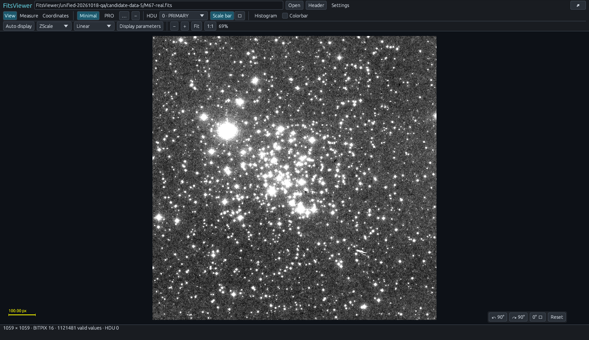

### Basic apertures and coordinates

Create a circular aperture and sky annulus; select it, move it, edit its radius or drag its edge. **Delete / Backspace** removes the selected aperture when a text field is not being edited; **Clear all apertures** removes the whole set. Measurements use original physical pixels; uncertainty and SNR require an appropriate error image or explicit noise model.

The shared **Coordinates** panel shows one-based pixels and FK5 J2000 coordinates. **Recognize / calibrate with Gaia** uses an existing or approximate field position and scale, then applies an independently validated WCS overlay with a default 3 arcsec acceptance limit. Its cached mapping supplies the cursor readout. Legacy FITS dates such as `29/11/51` are interpreted as 1951-11-29 for proper-motion propagation. This is a bounded field solver, not an all-sky blind solution; it leaves the FITS header unchanged.

The **Scale bar** control sits beside the HDU selector. Rotate the display by ±90° or a chosen angle using the lower-right controls. Apertures, picking and coordinates use the same inverse display transform; source arrays are unchanged.

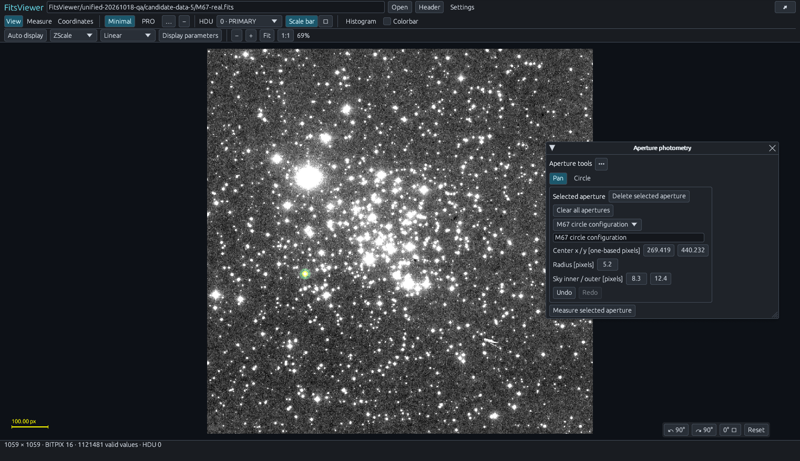

### Basic spectra and preferences

View 1D FITS spectra, recognized binary-table spectra, or numeric text files. Select wavelength/flux/error columns, show uncertainties, zoom and pan, and read the nearest original sample. Invalid samples break the plot instead of being joined across gaps.

**Settings** switches English, 简体中文, Italiano, Español, Deutsch or Français, theme and default startup mode, and opens as a separate window. Select an external Python environment, inspect its actual dependencies and explicitly install selected missing packages. Chinese paths are retained for opening and copying. Popup size, position and folded state are remembered.

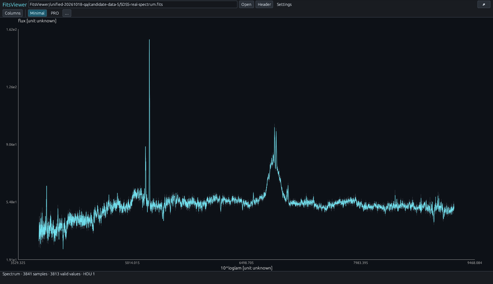

## PRO mode, module by module

PRO adds a framed work area with movable, resizable, dockable and collapsible pages. Image and spectrum tools use separate workspaces. Auxiliary help lives in **…** menus; results, units, progress and errors stay visible. Switching back to Minimal releases PRO jobs and rebuildable caches.

### 1. Image layers and comparisons

Manage visibility, ordering, opacity, labels and display scale/offset in framed layer rows. Compare files in a secondary view or overlay auxiliary images. **Match brightness from field stars** derives a robust relative count ratio using matched sources in an external NumPy/SciPy/Astropy environment.

This adjusts display brightness; it does not establish absolute photometric zeropoints, match PSFs or guarantee flux-conserving registration. [Layer conventions](docs/IMAGE_LAYERS.md).

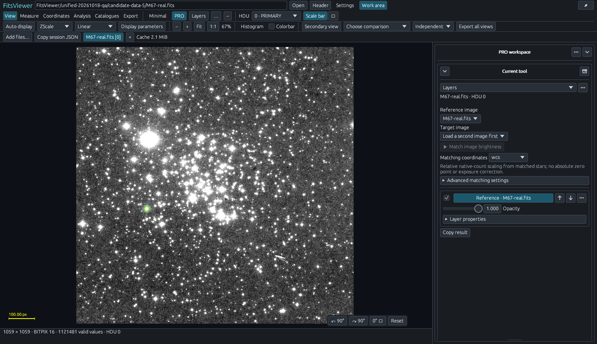

### 2. Measurements, aperture templates and profiles

Use advanced aperture shapes, background and uncertainty settings, growth/profile tools, and line/curved-trace apertures. Copy a template to another image and preview its pixel or WCS-based placement before recomputing measurements on the target. Review original data units and error provenance alongside the result.

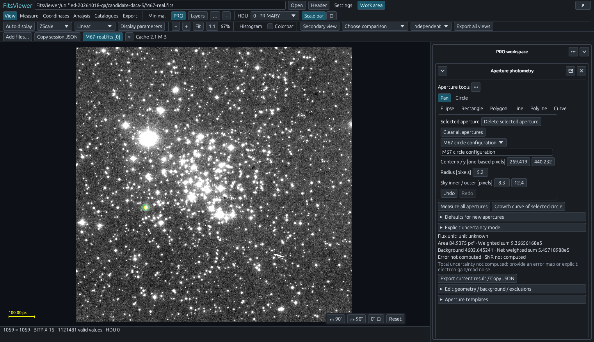

### 3. Coordinates and Gaia calibration

The same coordinates/Gaia tools available in Minimal can be docked beside other PRO pages. A validated solution can feed catalogue overlays, sky-linked comparisons, templates and figure export. Save the JSON solution for provenance, or restore the original WCS. Only the field/query is sent to Gaia TAP; image pixels remain local.

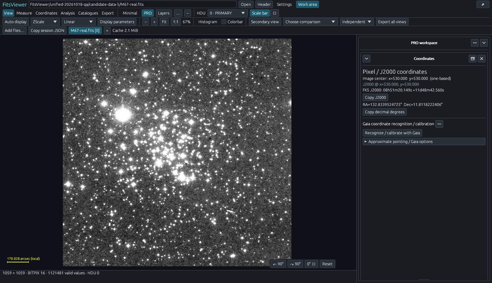

### 4. Source finding and traces

**Find stars** projects Gaia DR3 or SDSS DR17 identities through the current WCS, including a validated Gaia override. **Local source candidates** separately detects intensity peaks; those peaks are not catalogue identities or PSF photometry. Detect straight traces, click a seed to follow a curved trace, or click control points for a line/band profile. Trace inspection does not perform wavelength-calibrated optimal spectral extraction.

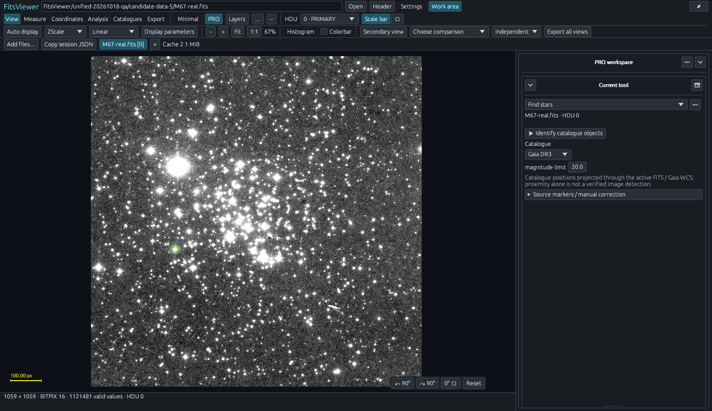

### 5. Catalogues, cross-matching and interoperability

Overlay local catalogues, match catalogues locally, or explicitly call CDS XMatch with Gaia, 2MASS, Pan-STARRS1 or SDSS presets. **Nearby observations** searches Aladin/CDS, SDSS, DES, Legacy Surveys, NOIRLab, MAST, ESO, CADC, IRSA, ALMA and ASTRON interfaces. Results distinguish survey coverage, observation inventories, FITS products and DataLink resources. A coverage/preview record alone does not establish an individual exposure or a downloadable original FITS file. SAMP exchanges information with an external Hub/client; remote deployments can use the optional local bridge.

Searches default to the current image's WCS footprint. The main list prefers image
areas of **40%–150%** of the current field, excludes larger products and offers
smaller partial coverage only when this bounded response has no preferred match.
Area ratio and actual overlap are displayed separately. Generate a resampled HiPS
FITS cutout or download a selected FITS product, save it beside the original and
add it to the viewer. Unwritable destinations explicitly use a temporary result;
the original stays unchanged. [Geometry, downloads and limits](docs/SCIENTIFIC_TOOLS.md#catalogues-and-nearby-observations).

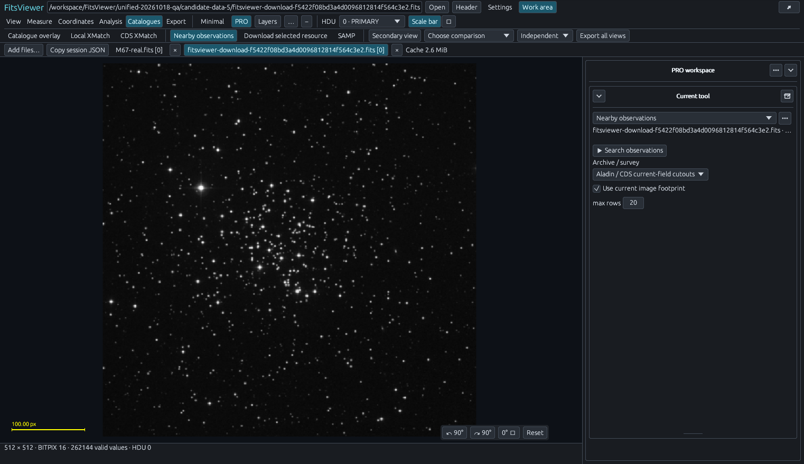

Local matching does not upload rows. CDS receives row identifiers, J2000 positions and explicitly selected extra columns. Online tools need the corresponding external packages and reachable services.

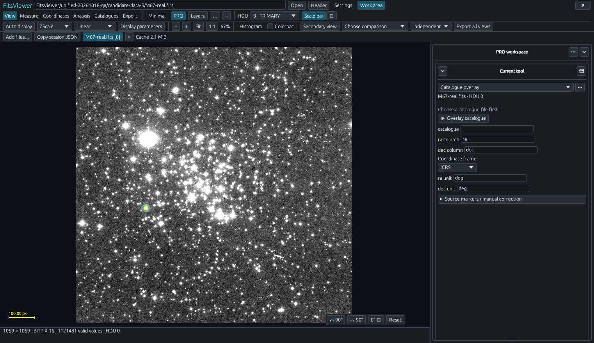

### 6. Reprojection, RGB and export

Prepare visualization reprojections, RGB compositions and annotated figure exports. MathText labels use the selected environment's Matplotlib with `usetex=False`; no TeX engine is embedded. Reprojection uses visualization resampling, so keep scientific measurements on the original images.


### 7. Spectrum references and candidate lines

Toggle single lines, doublets and groups, adjust redshift and marker width, and add custom references in the spectrum workspace. External Specutils can find candidate emission/absorption features for inspection. Select an explicit wavelength unit when the source lacks one, then use **Find candidate emission / absorption**. A nearby reference label is a candidate association, not an automatic physical identification.

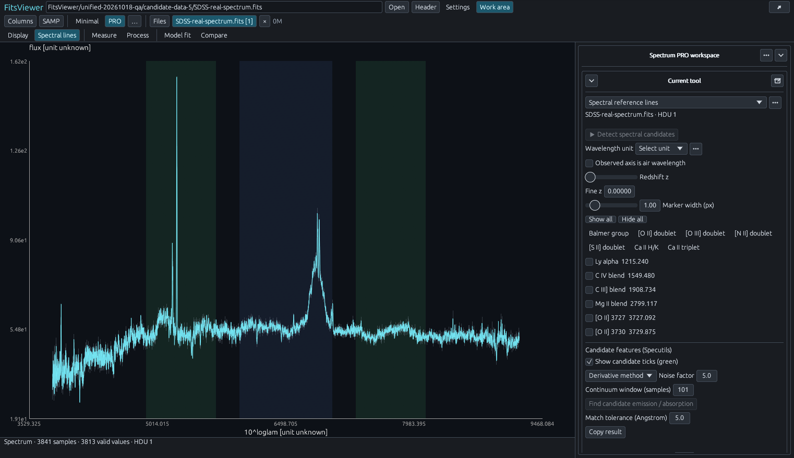

### 8. Spectral measurement, processing and fitting

Set line windows, continuum windows and masks. Fit a linear or low-order polynomial continuum; inspect normalized or continuum-subtracted previews; measure EW/pEW, net flux, centroid, minimum and FWHM where defined. Use observed/rest/relativistic-velocity axes with an explicit reference.

Boxcar, Gaussian and Savitzky–Golay smoothing operate on valid segments. Fit bounded Gaussian/Voigt components or show a relative blackbody curve with temperature/amplitude sliders. Formal measurements use original, unsmoothed samples. Missing uncertainties remain missing. [Numerical conventions](docs/SPECTRAL_ANALYSIS.md).

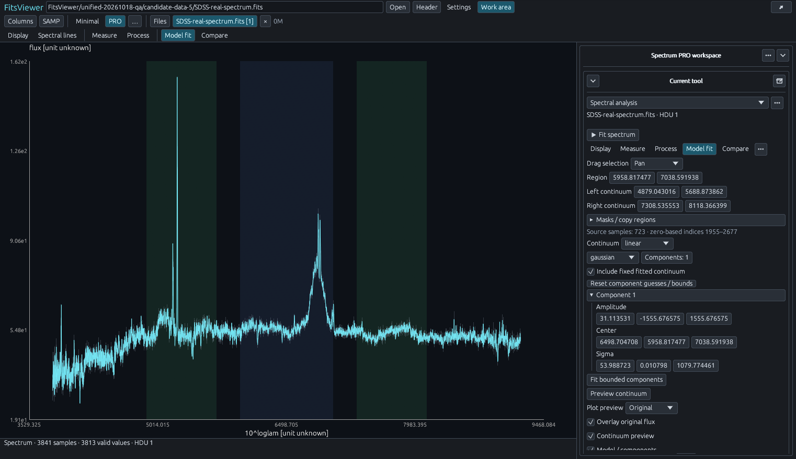

### 9. Spectrum layers and multi-epoch comparison

Overlay up to eight enabled comparison spectra on their native grids. Control visibility, ordering, opacity, scale, offset and epoch/phase labels. Explicit units and redshifts prevent silent axis assumptions. This release does not resample/coadd spectra or subtract one spectrum from another.

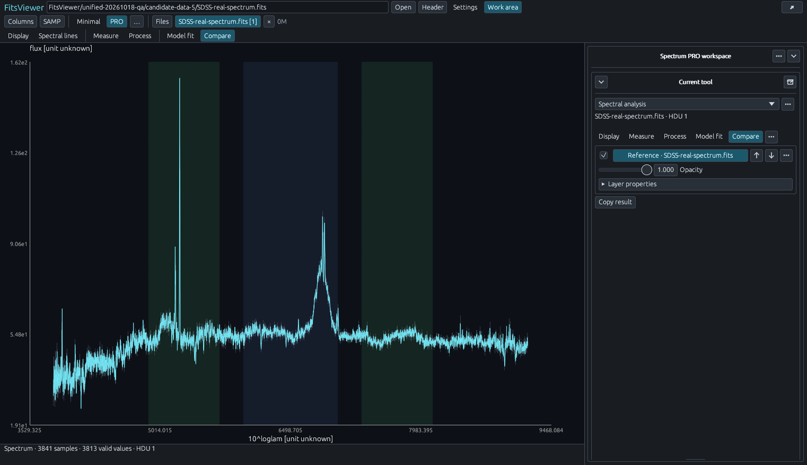

New screenshots use public scientific data. [Credits and capture details](docs/images/v0.1.6/README.md). Configuration screenshots illustrate controls; they do not establish a successful online query or calibration.

## Install

Download the **Full** asset for your platform from [GitHub Releases](https://github.com/minglinwang86/FitsViewer/releases/tag/v0.1.6). This release has no separate Mini-only package and is not published on PyPI.

| Route | Use |
|---|---|
| Linux wheel | Existing Python/Conda environment, CLI, Jupyter and native desktop |
| Windows Setup | Desktop installation; optional Python/Conda binding and default-viewer choice |
| Windows portable ZIP | Extract and run; no automatic environment or association changes |
| Windows wheel | Existing Windows Python/Conda environment and Jupyter |
| macOS portable ZIP | Native Apple Silicon / Intel desktop; [installation and signing notes](docs/MACOS.md) |
| Source archive / Git | Developer build; requires the build toolchain |

For Linux Jupyter, activate the environment that **runs the Jupyter server**, then install the downloaded wheel with its integration extra:

```bash
python -m pip install --upgrade "./fitsviewer-0.1.6-py3-none-manylinux_2_28_x86_64.whl[jupyter]"
fitsviewer defaults set --jupyter yes --desktop no
fitsviewer jupyter start --root "$HOME/data" --port 8082
```

The data directory must exist. Restart an existing Jupyter server after installation and refresh the browser. Double-click FITS/FZ files; for text spectra choose **Open With → FitsViewer**. Program and viewer tabs have the app icon; associated data-file icons remain generic.

```bash
fitsviewer image.fits
fitsviewer --native image.fits
fitsviewer install --python /path/to/env/bin/python --with-jupyter --default-viewer yes --desktop-default no
fitsviewer install --conda-env astro --default-viewer yes --desktop-default no
fitsviewer features --python /path/to/science-env/bin/python --json
```

The environment installer preserves an already supported JupyterLab version unless `--with-jupyter` permits an upgrade. Scientific packages are installed separately in the selected environment. See [installation and SSH](docs/INSTALL.md), [Windows setup](docs/WINDOWS.md), [macOS desktop](docs/MACOS.md), [ports/defaults](docs/COMMANDS.md) and [scientific dependencies](docs/SCIENTIFIC_TOOLS.md).

Notebook embedding:

```python
from fitsviewer import show
show("data/image.fits", height=650)
```

Paths are relative to the Jupyter root. If server and kernel use different environments, the server needs the Jupyter integration and the kernel needs the Python import.

## Open remote files over ordinary SSH

With an SSH local forward already in place, run `fver image.fits` on the remote host. The independent viewer provides a first clickable URL and can reuse an open browser window for later commands. An explicitly paired optional local helper can instead open the native app. Jupyter and X11 forwarding are not required. SSH alone cannot control a local browser window or add a port forward to an existing connection; see [setup and pairing](docs/REMOTE_VIEWING.md).

Selected HDUs with a complete decoded packet up to 20 MB transfer once. Larger supported images use a preview and visible numeric tiles; precise cursor values and scientific measurements still read the original data. Each remote view bounds its tile cache and outstanding requests. No Chromium, Python runtime or scientific package stack is bundled.

## Requirements and limits

| Component | Supported scope |
|---|---|
| Linux release | x86_64, GNU/Linux with glibc 2.28+; native window additionally needs X11/XWayland and usable OpenGL |
| Windows release | Windows 10/11 x86_64 with usable OpenGL; Python optional for standalone desktop |
| macOS release | Apple Silicon / Intel portable apps; macOS 15 validation, ad-hoc signature, no Apple notarization or Mac Jupyter installer |
| Python / Jupyter | Python 3.10+; JupyterLab `>=4.4,<5` and jupyter-server-proxy `>=4.4,<5` |
| Browser | WebAssembly and WebGL; Windows/macOS browsers can connect to Linux over SSH |
| Scientific tools | Packages in your selected environment; [dependency list](DEPENDENCIES.txt) |

JupyterLab 5, Linux/Windows ARM packages, Linux musl, Safari and actual X2Go forwarding are outside current acceptance. A manylinux baseline is not certification of every distribution. macOS startup probes do not constitute full interactive GUI acceptance; see the [validation scope](docs/releases/VALIDATION-0.1.6.md).

FITS images support BITPIX 8/16/32/64/−32/−64 with BSCALE/BZERO/BLANK. Tiled images support RICE/GZIP/GZIP2; HCOMPRESS, PLIO and compressed null-mask columns remain unsupported. Spectra cover 1D arrays, recognized scalar/fixed-vector binary tables and UTF-8 numeric text.

Open `.fits.gz` directly. Extract ZIP/TAR archives before opening their FITS members. Cubes, general table editing, variable-length/multiple-order spectra and full nonlinear spectral WCS are not implemented. The complete-array reader bounds input/decompressed files to 512 MiB and images to 32 Mi pixels; text spectra are limited to 32 MiB and spectra to one million samples. HTTP seek access to ordinary two-dimensional FITS can exceed the complete-array limits without loading the full image. Compressed inputs still have preparation/decode bounds, and a spectrum above the 20 MB complete-packet threshold is rejected. See [transport limits](docs/REMOTE_VIEWING.md); these component budgets are not total-memory guarantees.

Closing a view releases its renderer and owned jobs/artifacts. Allocator/browser caches can keep process memory above its starting value. See [release validation](docs/releases/VALIDATION-0.1.6.md) for tested scope.

## Development and license

[Build](docs/BUILDING.md) · [Architecture](docs/ARCHITECTURE.md) · [AI editing guide](docs/AI_DEVELOPMENT_GUIDE.md) · [API](docs/API.md) · [Changelog](CHANGELOG.md) · [Contributing](CONTRIBUTING.md)

Project source: [MIT](LICENSE). Dependencies and fonts retain their own terms; [third-party notices](THIRD_PARTY_NOTICES.md) and license texts accompany the distribution. Scientific screenshot data retain their providers' attribution.
