# FitsViewer

[English](README.md) · [下载 0.1.6](https://github.com/minglinwang86/FitsViewer/releases/tag/v0.1.6) · [安装](docs/INSTALL.md) · [基础命令](docs/COMMANDS.md) · [代码架构](docs/ARCHITECTURE.md) · [Agent 工作记录](AgentWorkLog.md)

一款轻量、快速启动的天文 FITS 图像与光谱查看器，为科研中使用远程服务器、本地容器时的人工查看和检查提供便捷方案，也支持 Linux、Windows 和 macOS 桌面。可在 JupyterLab 文件列表中双击打开，通过命令行调用，或内嵌到 Notebook。

> **科学使用说明：** 本工具识别、推算或测量得到的坐标、流量、星等等结果，建议仅用于快速检查和参考，不应直接作为论文中的科学测量数据。用于科研发表前，请通过适当的专业科学流程独立验证、校准，并评估不确定度与系统误差。

**一个全功能包，两种界面。** 日常检查使用**极简**模式，需要图层和科学工具时切换到 **PRO**。PRO 工作区在选择后初始化；科学计算调用所选 Python/Conda 环境中的外部包，不把科学软件栈装进程序本体。

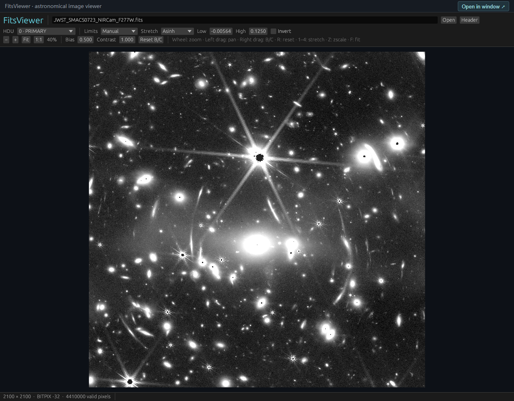

JWST/NIRCam F277W 的 SMACS 0723 视场；这张较早界面的截图保留为项目天文预览，下方展示当前 0.1.6 界面。观测：NASA、ESA、CSA、STScI；拼接数据：[Gabriel Brammer (2022)](https://doi.org/10.5281/zenodo.6874301)，CC BY 4.0。[裁剪、署名与复现说明](docs/images/README.md)。

## 极简模式

### 打开文件、检查图像、调整显示

支持普通 FITS、gzip FITS、支持编码的分块压缩 `.fz` 图像和基础光谱。切换 HDU、查看原始文件头；滚轮缩放、左键／中键拖动平移、右键拖动调亮度与对比度。**自动显示**一键选择便于检查的显示范围和拉伸，原始像素不变。

提供八种拉伸：**线性、对数、幂函数、平方根、平方、反双曲正弦、双曲正弦、直方图均衡**。可手动设置上下限、更换色表、反色、显示紧凑直方图与色标。底部信息栏高度固定，游标数值变化不会挤动图像。

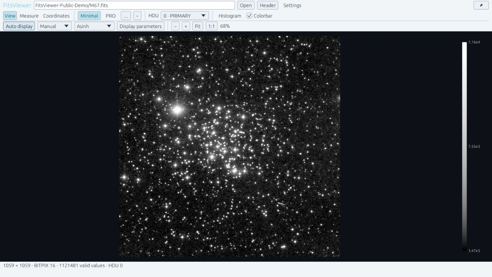

### 基础孔径测光与坐标

创建圆孔径和背景环，选择后可移动、修改半径或拖动边缘调整大小。未编辑文本时，**Delete / Backspace** 删除选中的孔径；**清除全部孔径**可一次清空。测量使用原始物理像素；误差和 SNR 需要适用的误差图或明确噪声模型。

共用的**坐标**面板显示从 1 开始的像素坐标及 FK5 J2000 坐标。**一键识别／校准 Gaia 坐标**利用已有或近似天区位置、角尺度，生成经过独立验证的 WCS 覆盖层，默认误差上限为 3 角秒；缓存映射用于底部游标坐标。旧式 FITS 日期 `29/11/51` 按 1951 年 11 月 29 日处理，用于自行传播。这是有限天区解算，不能当作全天盲解；不会改写 FITS 文件头。

**比例尺**位于 HDU 右侧；图像右下角提供左右 90°及任意角度旋转。孔径、选点和坐标共用同一显示逆变换，原始数组不变。

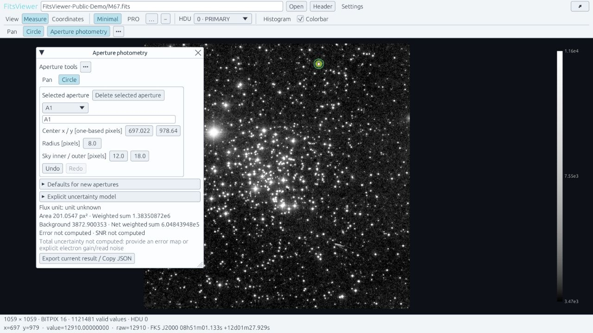

### 基础光谱和设置

查看一维 FITS、已识别列结构的二进制表光谱，或数值文本光谱。选择波长、流量、误差列，显示不确定度，缩放平移并读出最近的原始采样点。无效采样会断线显示，不跨缺口连线。

**设置**在独立窗口中切换英文／简体中文、主题和默认启动模式，也可选择外部 Python 环境、识别其实际依赖，单击安装选中的缺失包。打开及复制保留完整中文路径；弹窗的位置、大小和收起状态会保存。

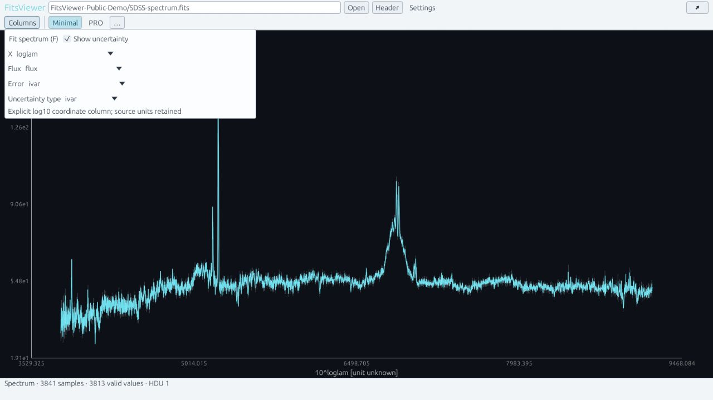

## PRO 模式：逐模块介绍

PRO 提供带边框的工作区，子页面可移动、调大小、停靠、组合与收起；图像和光谱使用各自的工具。辅助说明收进 **…** 菜单，结果、单位、任务进度和错误保持可见。切回极简会释放 PRO 任务和可重建缓存。

### 1. 图像图层与对照

每个图层独立加框，管理显隐、顺序、透明度、标签及显示比例／偏移；可在对照视图查看另一文件或叠加多图。**按场星匹配亮度**调用外部 NumPy/SciPy/Astropy，根据匹配源获得稳健的相对计数比例。

它调整的是显示亮度，不等于绝对测光零点定标，不进行 PSF 匹配，也不保证配准过程通量守恒。[图层约定](docs/IMAGE_LAYERS.md)。

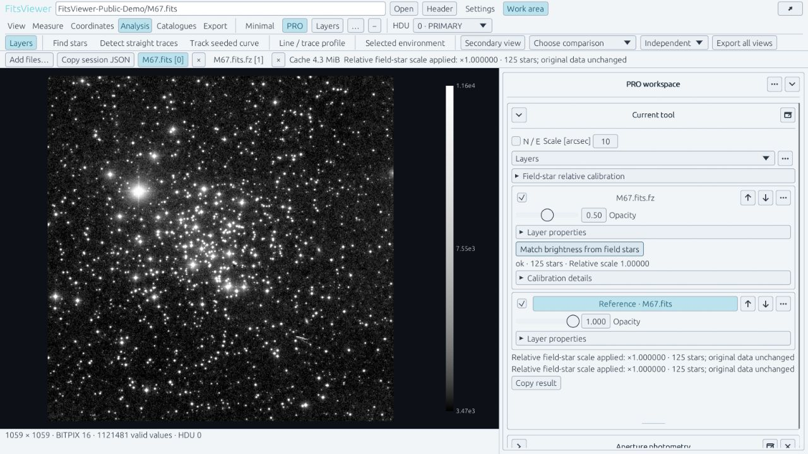

### 2. 测量、孔径模板和剖面

提供更多孔径形状、背景与误差设置、增长曲线／剖面工具、直线及曲线迹线孔径。可复制孔径模板到其他图像，预览像素或 WCS 定位后，在目标原图重新测量。结果保留物理单位和误差来源。

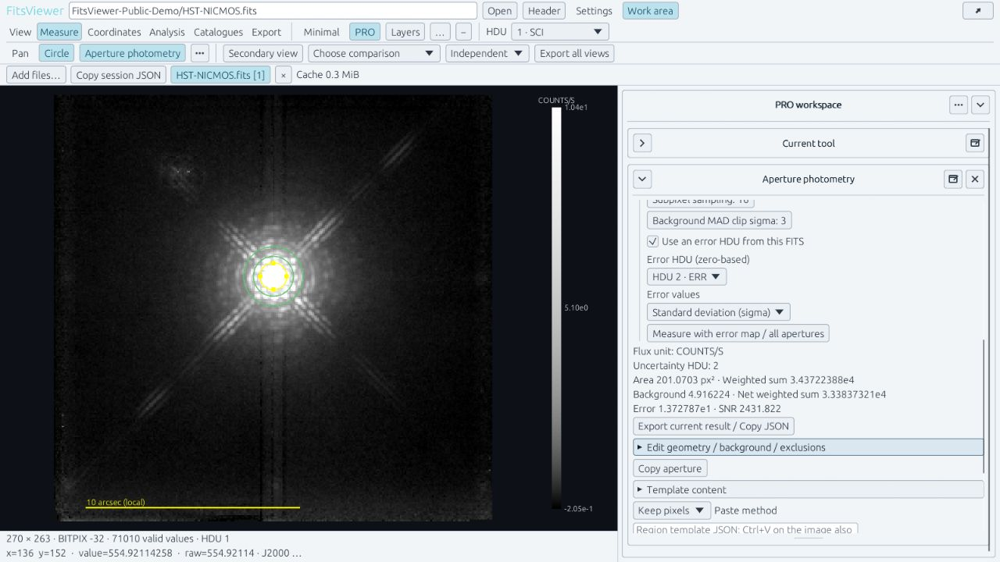

### 3. 坐标与 Gaia 校准

极简中的坐标／Gaia 功能也能停靠到 PRO 工作区，与其他工具并排使用。通过验证的坐标解供星表叠加、天球视角联动、孔径模板和图片导出使用。可保存 JSON 追溯解算来源，也可切回原始 WCS。发送至 Gaia TAP 的是天区／查询，图像像素留在本地。

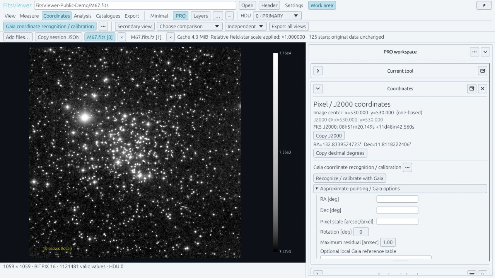

### 4. 找星与迹线

**找星**根据当前 WCS（包括已验证的 Gaia 校准）投影 Gaia DR3 或 SDSS DR17 的星表身份。另设**局部光源候选**检测图像亮点；亮点候选不等于星表认证，也不是 PSF 测光。可检测直线，手动点击种子跟踪曲线，或点选控制点查看线／带状剖面。迹线检查不会自动完成波长定标或最优光谱提取。

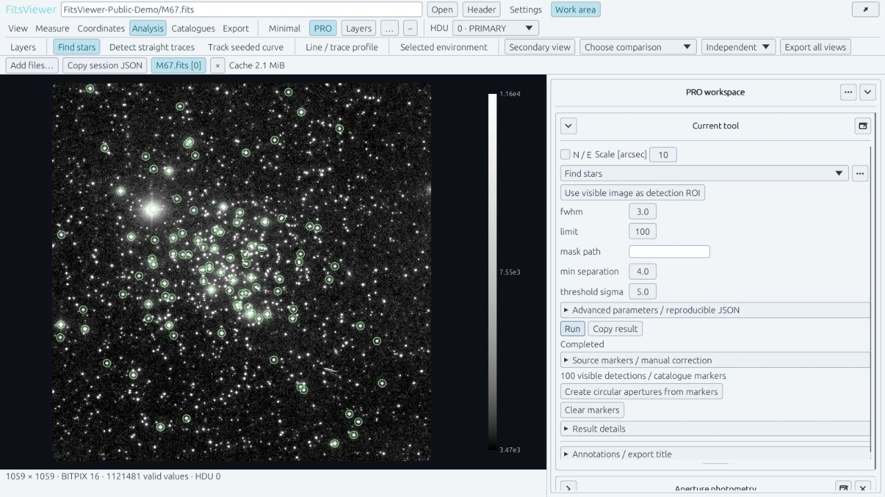

### 5. 星表、交叉匹配与互操作

叠加本地星表、本地交叉匹配，或显式调用 CDS XMatch，提供 Gaia、2MASS、Pan-STARRS1、SDSS 预设。**附近观测检索**连接 Aladin/CDS、SDSS、DES、Legacy Surveys、NOIRLab、MAST、ESO、CADC、IRSA、ALMA、ASTRON 等接口；区分巡天覆盖、观测清单、FITS 产品和 DataLink。覆盖／预览记录本身不能证明存在单次曝光或可下载的原始 FITS。SAMP 可与外部 Hub／客户端交换信息，远程环境可使用可选本机桥接。

默认按当前图像的 WCS 天区足迹检索。主列表优先显示面积为原图 **40%–150%** 的图像，
排除更大产品；本次有限返回中没有合格结果时才展示更小的部分覆盖。面积比与实际重叠比
分别显示。可生成 HiPS 重采样 FITS 切图，或下载选中的 FITS 产品，保存到原图目录并同时
加入查看器。目录不可写时明确改用临时结果，原图不变。[几何、下载与限制](docs/SCIENTIFIC_TOOLS.md#catalogues-and-nearby-observations)。

本地匹配不上传数据。CDS 接收行标识、J2000 坐标及明确选中的附加列。在线功能需要相应外部依赖和可访问的服务。

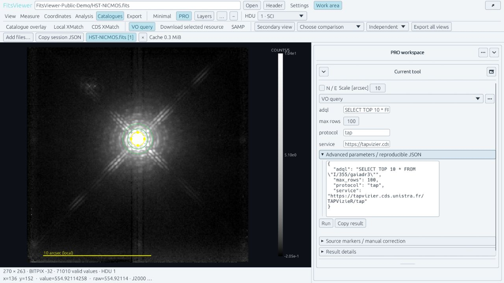

### 6. 重投影、RGB 与导出

准备可视化重投影、RGB 合成和带标注的图片导出。数学标注通过外部 Matplotlib MathText 实现，强制 `usetex=False`，不内嵌 TeX。重投影使用显示用途的重采样，科学测量仍应基于原始图像。

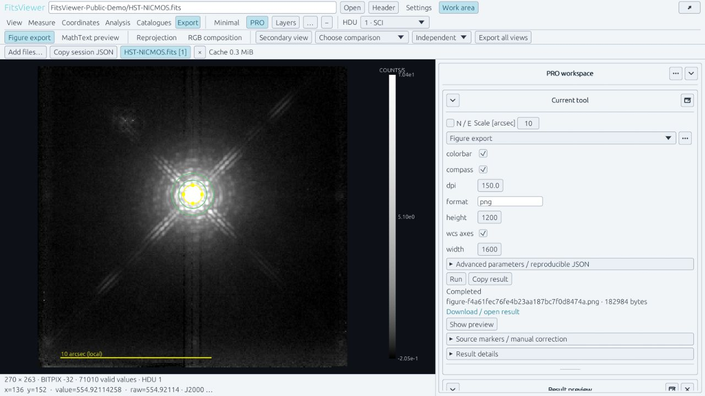

### 7. 光谱参考线与候选识别

光谱使用专属工作区。按单条、双线或组线开关参考标线，调整红移和标线宽度，并添加自定义参考线。可调用外部 Specutils 寻找待检查的发射／吸收候选；邻近参考线标签表示候选关联，不是自动完成物理谱线鉴定。

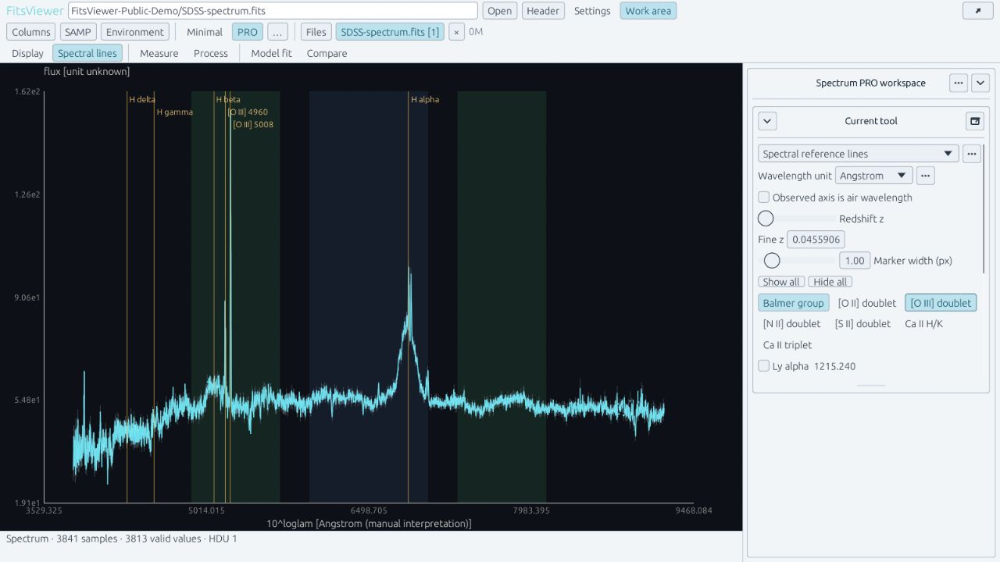

### 8. 光谱测量、处理与拟合

设置线区、连续谱窗口与掩膜，拟合线性或低阶多项式连续谱；查看归一化／扣连续谱预览，测量有定义的 EW/pEW、净积分流量、质心、最低点和半高全宽。可按指定参考线切换观测、静止及相对论速度横轴。

Boxcar、Gaussian、Savitzky–Golay 平滑按有效段处理。可做有界 Gaussian／Voigt 分量拟合，或用温度与幅度滑块查看相对黑体曲线。正式测量仍读取未平滑源采样；缺失误差不会被伪造。[数值约定](docs/SPECTRAL_ANALYSIS.md)。

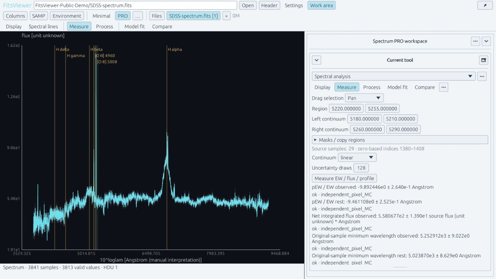

### 9. 光谱图层与多历元对照

最多启用八条对照谱，保留各自原始采样网格；分别管理显隐、层序、透明度、比例、偏移及历元／相位标签。单位和红移需要明确设置。本版不提供多谱重采样合并，也不支持两个光谱之间直接相减。

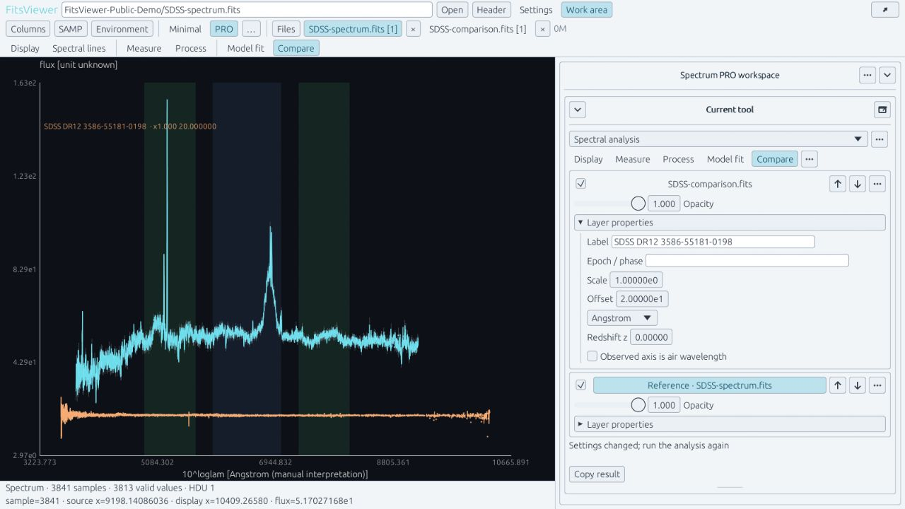

新增截图使用公开科学数据。[数据署名和截图说明](docs/images/v0.1.5rc1/README.md)。展示配置界面的截图不代表在线检索或定标已经成功运行。

## 安装

在 [GitHub Releases](https://github.com/minglinwang86/FitsViewer/releases/tag/v0.1.6) 下载对应平台的 **Full 全功能包**。本次不单独发布 Mini-only 包，也未发布到 PyPI。

| 安装方式 | 适用场景 |
|---|---|
| Linux wheel | 已有 Python/Conda 环境、命令行、Jupyter 与原生桌面 |
| Windows Setup | 桌面安装，可选绑定 Python/Conda 和默认 FITS 查看器 |
| Windows portable ZIP | 解压运行，不自动修改环境或文件关联 |
| Windows wheel | 已有 Windows Python/Conda 与 Jupyter 环境 |
| macOS portable ZIP | Apple Silicon／Intel 原生桌面，见[安装与签名说明](docs/MACOS.md) |
| 源码包／Git | 开发者构建，需要构建工具链 |

Linux 上先激活**运行 Jupyter 服务本身**的环境，再安装下载的 wheel 及其集成依赖：

```bash
python -m pip install --upgrade "./fitsviewer-0.1.6-py3-none-manylinux_2_28_x86_64.whl[jupyter]"
fitsviewer defaults set --jupyter yes --desktop no
fitsviewer jupyter start --root "$HOME/data" --port 8082
```

数据目录须已存在。安装后重启已有 Jupyter 服务并刷新浏览器。FITS/FZ 可双击打开，普通文本光谱使用 **Open With → FitsViewer**。程序、启动器和查看标签带图标，关联数据文件保留普通图标。

```bash
fitsviewer image.fits
fitsviewer --native image.fits
fitsviewer install --python /path/to/env/bin/python --with-jupyter --default-viewer yes --desktop-default no
fitsviewer install --conda-env astro --default-viewer yes --desktop-default no
fitsviewer features --python /path/to/science-env/bin/python --json
```

环境安装命令默认保留已兼容的 JupyterLab 版本，只有 `--with-jupyter` 才允许升级。科学依赖在所选环境另行安装。详见[安装与 SSH 转发](docs/INSTALL.md)、[Windows 安装](docs/WINDOWS.md)、[macOS 桌面](docs/MACOS.md)、[端口和默认关联](docs/COMMANDS.md)、[外部科学依赖](docs/SCIENTIFIC_TOOLS.md)。

Notebook 内嵌：

```python
from fitsviewer import show
show("data/image.fits", height=650)
```

路径相对于 Jupyter 文件根目录。若内核与服务端不在同一环境，服务环境需要 Jupyter 集成，内核环境需要能够导入 Python 包。

## 普通 SSH 打开远程文件

建立 SSH 本机端口转发后，在远端执行 `fver image.fits`。独立查看服务提供首次可点击的地址，已打开的浏览器窗口可接收后续命令；显式配对的可选本机助手也可调用原生程序。不需要先打开 Jupyter 或 X11 转发。普通 SSH 本身不能控制本机浏览器，也不能自行给现有连接增加端口转发，详见[配置与配对说明](docs/REMOTE_VIEWING.md)。

所选 HDU 的完整解码包不超过 20 MB 时一次传输；更大的受支持图像使用预览和当前视野的数值图块，精确游标值与科学测量仍读原始数据。每个远程视图限制图块缓存和在途请求；程序不内置 Chromium、Python 运行时或科学软件栈。

## 环境要求和边界

| 组件 | 支持范围 |
|---|---|
| Linux 发行包 | x86_64、glibc 2.28+ 的 GNU/Linux；原生窗口另需 X11/XWayland 和可用 OpenGL |
| Windows 发行包 | Windows 10/11 x86_64、可用 OpenGL；独立桌面不要求 Python |
| macOS 发行包 | Apple Silicon／Intel portable；在 macOS 15 验证，临时签名、未经 Apple 公证，不含 Mac Jupyter 安装器 |
| Python／Jupyter | Python 3.10+；JupyterLab `>=4.4,<5`、jupyter-server-proxy `>=4.4,<5` |
| 浏览器 | 支持 WebAssembly、WebGL；Windows/macOS 浏览器可通过 SSH 访问 Linux |
| 科学功能 | 使用所选环境的外部包，见[依赖列表](DEPENDENCIES.txt) |

JupyterLab 5、Linux/Windows ARM 包、Linux musl、Safari 和真实 X2Go 转发不在本轮验收范围。manylinux 基线不等于每个发行版均经过认证。macOS 窗口启动探测不等于完整交互验收，详见[实际测试范围](docs/releases/VALIDATION-0.1.6.md)。

FITS 图像支持 BITPIX 8/16/32/64/−32/−64 和 BSCALE/BZERO/BLANK。分块压缩支持 RICE/GZIP/GZIP2，暂不支持 HCOMPRESS、PLIO 和压缩空值掩膜列。基础光谱支持一维数组、已识别的标量／定长向量二进制表及 UTF-8 数值文本。

`.fits.gz` 可以直接打开；ZIP/TAR 多文件归档请先解压再打开其中 FITS。暂不支持数据立方、通用表格编辑、变长／多阶光谱和完整非线性光谱 WCS。完整数组读取的输入／解压后文件上限为 512 MiB、图像 32 Mi 像素；文本光谱限 32 MiB，光谱一百万采样点。HTTP 对普通二维 FITS 的 seek 读取可超过整数组路径限制，无需把整幅图装入内存；压缩输入仍有准备／解码限制，完整包超过 20 MB 的光谱明确拒绝。详见[传输边界](docs/REMOTE_VIEWING.md)，这些局部预算不是总内存上限。

关闭页面会释放对应渲染器及其任务／临时结果。内存分配器与浏览器缓存仍可能使进程内存高于启动值。实际测试范围见[发行验收记录](docs/releases/VALIDATION-0.1.6.md)。

## 开发和许可

[构建](docs/BUILDING.md) · [架构](docs/ARCHITECTURE.md) · [AI 修改指南](docs/AI_DEVELOPMENT_GUIDE.md) · [接口](docs/API.md) · [更新记录](CHANGELOG.md) · [贡献](CONTRIBUTING.md)

项目源码采用 [MIT](LICENSE)。随包依赖、字体保留各自许可，发行包附带[第三方声明](THIRD_PARTY_NOTICES.md)及许可文本；截图中的科学数据保留原提供者署名。
