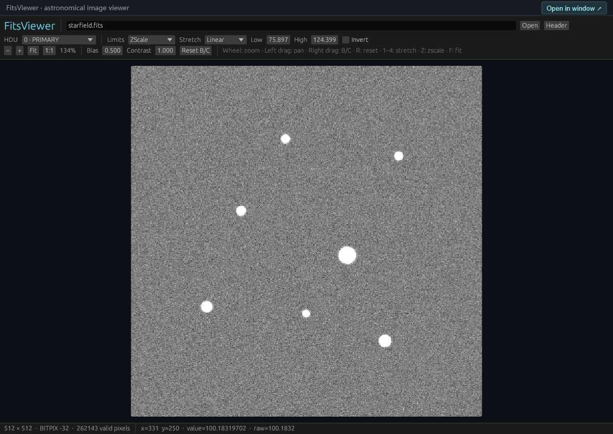

# FitsViewer — fitsrs 版

[English](README.md) · [基础命令](docs/COMMANDS.md) · [构建说明](docs/BUILDING.md) · [预发布流程](docs/RELEASING.md)

一个只读 FITS 图像查看器：Rust/fitsrs 读取数据，Rust/egui 提供原生窗口与 WebAssembly 共用的界面。支持 JupyterLab 文件列表双击打开、Linux 终端调用和 Notebook 内嵌。

**候选版本：Linux / Windows 0.1.4rc2。** Python 包名为 `fitsviewer`，终端命令为 `fitsviewer`。请从 [GitHub Releases](https://github.com/minglinwang86/FitsViewer/releases) 下载对应平台的发行物；本项目尚未发布到 PyPI。

从 rc1 升级时，请先按[迁移说明](docs/releases/v0.1.4-rc.2.md)移除旧发行包，再安装改名后的新包。

## 界面预览



程序实际运行截图，使用随包提供的合成示例 `starfield.fits`。滚轮缩放、左键拖动平移、右键拖动调整亮度和对比度；JupyterLab 与原生窗口共用查看界面。

## 环境要求

| 组件 | 要求 |
|---|---|
| Linux 服务端 / wheel | x86_64，glibc 2.28 及以上 |
| Windows 桌面 / wheel | Windows 10/11 x86_64，需可用的 OpenGL；见 [Windows 说明](docs/WINDOWS.md) |
| Python | Jupyter 集成需要 3.10 及以上；Windows 独立桌面无需 Python |
| JupyterLab | 4.4 及以上、低于 5；安装到启动服务的环境 |
| 浏览器 | 支持 WebAssembly、WebGL；已验证 Linux Chromium |
| 原生窗口 | 可选；需要已配置的 X11/OpenGL 显示或转发环境 |

JupyterLab 的范围表示 `4.4 <= 版本 < 5`。5.x 尚未做兼容验证，当前 Python 安装依赖和前端扩展版本范围暂时排除了 5.x；完成主版本升级的适配测试后才能放宽。原生桌面窗口独立运行，不受 JupyterLab 版本限制。

Windows、macOS 也可以通过 SSH 通道，在本机浏览器使用 Linux 服务，无需在本机安装 Linux wheel。Safari 和真实 X2Go/X11 转发尚未验证。安装 wheel 无需 Rust、Node.js 或 `jupyter lab build`。

完整环境清单见 [DEPENDENCIES.txt](DEPENDENCIES.txt)，pip 运行依赖见 [requirements.txt](requirements.txt)，固定版本的构建工具见 [requirements-build.txt](requirements-build.txt)。

预编译 wheel 需要使用 glibc 的 GNU/Linux，不涵盖 Alpine/musl 或 ARM。源码构建会选择当前主机的 x86_64/aarch64 目标，但 ARM 尚未验证。manylinux 标签表示库兼容基线，并不表示已在每种发行版或桌面上测试。

## Windows 桌面安装

从 [Windows 候选版](https://github.com/minglinwang86/FitsViewer/releases/tag/v0.1.4-rc.2) 下载 `FitsViewer-0.1.4rc2-windows-x86_64-setup.exe`。安装界面可选已有 Python/Conda 环境，用于绑定 JupyterLab/Notebook，并独立选择是否设为默认 FITS 查看器。独立桌面窗口无需 Python，也不占用服务端口。另提供免安装 ZIP 和 Windows wheel。安装、默认关联和构建方式见 [Windows 说明](docs/WINDOWS.md)。

## Linux：安装并双击打开 FITS

从 [Linux 候选版](https://github.com/minglinwang86/FitsViewer/releases/tag/v0.1.4-rc.2) 下载 wheel。先激活实际启动 JupyterLab 的 Conda 或虚拟环境，再安装本地文件：

```bash
python -m pip install --upgrade ./fitsviewer-0.1.4rc2-py3-none-manylinux_2_28_x86_64.whl
fitsviewer jupyter start --root "$HOME/data" --port 8082
```

数据目录需已存在。打开命令输出的登录链接，在 JupyterLab 文件列表双击 `.fits`、`.fit`、`.fts` 或对应 gzip 文件。FitsViewer 会注册为默认查看器。安装时已有 JupyterLab 正在运行，需要从同一环境重新启动服务，再刷新浏览器。

检查扩展：

```bash
jupyter server extension list
jupyter labextension list
fitsviewer status
```

后端 `fitsviewer`、`jupyter_server_proxy` 和前端 `fitsviewer` 应启用。若此前指定过其他默认查看器，使用 **Open With → FitsViewer**，或修改默认查看器设置。绑定命令和排错见[基础命令](docs/COMMANDS.md)。

已有完整安装时，可复制到另一个环境：

```bash
fitsviewer install --python /path/to/env/bin/python --check
fitsviewer install --python /path/to/env/bin/python
```

也可选择 `--prefix /path/to/env` 或 `--conda-env astro`。目标缺少 JupyterLab 时添加 `--with-jupyter`。成功后用英文显示目标环境、端口、绑定状态和绑定命令。直接 `pip install` 使用 pip 自带输出。

### 选择环境及默认查看器

终端运行 `fitsviewer install`，可交互选择当前 Python、指定 Python 路径或 Conda 环境，再选择是否设为 Jupyter 和桌面默认查看器。SSH 自动安装可显式传参：

```bash
fitsviewer install --conda-env astro --default-viewer yes --desktop-default no
fitsviewer install --python /path/to/env/bin/python --default-viewer no --desktop-default no
```

首次通过 pip 安装到已有 Conda 环境：

```bash
conda run -n astro python -m pip install ./fitsviewer-0.1.4rc2-py3-none-manylinux_2_28_x86_64.whl
conda run -n astro fitsviewer defaults set --jupyter yes --desktop no
```

Python/venv 环境则使用其 `bin/python -m pip install ...` 和 `bin/fitsviewer defaults set ...`。将 `yes` 改为 `no` 可取消 Jupyter 默认关联，同时保留 Open With 入口。此流程不需要图形桌面。

仓库发布后，从 Git 源码安装：

```bash
git clone https://github.com/minglinwang86/FitsViewer.git
cd FitsViewer
python3 scripts/install.py --from-source --build-python python3.11 --conda-env astro --default-viewer yes --desktop-default no
```

源码安装器也接受 `--python`、`--prefix`，以及 `--wheel ./file.whl`；wheel 模式不构建 Rust/Node。构建依赖见 [BUILDING.md](docs/BUILDING.md)。目标需要安装 JupyterLab 时加 `--with-jupyter`。

## SSH 远程访问 Linux

在 Linux 服务端执行：

```bash
fitsviewer jupyter start --root "$HOME/data" --port 8082 --browser-port 18082
fitsviewer tunnel --ssh-host user@server.example.com --ssh-port 22 --local-port 18082 --remote-port 8082
```

第二条命令输出 SSH 命令。将它复制到浏览器所在电脑的终端执行，并保持终端运行。上述例子对应：

```bash
ssh -N -o ExitOnForwardFailure=yes -o ServerAliveInterval=30 -L 127.0.0.1:18082:127.0.0.1:8082 -p 22 user@server.example.com
```

使用打印的 Jupyter 登录链接，本机浏览器端口为 `18082`。把示例用户名、域名替换为本机可连接的 SSH 地址。Rust 内部代理自动分配端口，无需额外转发。登录链接含认证 token，应仅供自己使用。

## 终端和 Notebook

```bash
fitsviewer /path/to/image.fits
fitsviewer /path/to/image.fits --hdu 1
fitsviewer /path/to/image.fits --no-browser
fitsviewer --native /path/to/image.fits
fitsviewer ports
fitsviewer ports set --jupyter 8084 --browser 18084
```

普通命令优先使用同一环境中已连接的 Jupyter；没有可用服务时启动独立浏览器查看器。点击 **Open in window** 可创建浏览器弹窗，后续终端请求可切换文件。原生模式需要已有显示连接。端口修改用于后续启动，不改动正在运行的 SSH 通道。

### Linux 桌面或 X2Go 中双击打开

```bash
fitsviewer desktop install
fitsviewer defaults status
fitsviewer defaults set --jupyter yes --desktop no
```

`desktop install` 为当前 Linux 用户注册 FITS/FITS.gz 文件关联和原生启动项。需要 `xdg-utils`、`shared-mime-info`、X11/XWayland 及可用 OpenGL；可安装 desktop-file-utils 刷新缓存。X2Go 也需要具备相应显示/GLX 能力。保留注册时使用的 Python/Conda 环境。桌面默认设置按用户保存，Jupyter 默认设置按环境保存。

`--no-default` 只注册 Open With 入口。`defaults set --desktop no` 恢复此前记录的默认查看器；此前没有默认项时交给桌面系统选择。卸载包或环境前运行 `fitsviewer desktop remove`。修改 `--jupyter yes|no` 后刷新 JupyterLab。

Notebook 中执行：

```python
from fitsviewer import show
show("image.fits", height=650)
```

路径相对于 Jupyter 服务的文件根目录。内核与服务使用不同环境时，服务环境安装完整包以支持双击，内核环境也要安装包以调用 `show()`。内核未继承 URL 前缀时，可使用 `show(..., base_url="/user/name/")` 明确指定。

## 操作

| 功能 | 操作 |
|---|---|
| 缩放 / 平移 | 滚轮或 `+` / `-`；按住左键拖动 |
| 亮度 | 右键左右拖动，向右更亮 |
| 对比度 | 右键上下拖动，向上增强 |
| 重置亮度和对比度 | **Reset B/C** 或 `R` |
| 适应窗口 / 原始比例 | **Fit** 或 `F`；**1:1** |
| stretch | Linear、Log、Sqrt、Asinh；快捷键 `1`–`4` |
| 显示范围 | ZScale、99.5%、Min/Max、Manual；修改 **Low** / **High** |
| 反转 / HDU / Header | **Invert** 或 `I`；**HDU** 菜单；**Header** |
| 像素值 | 悬停显示从 1 开始的 FITS 坐标、物理值和精确 raw 存储值 |

显示变换复用已加载像素，不修改 FITS 文件。亮度/对比度作用在 stretch 后，与 Low/High 独立。ZScale 使用 IRAF 风格采样拟合，尚未承诺与 DS9 数值完全一致。

## 数据支持及限制

- 普通二维 Primary/Image HDU、多 HDU、外部 gzip 压缩 FITS。
- BITPIX 8、16、32、64、-32、-64，保留原始存储类型。
- 处理 `BSCALE`、`BZERO`、整数 `BLANK` 和非有限浮点值。物理值和显示采用 f64；raw 大整数读数保留精度。
- 单文件及解压后上限 512 MiB，二维图像上限 32 Mi 像素。这些是容量限制，不代表始终流畅。

尚未实现分块压缩 `.fz`、数据立方切片、FITS 表格、WCS 天球坐标、区域、测光，也没有分块渲染、图像金字塔或浏览器 Worker。不支持的数据会报错或禁用对应 HDU。`examples/` 全部为合成样本，包括故意构造的无效测试文件。

`.fits.gz` 在 Linux 后端解压；浏览器内存取决于解压后的像素、WASM 缓冲区及显示纹理。关闭 FITS 页签会在移除 iframe 前主动销毁渲染器。普通 FITS 与 gzip FITS 已各自独立测试：6 个 2048x2048 float32 图像反复开关 8 轮，以及单文件反复开关、加载中关闭，关闭后无存活的 WASM 内存实例；额外的对象检查确认无存活的查看器或 iframe。浏览器、Jupyter 缓存和分配器仍可能保留部分进程内存。详见[内存验证报告](docs/releases/MEMORY-0.1.4rc1.md)；最大尺寸图像和长时间会话不在此次验证范围内。

## 构建与贡献

[BUILDING.md](docs/BUILDING.md) 提供不依赖特定容器路径的步骤。源码使用 Cargo/npm 锁文件、固定构建工具和独立 QA 锁文件。构建产出发行物，安装另行执行。

另见[候选版说明](docs/releases/v0.1.4-rc.2.md)、[参与开发](CONTRIBUTING.md)、[安全问题](SECURITY.md)和[公开 API](docs/API.md)。

## 许可

项目源码采用 [MIT](LICENSE)，版权归 FitsViewer contributors。随包依赖保留各自许可；wheel 和源码发行物包含 [THIRD_PARTY_NOTICES.md](THIRD_PARTY_NOTICES.md) 与 `licenses/`。Python 许可元数据描述包含字体等依赖的组合分发。
