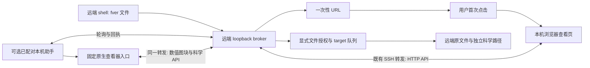

# FitsViewer 0.1.7 实现方案审查

审查日期：2026-10-29。范围为当前工作区源码，基线提交 `1c89bc3`，包括尚未提交的取消保存、原生窗口与语言修改。行号对应审查时工作区；不是对已发行二进制的保证。

## 推荐结论

建议保留现有 Rust 核心、共享 native/WASM 界面、独立 `fver` broker 与外部 Python 科学环境。最值得先做的是让连接、首帧、资源预算和任务状态更容易判断，再针对测得的瓶颈改善调度，不宜为了“SSH 弹窗”换成 Chromium 容器、引入常驻大服务或重写科学算法。

SSH 默认路线应是：**本机已有明确的端口转发 → 远端 `fver 文件` 打印一次性 URL → 首次点击 → 以后同一 target 的请求更新已打开的查看页**。需要每次自动出现本机原生窗口的用户，显式启用已配对助手。复用 SSH ControlMaster 是本机的可选优化，不能由远端根据 `SSH_CONNECTION` 自动获得本机控制权。

本次没有确认全局图像锁或后台任务延迟释放为当前功能 bug。它们有真实的预算保护作用，但可能增加交互等待，值得按本文场景量测。Linux CLI 审查确认配对提示会给 HTTPS/代理地址生成无效 helper 命令，随后已获授权完成最小修复及六项检查（§10–11）。独立认证审查则在隔离的共享网络命名空间、两个不同 UID 的无害夹具中，实证了空 token Jupyter 后端的越权读取和以受害服务身份执行 probe；该问题已转交专门修复。用户当前部署是否满足此前提未探测，最终修复验收状态需单独记录。

## 1. 证据范围与判定方法

已读取 `AGENTS.md`、`docs/AI_DEVELOPMENT_GUIDE.md`、`docs/ARCHITECTURE.md`、`AgentWorkLog.md`，并沿入口、授权、传输、显示、科学任务与释放路径追踪实现。采用技术准确性审查的“源码核验—证据分类—风险去重”方法。初始任务只做方案分析；之后明确授权落实 U-01 配对提示和 D-01 文档纠正，范围及 Linux 验证见 §11。J-01 由独立代理负责修复，未在本审查中修改其宿主/代理文件。

路径约定：正文 `core/src/`、`viewer/src/`、`server/src/` 均在 `crates/` 下；仅写文件名时沿该模块定位。关键入口可直接打开：[远端 CLI](../../jupyter/fitsviewer/remote.py)、[broker](../../crates/server/src/remote_broker.rs)、[图像存储](../../crates/server/src/remote_data.rs)、[客户端渐进图像](../../crates/viewer/src/remote_image.rs)、[浏览器远端会话](../../web/remote.js)、[宿主入口](../../crates/server/src/main.rs)、[Jupyter 代理](../../jupyter/fitsviewer/server.py)。每条具体结论附审查时的行号。

状态用语如下：

| 标记 | 含义 |
| --- | --- |
| 已实现 | 当前源码存在可追踪调用链；不自动代表所有平台 GUI 已验收 |
| 部分实现 | 路径存在，但有明确范围、行为差异或尚缺验收 |
| 建议 | 当前未实现；下文复杂度与收益是工程判断 |
| 条件风险 | 源码可证明前提，但尚未证明用户当前部署满足全部触发条件 |

此次审查没有启动 Windows 程序、构建应用、安装包、改 SSH 配置、访问用户数据服务或停止容器服务。没有执行新的性能基准。已有测试只用于说明覆盖范围；测试源码存在与本轮运行通过分开陈述。任务私有证据目录保存源码摘要和优先级列表，公开报告不记录真实内网地址、用户目录或 token。

## 2. 普通 SSH 的真实入口和调用链



### 2.1 从命令到可见图像

| 阶段 | 当前实现 | 源码证据 |
| --- | --- | --- |
| CLI 入口 | 安装包的 `fver` 指向 `fitsviewer.remote:main`；`fitsviewer remote` 转到同一入口 | `jupyter/pyproject.toml:570`；`jupyter/fitsviewer/cli.py:33` |
| 选择文件 | 将显式路径解析成真实文件，要求 regular file；不是授权整个目录 | `jupyter/fitsviewer/remote.py:183`；`crates/server/src/remote_broker.rs:101` |
| 服务复用 | 私有 runtime 记录须有 broker 标记和 token；以 health 的 viewer/fver/epoch 核对。不存在才用独占 start.lock 启动自己的 broker | `jupyter/fitsviewer/remote.py:68`、`:79`、`:94` |
| 注册请求 | 向本机远端 loopback 的 `/api/fver/register` 提交 path/HDU/target/route；先打印 URL，再探测助手回执 | `jupyter/fitsviewer/remote.py:188`、`:204` |
| 选路 | `auto` 或 `native` 在助手 10 秒内活跃时选 helper，否则 browser；显式 browser 始终走浏览器 | `crates/server/src/remote_broker.rs:1118` |
| 浏览器引导 | URL fragment 的一次性票据先从地址栏移除，再换成内存中的查看凭据 | `web/index.html:4`；`web/remote.js:157` |
| 同页跟随 | 每轮读取 events，选择最新 queued/browser 请求，在界面已启动且当前不在 loading 时打开；通常每秒轮询 | `web/remote.js:117`、`:140`、`:153` |
| 助手启动 | 本机助手每秒轮询；固定启动打包的原生程序 `--native --connect-stdin`，连接能力通过有界 stdin 传入；也可选择系统浏览器模式 | `jupyter/fitsviewer/remote.py:263`、`:318`、`:331`、`:341` |
| 回执 | claim、visible 与 first_frame 是不同事件；accepted 不等于已经画出图像 | `web/remote.js:109`、`:129`；`crates/server/src/remote_native.rs:146` |

请求本身不立即解码全图。broker 登记文件句柄和身份，后续实际图像请求才准备源。故“打印链接迅速”只能证明登记成功，不能证明转发、浏览器、解码或首帧成功。`scripts/check_remote.py:33` 专门约束 URL 必须先于助手探测输出；`qa/remote_contract.mjs:51` 区分 claim 与首帧。

### 2.2 “复用”不是一种行为

* **服务复用，已实现**：同一用户 runtime 默认复用一个 broker，既有 broker 的 public URL 不能随意改；独立映射需独立 runtime。见 `remote.py:94`。
* **浏览器 target 跟随，已实现**：同一 target 的普通 bootstrap 查看页跟随新请求。新开另一个普通 bootstrap 会撤销该 target 的旧 browser scope；固定单文件 popup 是不同 scope。见 `remote_broker.rs:1251`、`:1262`。
* **本地原生同窗打开，已实现**：同用户窗口消息箱有 ACK；仅 local_files 窗口接收本地路径。远程窗口不能利用这个接口读取本机文件。见 `native_windows.rs:55`、`:88`、`:102`。
* **远程助手同一个原生窗口换图，当前未实现**：助手为每个请求启动一个固定子进程，最多八个在用窗口。远程窗口登记为 `local_files=false`。不能把本地“同窗打开”设置解释成远程也会复用一个原生进程。见 `remote.py:320`、`:341`；`remote_native.rs:190`。
* **SSH 连接复用，部分实现**：助手使用系统 `ssh`，可能受用户现有客户端配置影响；代码没有明确管理 ControlMaster control socket、`-O forward` 或借用转发的所有权。当前显式路径是复用已有 URL 或创建助手拥有的 SSH 子进程。见 `remote.py:223`。

### 2.3 状态与容量是有意约束

当前最多 16 个 target、每 target 32 个文件授权、64 条请求历史、256 张未消费引导票据；每个 helper 最多八个活动窗口。新请求会 supersede 同 target 仍 queued 的旧请求，已有 accepted/first_frame 不会被同样处理。引用：`remote_broker.rs:348`、`:1098`、`:1109`、`:1112`、`:1142`、`:1371`。

helper 三秒未领取会转 browser；已领取但 30 秒没有后续更新会变为 unknown，避免不确定时盲目再起窗口。未完成投递请求十分钟过期；first_frame 不适用该投递超时。代码测试分别覆盖迟到 ACK、unknown 不重启和完成首帧不因投递超时过期：`remote_broker.rs:278`、`:1796`、`:1812`、`:1824`。

建议在帮助和状态中明确 `--route native` 当前是偏好且可回退，不是强制保证原生；它也不会把一个 browser 模式 helper 改成 native。添加 `preferred_route` 与 `actual_route` 的可读状态比悄悄改变语义稳妥。容量用尽时应提示关闭哪些由本 target 拥有的请求；不要自动杀窗口来腾出配额。

## 3. SSH、浏览器与认证的技术边界

### 3.1 最少依赖的推荐用法

下列为通用示例，未执行，也不代表现有 SSH 设置已变更：

```sh
# 在本机建立或确认转发；端口须选择未占用的值。
ssh -N -T -o ExitOnForwardFailure=yes -o ForwardAgent=no \
  -L 127.0.0.1:18877:127.0.0.1:8877 TRUSTED_SSH_ALIAS

# 在远端运行；public-url 必须对应上面实际存在的本机映射。
fver observation.fits --port 8877 --public-url http://127.0.0.1:18877/

# 点击首次输出的链接后，保持该查看页；同 target 后续请求会跟随。
fver next-observation.fits
```

已有同一 broker/端口的转发可直接使用，不必再起 tunnel。如果现有转发仅通向 Jupyter 的 HTTP 端口，它不会自动通向独立 fver 的另一个端口；须选择已有 Jupyter 集成或显式增加所需转发。Jupyter Server Proxy 支持经既有 Jupyter URL 访问后端，路径前缀和身份认证需要按其模型集成，不能把任意代理路径当成 native helper 的直连地址。当前 helper `--url` 明确只接受无代理路径的 loopback URL。来源：[OpenSSH ssh](https://man.openbsd.org/ssh#L)、[Jupyter Server Proxy](https://jupyter-server-proxy.readthedocs.io/en/latest/arbitrary-ports-hosts.html)；源码 `remote.py:29`。

`ExitOnForwardFailure` 只保证转发监听的建立，不保证最终目标服务可用；助手随后核对 broker health/instance 是必要步骤。`AllowTcpForwarding`、`PermitOpen` 等服务端策略可能拒绝通道，不应自动修改 sshd 设置绕过。来源：[客户端选项](https://man.openbsd.org/ssh_config#ExitOnForwardFailure)、[服务端转发权限](https://man.openbsd.org/sshd_config#AllowTcpForwarding)、[PermitOpen](https://man.openbsd.org/sshd_config#PermitOpen)。

首次点击是浏览器安全模型中的真实用户动作。轮询回调不能可靠地产生一个新 popup；当前“在窗口打开”先在按钮事件中打开空白窗口，再取得票据并导航，符合此边界。已开页换图不需要重新申请 popup。`window.close()` 对用户手工打开的标签也可能被限制，界面应正常释放自己的资源并给关闭提示。来源：[MDN window.open](https://developer.mozilla.org/en-US/docs/Web/API/Window/open)、[MDN window.close](https://developer.mozilla.org/en-US/docs/Web/API/Window/close)；源码 `web/remote.js:168`。

### 3.2 可选助手与 ControlMaster

已安装本机 FitsViewer 时，可以在远端 `fver pair --target desk`，再于本机运行 `fver helper --url http://127.0.0.1:18877/ --target desk`，按提示输入一次性配对码。`--ssh TRUSTED_SSH_ALIAS` 则创建助手自有转发；无须读取 SSH 私钥内容、转发 ssh-agent 或接受远端任意命令。配对码不能作为长效秘密写入项目配置。源码 `remote.py:191`、`:231`、`:277`、`:337`。

后续可以增加显式的本机 `--control-path` 模式，先检查已知 master，再申请指定转发；退出只撤销自己登记的转发，绝不能 `-O exit` 用户 master。只有用户明确提供且权限可信的 socket 才可使用。ControlMaster 由本机客户端维护；`SSH_CONNECTION` 只提供连接相关信息，不提供本机启动程序的权能。OpenSSH 支持共享连接及控制命令，但 Windows 客户端的实际构建、socket 支持和终端登录提示须单独验证，不能从 Unix 手册推断已支持。来源：[ControlMaster](https://man.openbsd.org/ssh_config#ControlMaster)、[ssh 控制命令](https://man.openbsd.org/ssh#O)。

X11 转发需要本机 X server、远端 GUI 依赖及额外授权；它显示的是远端 GUI，不是让任意 SSH 会话自动调用本机浏览器。对当前已有 native/WASM 架构，不建议作为默认替代。无需增加自定义 URL 协议、浏览器扩展或终端私有转义序列来实现本来已经可用的首次链接路径。

### 3.3 生命周期、来源校验和多用户

| 能力 | 实现与范围 | 建议 |
| --- | --- | --- |
| 控制 token | 远端私有 runtime；control API 要求该 token 且拒绝 Origin | 保持不进入 URL、命令行和页面；`remote.py:79`、`remote_broker.rs:1055` |
| 初次 URL | 60 秒单次票据，fragment 进入页面后立即清除 | 复制到聊天/日志仍可能泄露这次授权；文档只放占位符；`:1145`、`web/index.html:4` |
| 配对码 | 120 秒、单次；核对显式 target 和 server instance | 不缓存配对码；helper 换 broker 后重新配对；`:1172`、`remote.py:279` |
| 查看 scope | 30 分钟 idle、8 小时硬上限；request/epoch/owner 分离 | 轮询会刷新 idle，故它不是“离开键鼠 30 分钟”；需在状态页显示到期与重新授权方式；`remote_broker.rs:32`、`:315`、`:374` |
| helper | 每 target 独立凭据；新配对替换旧 helper；活动时间决定选路 | 当前 helper 没有独立 created/max-age 字段，不宜笼统说所有凭据都恰好八小时过期；配对 authority 有八小时边界。建议统一声明与撤销入口；`:221`、`:914`、`:1215` |
| 传输 | Rust 服务绑定 IPv4 loopback；broker 检查 Host、Origin、Fetch Metadata；助手拒绝重定向/继承 HTTP proxy | loopback 限制网络暴露，不是 OS 用户隔离；`main.rs:805`、`remote_broker.rs:978`、`remote.py:24` |
| 文件授权 | 持有文件身份，原路径替换即拒绝；文件能力不自动变目录授权、安装权限或新下载权限 | 保留文件、job、artifact 能力分离；`remote_broker.rs:131`、`:397`、`:567` |

HTTP 穿过 SSH 隧道与直接公网 HTTPS 是两种部署。当前 Rust listener 本身不提供 TLS；`--public-url https://…` 描述受控网关，网关的 TLS、Host/前缀转发和认证要独立验证。不能把修改 public URL 当成已建立加密网关。

不同 OS 用户应使用自己的 runtime、token 和端口；固定默认端口冲突时明确提示，不尝试接管别人的进程。同一 OS 账号的多个 shell 默认共享信任域，`--target` 只是逻辑投递通道，不是用户隔离边界。跨不互信账号应使用容器/网络命名空间或另加后端认证，不能仅靠 loopback。

**J-01（隔离 Linux 夹具已证实，修复交由独立代理）**：审查时 Jupyter 集成命令传入 `--jupyter`（`jupyter/fitsviewer/server.py:52`）；宿主因此生成空 token（`main.rs:811`），`authorize` 接受空 token 状态（`:260`）。外层 Jupyter 代理有身份体系，直接访问裸后端却绕过该层。独立认证审查随后在同一网络命名空间、不同测试 UID 的专属无害夹具中，复现另一个 UID 直连读取，以及 probe 以受害服务 UID 执行。该结果将问题从静态条件风险提升为已证实的跨 UID 隔离缺陷。测试未访问用户服务；用户当前部署是否具备触发前提仍未探测。以上行号记录修复前快照，修复后的实现与验收需以认证任务证据为准。

对多租户支持承诺，这应是 P0 准入条件：验证裸后端无凭据请求被拒绝、代理请求成功，后端凭据按实例隔离。可选方案为每实例独立后端 secret 由认证代理注入，或带文件权限隔离的 Unix socket；必须同时保护科学与控制 API，不能把 Jupyter 主 token 发给浏览器来修补。当前单用户隔离容器可明确保留适用边界。Jupyter 官方也明确其普通 public server 不是多用户方案：[Jupyter 安全模型](https://jupyter-server.readthedocs.io/en/latest/operators/security.html)、[单用户公开服务边界](https://jupyter-server.readthedocs.io/en/stable/operators/public-server.html)。

后续防御修复状态：父任务报告 `main.rs` / `server.py` 已加入每实例后端凭据与代理注入，普通配置检查 4/4、授权单元测试 5/5 通过；新版真实 Jupyter 端到端验收仍待执行。修复前证据保存在本任务证据目录的 `security/reproduction-before.json`，不在本文复制身份、地址或凭据。进一步复现已停止，本文不要求重复跨 UID 演示；后续只验收正常授权路径及无凭据拒绝行为。

## 4. 小图、大图与科学原图路径

### 4.1 20 MB 的准确含义

阈值是**选中 HDU 解码后的数值封包不超过 `20_000_000` 字节**，包含元数据和光谱坐标/误差数组；不是原始 FITS 文件体积，也不是 `.gz` 压缩体积。一个多 HDU 文件只打开某 HDU，也不等于传整份磁盘文件。代码：`core/src/remote.rs:6`、`:24`、`:26`；阈值测试 `:265`。

| 数据 | 当前显示路径 | 不应混淆的限制 |
| --- | --- | --- |
| 小的选中 HDU | metadata 协商后 full 数值封包 | 有上限核验；没有自动选择“更低科学精度” |
| 大型二维普通 FITS | metadata + 最长边至多 256 的预览 + 256×256 视野 tile | 缩放/平移仍在本地；视野最多 20 个 tile 请求，当前窗口最多四个 pending |
| FITS 内部压缩 | 按显示采样所需的源压缩块解码，保留原 dithering 序列 | 单个源压缩块及其解码体各限 16 MiB；不是无限尺寸承诺 |
| 外层 gzip | 有界解压到私有磁盘，再做索引/按需读取 | 压缩输入和解压流各有 512 MiB 限制；首次准备不一定快 |
| 大型光谱 | HTTP full-view 超过 20 MB 明确拒绝；本地原生光谱另有完整读取回退 | 图像 tile 不能直接替代科学光谱采样 |

证据：`remote_data.rs:34`、`:58`、`:82`、`:90`、`:110`、`:129`；`core/src/compressed_reader.rs:30`、`:91`、`:102`、`:120`；`viewer/src/remote_image.rs:124`、`:135`；原生入口 `server/src/native_images.rs`。

Minimal 的 16 位表示只改变大图显示数值的传输/缓存，PRO 请求原始位深 tile。切换模式清空旧 tile/纹理并隔离迟到响应；量化 preview 不进入 PRO 多图缓存。精确 cursor 走原始 `/image/pixel`，测光/光谱读科学原文件。相关证据：`remote_image.rs:91`、`:93`、`:127`、`:188`；`remote_data.rs:143`；`measurement.rs:12`；`fitsviewer_spectral_analysis.py:595`。

### 4.2 延迟可能来自哪里

首帧延迟应拆成：登记/选路、建立或复用连接、WASM/字体启动、源授权准备、gzip/压缩块处理、metadata、preview/full、绘制与回执。已有每秒轮询会引入约 0–1 秒的调度等待（仅按定时器推算，另有网络和后台标签节流）；helper 未领取回退有三秒等待。这些不等于“FITS 解码慢”。

授权源准备尤其值得显示：`remote_sources.rs:237` 优先建硬链接并验证它指向持有的原文件；跨文件系统等情况下，`:250`–`:275` 改为最多 512 MiB 的有界复制，所有私有快照总预算 1 GiB。原路径被替换后，不能为提速直接重新打开新路径；这是防止授权越界的设计。建议在诊断中分别记录 `hardlink`、`snapshot-copy`、`gzip-spool`、`roi-read` 耗时，不在常规 UI 暴露内部路径。

对低带宽连接，可在保留 20 MB 硬上限和原始精度的前提下，为二维数据增加“优先渐进显示”的用户选项；不要自适应地偷偷降低 PRO 数值精度。是否值得做应由小图/full 与 preview-first 的首帧和总传输量对照决定。不能依据本次静态审查宣称能提升某个百分比。

### 4.3 缓存、取消和队首等待

已有约束：宿主准备缓存 192 MiB/24 项、gzip 磁盘 1 GiB、16 个准入图像操作；活动 tiled view 40 MiB 估算缓存；客户端跨图像最多 12 个在途请求；多图 LRU 128 MiB，主图和比较图可以超过 LRU 预算。它们不是整个进程 RSS/GPU 的总上限。证据：`remote_data.rs:6`、`:19`、`:26`、`:30`；`remote_image.rs:8`、`:35`、`:181`；`multiview.rs:45`、`:46`。

`manifest/full/display_tile/pixel` 都在同一个 Store `io` mutex 内执行。因而同一 Store 中，一个慢准备任务持锁时，另一个图像的精确 pixel 也必须等待。**这能从锁范围确认；是否造成用户可感知的饥饿、超时或不可接受延迟，尚无本轮测量。**锁同时保护准备缓存、预算和文件操作，不能简单删锁或把并发调大。参见 `remote_data.rs:110`、`:115`、`:129`、`:143`。

浏览器取消已经覆盖响应体，而不只响应头；换图、视野变化会中止不再需要的浏览器 fetch。相关 mock 覆盖在 `qa/remote_contract.mjs:9`、`:17`、`:43`。但 HTTP abort 不意味着已启动的宿主 `spawn_blocking` 同步任务立即停止；native `cancel_group` 当前不做线程取消，旧结果通过 active 标志丢弃。释放会在有界任务完成后发生，不能把此延迟叫永久泄漏。证据：`remote_image.rs:30`、`:34`、`:129`、`:199`；`main.rs:374`、`:398`；[MDN AbortController](https://developer.mozilla.org/en-US/docs/Web/API/AbortController)、[Tokio spawn_blocking](https://docs.rs/tokio/latest/tokio/task/fn.spawn_blocking.html)。后者是官方 API 语义参考，并不替代项目锁定版本核验。

推荐先加低开销时序/队列诊断，然后在确定需要时实现：

1. 将准备过程按 source/version/options 合并为单一在途任务，缓存管理锁仅负责登记和预算预留；实际不同源读取可用小型有界队列，预算仍需按在途对象计账。
2. 为用户当前 pixel/visible tile 赋予高于 speculative tile 的优先级；保持每 view 配额，防止一个窗口垄断。保留预览和准确像素不同语义。
3. 取消先作用于尚未执行任务；已运行 copy/gzip/压缩块循环在安全块边界检查取消。一个共享准备任务只有所有订阅者都放弃后才取消，不能误伤另一窗口。
4. 不为单像素读数无限缓存源压缩块。若实际访问模式证明重复解码昂贵，再增加严格计账的源块 LRU，并用独立 CFITSIO/Astropy 对照保持 dithering、BLANK、BSCALE/BZERO 和非有限值一致。

### 4.4 可复现的 Linux 小规模验证设计

以下是**待执行方案**，不要求在当前冻结版本上加入生产修改或改机器网络设置：

| 场景 | 最小夹具与同步方式 | 记录/判据 |
| --- | --- | --- |
| metadata 是否阻塞另一图 pixel | 两个小型受控 FITS；测试专用注入点把 A 的准备停在持锁阶段，B 先 warm 后发 pixel。用 channel/gate，不靠 sleep 赌时序 | B 排队时间、A 释放后是否完成；对比拆锁方案的预算峰值；当前应把延迟归因于锁而非网络 |
| 取消能否减少后台工作 | 分别在队列前、gzip 块边界、tile 解码后取消；记录实际处理字节/块及 active 请求数 | 旧结果不得污染新文档；取消后的有界工作量和最后一个引用释放时间；不要求 RSS 立即归零 |
| 真实高 RTT 表现 | 自建测试 HTTP 代理对本任务接口注入固定 RTT/限速，两个窗口同时操作 | 首帧、pixel P50/P95、传输字节、429/重试次数；不要修改用户 SSH/tc 配置 |
| 精度隔离 | float64、整数缩放、RICE、GZIP_2、无效像素，小图/阈值两侧 | 科学 pixel 与独立标准相同；Minimal 显示量化有界；PRO 不复用 compact 结果 |
| 关闭与引用 | A/B 两个 view 共享源，A 取消/关闭，B 继续；源文件随后替换 | B 的有效引用不受损；新路径不得继承旧授权；owned 临时目录最终回收 |

现有 `qa/verify_large_image_transport.py` 提供数值对照基础；不能用 Rust 自己的 preview 当作唯一真值。并发与延迟测试应独立于现有发布构建，并限制线程和内存，不跑大规模压力测试。

## 5. 其他功能的高价值改进

| 模块 | 应保留的实现 | 有证据的改进方向 | 等级/复杂度 |
| --- | --- | --- | --- |
| 目录与构建 | 一个源码树、模块 registry、base/pro/desktop/jupyter 边界；科学 Python 外置 | 维护源码/生成物/验收清单分离。不要为平台复制精简源码。审查发现 `docs/ARCHITECTURE.md:177` 原称 tiled compression 必须整块 decoded cache，与 `remote_data.rs:82` 的“小封包才完整解码”和源块 ROI 路径不一致；已定点纠正（§11） | P1，低，已落实 |
| UI 状态 | document generation、role epoch、view owner 已集中处理；折叠不释放科学任务 | 对 broker 的 route/state 与科学任务状态使用共享 schema/枚举及迁移表，减少 Rust/Python/JS 字符串重复；先约束现有字段，不引入大状态管理框架 | P1，中 |
| 语言与布局 | registry+JSON 已统一 native/WASM/shell；工具参数保持科学 ID | 构建检查键/占位符/单位，窄窗截图覆盖长词；不要在各面板再加独立词典 | P1，低；当前由独立语言任务验收 |
| 外部服务 | `ServiceError` 区分服务失败与合法空结果；有字节、deadline、取消边界 | 统一结构化 `category/service/retryable/attempts`。显式声明哪些查询可安全重试，HTTP 429/503 可在总 deadline 内尊重 Retry-After；上传、安装和非幂等提交默认不重试 | P1，中 |
| 依赖环境 | 独立解释器、实际 import 探测、dry-run 固定计划、`--no-deps`、拒绝替换已有包 | 多个 FitsViewer 实例共用同一环境时，用环境级合作锁并在安装前再次核对计划；锁不能阻止外部 pip。优先给用户选择独立 venv 的清晰路径，不宣称安装原子可回滚 | P1，中 |
| 图层 | 原始 `Arc<FitsImage>` 与显示纹理/缩放分离；亮度匹配有显式配准和滤镜约束 | 可把当前固定“最多 1 Mi 像素预览”状态展示清楚；跨图层高分辨率逐步加载仅在有实际需求后做。不要把相对场星缩放变成绝对零点 | P1 状态说明低；P2 渐进图层高 |
| 测光 | 基础 Rust 测光可不启动 Python；误差图 HDU/类型必须显式 | 当前 `measurement.rs:14` 每次读完整科学图；大图能浏览不代表整图测光无上限。后续可按孔径+天空环+排除区取原精度 ROI，并保持全图坐标与误差图对应 | P2，中高 |
| 光谱 | 原始采样进入计算，预览降采样独立；返回参数、版本、来源、警告 | 保持 `MAX_SAMPLES` 与模型边界。对拖动参数只预览，明确执行昂贵拟合；若加缓存，用 source identity+HDU/列+单位+误差模型+参数 revision 作为键 | P1 交互/来源中；P2 大谱传输高 |
| 下载与保存 | owned cache → 校验 → 唯一临时文件 → 不覆盖原子提交；取消与提交共用顺序边界 | 保留此次确定性 checkpoint 测试；不要为了“更快取消”在提交后按路径删除文件 | 已修复的重要回归门槛，不是本报告新 bug |

源码依据：`document_lifecycle.rs:21`、`:30`；`science_client.rs:15`、`:28`；`science_sessions.rs:33`、`:74`；`web/python/fitsviewer_network.py:123`、`:129`；`fitsviewer_environment.py:127`、`:139`、`:150`、`:158`；`multiview.rs:45`、`:53`、`:111`；`fitsviewer_image_matching.py:28`；`measurement.rs:12`；`fitsviewer_spectral_analysis.py:13`、`:135`、`:595`；`download_save.rs:17`、`:102`。

网络重试有一处应澄清的契约：`fetch_bytes` 注释说不重试 uploads，但实现的 timeout 重试并未按 `data is None` 区分 GET/POST。当前调用方的 POST 是 MAST 和同步 TAP 查询，不据此指控已发生重复文件上传；将“是否可重试”作为显式参数，能防止以后复用该函数时误把写操作重试。证据：`fitsviewer_network.py:129`、`:137`、`:141`、`:152`；`fitsviewer_archive_services.py:193`；`fitsviewer_tap.py:67`。

科学门槛保持：Gaia 同时检查拟合 RMS、独立验证 RMS 和最大验证残差（`fitsviewer_gaia.py:260`）；巡天面积/覆盖判断保持当前质量阈值；没有误差模型时不生成正式 SNR；光谱平滑、RGB、HiPS 重采样和图层亮度仅在明确声明的语义下使用。ROI 或并行化优化必须对同一输入返回同一科学结果，不能靠放宽阈值换通过率。

## 6. DS9、Aladin 与可借鉴的部分

DS9 的 XPA 能向已经存在的 GUI 持续发送操作，这支持“稳定目标+窄命令集合+响应”的产品思路；它不是普通 SSH 自带弹窗能力。FitsViewer 已有 broker/ACK，不需要为了模仿 DS9 再嵌一个通用远程脚本解释器。参考 [DS9 scripting](https://ds9.si.edu/doc/user/scripts/index.html)、[XPA access points](https://ds9.si.edu/doc/ref/xpa.html)。

Aladin Desktop 支持 SAMP 的 FITS、表格、行选择与 sky-point 消息，也有 stdin/script console。可借鉴的是在明确授权后交换文件/表格/坐标并保留来源，而非把任意脚本执行能力加入 fver。参考 [CDS Aladin FAQ：SAMP 与脚本](https://cds.unistra.fr/help/faq/aladin/)。

当前 FitsViewer 已有 `fitsviewer_samp.py:11` 的消息集合及 `samp_bridge.py:9` 的可选本机桥，后者对远端资源做有界转移；它和“SSH 原生弹窗助手”职责不同。远端服务器上的 `file://` 不能被本机 Aladin/DS9 直接读取，必须提供本机可读文件或经过授权、可达且时效合适的 URL。建议继续复用 SAMP 互操作，避免新增与现有 broker、SAMP、Jupyter 三套控制面重叠的第四套总线。

## 7. 轮询、长轮询、SSE 与 WebSocket 的选择

当前每秒 HTTP events 对个人使用简单、易诊断，且与现有自定义认证 header 相容。一个 target 页面加 helper 会产生各自轮询；忙碌、多窗口或高 RTT 时可测量空响应开销。

**优先建议有界长轮询，而不是立即改 WebSocket**：在现有 events 增加 `after`/等待时间，等待队列变化或短 timeout；request ACK 仍走普通 POST。客户端保持 instance+target+attempt_epoch，重连后以服务端状态为准。注意当前 sequence 主要用于注册新请求，状态 ACK/取消也应使事件 revision 更新；不能只等待 sequence 而漏掉状态变化。必须限制同时等待数、释放 waiter，并保留短轮询回退。属于 P1 中等复杂度，收益需以请求次数和首帧延迟验证。

SSE 是后续可选项：原生 EventSource 构造器没有任意 header 参数，当前 header token 不应为方便而移到长效 query；可使用可取消的 fetch streaming，但要自行处理恢复与消息边界。HTTP/1 多页 SSE 还受浏览器连接数限制，可能与 tile 竞争。来源：[EventSource 构造器](https://developer.mozilla.org/en-US/docs/Web/API/EventSource/EventSource)、[MDN SSE](https://developer.mozilla.org/en-US/docs/Web/API/Server-sent_events/Using_server-sent_events)。WebSocket 只有在确需大量双向事件时再评估；不会消除浏览器 popup 权限、认证或科学数据预算问题。

## 8. 分级优先级与推荐实施顺序

复杂度为相对估计：低＝局部说明/状态/契约；中＝跨少量模块、有边界测试；高＝改变调度或科学读取路径。并非工期承诺。

| ID | 优先级 | 建议与当前状态 | 收益 | 复杂度 | 必要测试 |
| --- | --- | --- | --- | --- | --- |
| J-01 | P0 已证实 | 不同 UID 共享网络命名空间的无害夹具已复现越权；独立代理修复中，用户部署前提未探测 | 避免外层登录被误认为后端隔离 | 中 | 修复后隔离 Linux 两身份/代理与直连矩阵、控制/科学 API 拒绝路径 |
| R-01 | P0 回归门槛 | 保留取消/提交、窗口注册与迟到 ACK 已修复回归；本报告不重写 | 防止已修复问题重新进入新包 | 低 | 现有确定性保存测试、IPC 测试、最终包对应源码验证 |
| S-01 | P1 | 首次 URL+已开页跟随作为默认教程；route/首帧/权限结束状态明确 | 最少依赖，减少“命令成功但没显示”的困惑 | 低 | 首开/第二次换图、票据过期、helper 离线、无 display、窗口被关闭 |
| U-01 | P1 已修复 | 配对提示不再把 HTTPS/代理 public URL 直接作为 helper --url 首选命令 | 避免首次配对复制即失败 | 低 | Linux 六项聚焦测试通过；仍需最终包交付验证 |
| S-02 | P1 | 显示安全的连接/传输阶段诊断；不显示 token/内部路径 | 先定位连接、准备还是渲染慢 | 低 | 字段脱敏、耗时单调、失败状态、不改变结果 |
| D-01 | P1 已修正 | 压缩缓存旧句已修正；其余预算与取消说明继续按源码维护 | 避免重复实现已存在能力及误判限制 | 低 | 已对照当前 source-block ROI 及小封包完整缓存分支 |
| E-01 | P1 | 网络错误/安全重试契约、环境计划合作锁 | 减少不明失败和多实例互相干扰 | 中 | fake timeout/429/503、禁止重试写操作、两个安装任务竞争、取消日志 |
| Q-01 | P1 验证后 | events 有界长轮询，保留短轮询 | 降低空轮询、改善事件等待 | 中 | 断线/超时/取消/并发 listener/状态 revision，不泄露凭据 |
| I-01 | P1 先测、P2 改调度 | 准备任务合并、预算预留、pixel/visible tile 优先、协作取消 | 可能减少队首等待与无效读取 | 中高 | §4.4 的确定性双源与两 view 夹具；预算峰值与科学对照 |
| S-03 | P2 | 显式 ControlMaster 借用与仅撤销自有 forward；可选原生单 target 进程复用 | 减少重连/多进程成本 | 中高 | 本机客户端平台矩阵、错误 master、借用与自有 tunnel 生命周期、能力隔离 |
| M-01 | P2 | 原精度 ROI 测光、渐进图层/大型光谱协议 | 支持更大的科学任务和比较 | 高 | 与独立标准逐项对照，孔径/天空/误差/单位/掩码全覆盖 |

推荐顺序：先处理或限制 J-01 的部署承诺，并完成当前已修复 bug 的最终包验收；随后做 S-01/S-02/D-01，得到可解释的 SSH 和传输状态；再按量测结果选择 Q-01 或 I-01；最后才做 ControlMaster、原生远程窗口复用和科学 ROI。不要把后两类长期优化塞进当前冻结版本的发布修补。

## 9. 已有覆盖、缺口与本报告交付边界

已有源码覆盖包括：

* `scripts/check_remote.py:25`：URL/endpoint、先输出链接、固定 helper 启动、SSH 参数非 shell；`:87` 的协议检查需显式提供隔离 runtime，脚本不因此获准探测用户服务。
* `remote_broker.rs:1691` 起：文件/job/嵌套路径权限、迟到 attempt、helper 回退、首帧超时、容量、下载能力、生命周期标签。
* `remote_sources.rs:438`：原路径被替换后不追随新内容；`:459`：复制来源清理；`:480`：文件名 Unicode 边界。
* `qa/remote_contract.mjs:1`：明确是 mock fetch，不是实际浏览器 popup 验收；已覆盖响应体取消、token header、POST 请求体、首帧区别和显式接管。
* `remote_image.rs:212`：切原精度时丢弃 compact 缓存/迟到回复；`core/src/remote.rs:265`：解码封包阈值。
* `science_sessions.rs:105` 起：view/PRO/Gaia 租约、旧请求/旧关闭、TTL；`measurement.rs`、光谱/图层专项及 `qa/verify_large_image_transport.py` 负责相应科学边界。

已独立存在的 Linux 保存修复证据记录了 host 47 项通过、下载专项 3 项连续重复十轮及 no-pro 检查通过；它只证明对应源码和该次 Linux 测试，不替代最终多语言构建、真实 SSH 链路、macOS/Windows 窗口验收。本文没有新增性能数字、没有声称所有方案已实现，也没有把发布候选视为已验收。

仍应补充的验收是：普通 SSH 首次点击与后续跟随的端到端演示、真实客户端的 popup 拒绝/恢复、native helper 无 display/断线/服务器更换、慢准备与 pixel 公平性、Jupyter 裸后端隔离，以及最终平台包与源码/资源 hash 的一致性。测试只能在明确隔离的 Linux 夹具中开展；当前 Windows 桌面与发布暂停限制继续有效。

## 10. 首次使用者 CLI 核对：Linux 轻量验证

本节是本报告新增的实际执行证据，但只运行 Linux CLI 帮助、连接前参数校验和 mock 引导输出。未启动 broker、helper、SSH tunnel、浏览器或原生窗口，未访问任何真实数据服务。容器被审查的 `jupyter/fitsviewer/remote.py` SHA-256 为 `2e19203f024b2dc4571d9c6c910fa4188f662ff50455dfa67fd2f9b4376a5a52`；私有证据文件为 `architecture-review/cli-first-use.json`。

| 用户动作 | 观察结果 | 判定与最小改善 |
| --- | --- | --- |
| `fver --help` | exit 0；说明需要真实 SSH HTTP forward，并列参数。没有首开/随后复用的最短示例，`--route`、`--hdu`、`--mode` 等仅显示选项而无行为解释 | P1 文案：在 epilog 给“本机转发—远端命令—首次点击—后续跟随”四步；标明首次配对前先准备本机程序和转发 |
| `fver helper` | exit 1，明确提示在本机使用 `--url` 或 `--ssh` | 方向正确；可再指向 `fver pair` 在远端生成配对码，形成闭合步骤 |
| 不存在的文件 | exit 1，在启动 broker 前返回文件不存在 | 正确的提前失败；不应为错误路径先起后台服务 |
| `fver --port 0 …` | exit 2，仅提示 `Invalid port` | P1 文案：说明 `--port/--remote-port` 范围 1–65535，只有 `--local-port` 允许 0 自动分配；指出是哪一项错误 |
| 非法 target | exit 2，明确 1–64 字符及字母/数字/下划线/连字符要求 | 提示足够具体，保留 |
| 直连 loopback public URL 的配对输出 | mock `pair` 返回 exit 0；生成的 helper --url 被 endpoint 接受 | 当前普通 SSH 路径的参数语义一致；这不是实际 tunnel 连通性证明 |
| HTTPS public URL 的配对输出 | mock `pair` 输出 `fver helper --url https://viewer.example/fitsviewer/ …`；helper 在连接前拒绝，要求 loopback HTTP | **U-01，确认的提示缺陷**；public URL 是浏览器网关地址，不能直接推导为 helper 地址 |
| 带 `/proxy/` 的 loopback public URL | mock `pair` 同样推荐该 --url；helper 在连接前拒绝代理路径 | 同一 U-01，无需另建缺陷；保留 helper 无代理直连的安全约束 |

U-01 的源码路径是 `remote.py:195` 无条件打印 public URL，接收路径则由 `:271` 调用默认 `endpoint`，在 `:34`、`:36` 拒绝 HTTPS/代理路径。推荐只在该地址通过 helper endpoint 校验时输出 `--url` 命令；否则先明确“此地址用于浏览器”，给本机 `--ssh TRUSTED_SSH_ALIAS` 或用户已有直连 loopback 转发的命令。不要通过放宽 endpoint 校验来使错误文案看起来可用。

配对码只有 120 秒，首次用户若拿到码后才安装本机程序，容易超时。更合适的顺序是先完成本机程序/转发准备，再运行远端 `fver pair`，失败时重新生成码；不建议为掩盖步骤问题改成长效配对秘密。常规打开已经打印完整 URL，当前 CLI 不调用浏览器也不保证终端把文本自动渲染成可点击链接，但用户可复制粘贴；后续可添加可选 OSC 8 超链接增强，仍必须保留纯文本 URL，不能把特定终端能力列为默认前提。

## 11. 审查后的授权最小修复

U-01 仅修改 `jupyter/fitsviewer/remote.py` 的 pair 输出分支：通过 helper endpoint 校验的地址才显示 `helper --url`，并明确该转发须已经存在；HTTPS/代理地址改为说明其浏览器用途，给出远端 `fver YOUR_FILE.fits --target … --route browser` 获取一次性链接的步骤。两种情况均给出本机 `helper --ssh … --remote-port <实际 broker 端口>`，明确它会创建助手自己的直连 SSH 转发，没有宣称复用已存在的转发。

没有修改 endpoint 限制、授权 token、网络监听或助手启动行为；没有泄露控制凭据。新增回归位于 `scripts/check_remote.py:81` 起。旧 `remote.py` 上，网关回归的三个子场景均在“错误地输出 --url 命令”断言失败；修复同步到 Linux 后，CLI 检查六项全部通过，覆盖直连地址/不同本地远端端口、HTTPS、HTTPS prefix、loopback prefix、控制 token 不泄露、原有固定启动与非 shell 参数边界。该测试使用 mock，不声称真实 SSH 登录或 GUI 首帧已验收。

D-01 只更正 `docs/ARCHITECTURE.md` 的压缩读取旧句：大型内部压缩图像按所需源块读取，单源压缩/解码块 display 上限 16 MiB；小 full-transfer 产品仍可使用有界 decoded cache。未调整数值阈值、缓存预算或科学算法。其余长轮询、调度、ControlMaster、ROI 科学优化仍是建议，未借此扩展修改范围。
